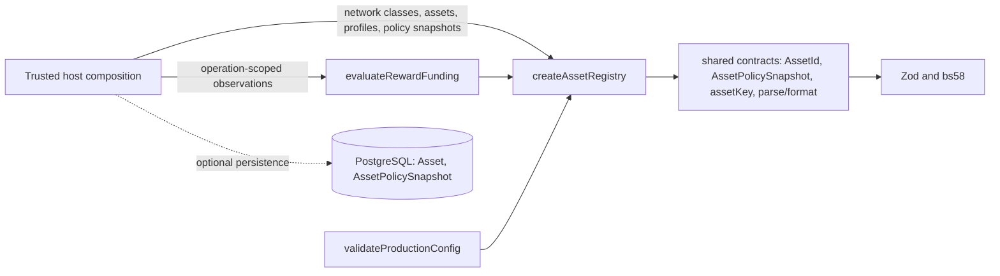

# Asset registry v1 (exact asset identity and bounded amounts)

[Rewards and escrow](../RAID_AGENT_BLUEPRINT.md#16-rewards-and-escrow) · [Domain and data model](../RAID_AGENT_BLUEPRINT.md#25-domain-and-data-model) · [Module reuse](raid-module-reuse.md) · [Shared contracts](raid-shared-contracts.md) · [T029 plan](tasks/T029-plan.md) · [Migration plan](tasks/T003-migration-plan.md)

**Status: technically reviewed, ACCEPTED WITH CONDITIONS ([review](tasks/T029-review.md)), on a disposable test database. T029 is NOT complete: criteria C02, C08 and C15 remain NOT VERIFIED.** Independent technical review (a distinct non-author agent) covered the other criteria only; there is no UAT, business or release approval. Nothing here is deployed, migrated on a live database or backfilled. **No asset is supported for production**: open decision O07 (initial supported assets and extension/freeze policy) and gate G04 (supported assets) are unresolved, so the shipped allow list is empty.

## Purpose and non-goals

Gives the rest of RAID one place that answers three questions exactly:

1. **Which instrument is this?** An asset is chain + network identity + kind (`NATIVE_SOL` or `TOKEN`) + mint + token program (16.2). A ticker, name or image never selects, matches or substitutes an asset (AC29).
2. **How much is this?** Nonnegative `bigint` base units under an explicit bound (default unsigned 64-bit), exact decimal parse/format, checked add/subtract, deterministic splits with a disclosed remainder rule, fee calculation, and JSON decimal strings (16.3, I03). No floating point.
3. **Is this reward funded?** A reward is a vector of asset legs. It is fully funded only when every promised asset has verified funds (AC28, 16.4). A policy version never creates or splits a balance (AC30).

Also: a production profile containing test, devnet, sample or mock configuration, or any asset not on a recorded allow list, fails closed (AC41, I12).

Owned requirements: R15, R16, P05 (direction); I03, I04 (inputs), I05, I08 (inputs), I10, I11, I12, I13; D03, D12; blueprint 16.2–16.5, 16.9 (funding-leg states), 25.5, 29.2, 30.1.

Non-goals (not delivered here): verifying a deposit on chain or at finality (T031), escrow or program accounts (T030), reservations, claims and the append-only ledger (T033, T080), command receipts and outbox (T038), price oracles or valuation, fee rates (O08), Token-2022 behavior beyond the reject list, mapping the legacy USDC code (`src/lib/usdc-*.ts`, `rewards.ts`, which stay untouched), UI, and choosing any supported asset. Registry membership grants no permission, access, rank or payout entitlement.

## Dependency and host contract



- Public entry point: `src/asset-registry/index.ts`. Copy `src/asset-registry` and `src/contracts` as sibling directories. Dependencies: Zod and bs58 through the shared contracts. No Next.js, Prisma, Solana SDK, environment variable, clock, global client or credential import (enforced by `tests/asset-registry-boundary.test.ts`).
- The host supplies all data: declared networks with a cluster class, registered assets, extension profiles, policy snapshots and funding observations. The module reads no file, network or environment.
- The host owns authorization, chain verification (deciding `verified: true`), persistence and any caching. The registry object is immutable; `withPolicy` returns a new one.
- Optional persistence: the additive migration `202610090002_asset_registry` creates `Asset` and `AssetPolicySnapshot`. The module does not depend on it; a host can fill the registry from any source (see Substitution).

## Public interface

| Export                                                                       | Behavior                                                                                                                                                                                                                                                                                      |
| ---------------------------------------------------------------------------- | --------------------------------------------------------------------------------------------------------------------------------------------------------------------------------------------------------------------------------------------------------------------------------------------- |
| `U64_MAX`, `MAX_SPLIT_RECIPIENTS`                                            | Default amount bound and recipient cap.                                                                                                                                                                                                                                                       |
| `parseAmount(display, decimals, bound?)`                                     | Exact display string to `bigint`. Rejects excess precision (`EXCESS_PRECISION`), malformed text, numbers, signs, exponents and whitespace (`INVALID_AMOUNT`) and values above the bound (`AMOUNT_OVERFLOW`). Never rounds.                                                                    |
| `formatAmount(amount, decimals, bound?)`                                     | Shortest exact display decimal.                                                                                                                                                                                                                                                               |
| `checkedAdd`, `checkedSub`, `sumAmounts`                                     | Exact; `AMOUNT_OVERFLOW` above the bound, `AMOUNT_UNDERFLOW` below zero.                                                                                                                                                                                                                      |
| `splitProportional(total, weights, rule?, bound?)`                           | Floor shares plus leftover units by the disclosed rule: `LARGEST_REMAINDER` (default; largest fractional parts first, ties to the lowest index, never to a zero weight; shares sum to the total) or `UNALLOCATED` (leftover returned as `residual`). Percentages are weights.                 |
| `computeFee(amount, basisPoints, 'FLOOR' \| 'CEIL', bound?)`                 | Basis-point fee; rates are never chosen here (O08).                                                                                                                                                                                                                                           |
| `toJsonAmount`, `fromJsonAmount`                                             | Canonical decimal strings. JSON numbers are rejected.                                                                                                                                                                                                                                         |
| `createAssetRegistry(input)`                                                 | Validates and freezes networks, assets, profiles and policies. Inconsistent input is `INVALID_CONFIGURATION`.                                                                                                                                                                                 |
| `AssetRegistry`                                                              | `keyOf`, `has`, `resolve` (`INVALID_ASSET_ID` for non-identities such as tickers, `UNSUPPORTED_ASSET` for unknown ones), `requireSame` (`ASSET_MISMATCH`), `assets`, `policies`, `policy(id, version?)`, `withPolicy(snapshot)`, `evaluateSupport(id)`.                                       |
| `REJECTED_TOKEN_EXTENSIONS`, `SPL_TOKEN_PROGRAM_ID`, `TOKEN_2022_PROGRAM_ID` | Section 16.5 reject list and the two known token programs.                                                                                                                                                                                                                                    |
| `creditedByAsset(registry, observations)`                                    | Verified and pending base units per asset key, de-duplicated by `operationId`; conflicting redelivery is `CONFLICTING_OBSERVATION`.                                                                                                                                                           |
| `evaluateRewardFunding(registry, legs, observations)`                        | Per-asset state `REQUIRED`, `PENDING`, `VERIFIED`, `SHORTFALL` or `BLOCKED`; `fullyFunded` only when every promised asset is `VERIFIED`. An empty bundle is never funded.                                                                                                                     |
| `PRODUCTION_ASSET_ALLOWLIST`                                                 | Empty and frozen until O07 is decided.                                                                                                                                                                                                                                                        |
| `validateProductionConfig`, `createProductionAssetRegistry`                  | Fail-closed production gate; throws `PRODUCTION_BLOCKED` with positional violation codes.                                                                                                                                                                                                     |
| `AssetRegistryError`, `AssetRegistryErrorCode`                               | `INVALID_AMOUNT`, `EXCESS_PRECISION`, `AMOUNT_OVERFLOW`, `AMOUNT_UNDERFLOW`, `INVALID_ALLOCATION`, `INVALID_ASSET_ID`, `UNSUPPORTED_ASSET`, `ASSET_MISMATCH`, `ASSET_POLICY_CHANGED`, `CONFLICTING_OBSERVATION`, `INVALID_CONFIGURATION`, `PRODUCTION_BLOCKED`. The message is the code only. |

Support rules (`evaluateSupport`, latest policy): a policy must exist (`NO_POLICY`); a token program must be Tokenkeg or Token-2022 (`UNKNOWN_TOKEN_PROGRAM`); the extension profile must be declared (`UNKNOWN_EXTENSION_PROFILE`); `TransferFeeConfig`, `TransferHook`, `PermanentDelegate`, `NonTransferable`, `ConfidentialTransferMint`, `ConfidentialTransferFeeConfig` and `DefaultAccountStateFrozen` are always rejected (`REJECTED_EXTENSION:*`) and cannot be allowed; any other Token-2022 extension needs the host's reviewed `allowedExtensions` (`UNREVIEWED_EXTENSION:*`); extensions on a legacy-program or native asset are rejected.

Production violation codes: `NO_SUPPORTED_PRODUCTION_ASSET`, `NETWORK_NOT_MAINNET`, `ASSET_NOT_CHAIN_VERIFIED`, `ASSET_NOT_ALLOWLISTED`, `ASSET_NOT_APPROVED`, `PROGRAM_NOT_CHAIN_VERIFIED`, `PROVIDER_NOT_LIVE`, `ASSET_POLICY_UNSUPPORTED`, `INVALID_CONFIGURATION`.

## Entity and state ownership

| Record                                                              | Owner                                | Rules                                                                                                                                                                                                                                                                                                                                                                                          |
| ------------------------------------------------------------------- | ------------------------------------ | ---------------------------------------------------------------------------------------------------------------------------------------------------------------------------------------------------------------------------------------------------------------------------------------------------------------------------------------------------------------------------------------------- |
| `Asset` (migration `202610090002_asset_registry`)                   | This module                          | One row per exact identity: `UNIQUE (chain, networkIdentity, kind, mint, tokenProgram)`. Native SOL stores `''` in mint and token program so one plain unique index covers every case. Shape checks (base58 alphabet, 32 to 44 characters; the module decodes 32 bytes). Rows are immutable and cannot be deleted (trigger `asset_immutable_v1`, SQLSTATE `23000`); no-op updates are allowed. |
| `AssetPolicySnapshot`                                               | This module                          | `UNIQUE (assetId, registryVersion)`, FK `RESTRICT` to `Asset`; decimals 0 to 255; observed slot 0 to 2^64-1; immutable. Trigger `asset_policy_guard_v1` locks the asset row, then rejects a decimals change or an older observation for that asset, so concurrent versions cannot diverge.                                                                                                     |
| Funding observations, reservations, claims, ledger                  | Treasury tasks T031 to T033 and T080 | Not stored here. Consumers key every balance by the asset identity, never by a policy version.                                                                                                                                                                                                                                                                                                 |
| Legacy USDC data (`BalanceEntry`, `UsdcTransfer`, `RaidAllocation`) | Existing code                        | Untouched. No mapping or backfill; a reviewed bridge is later work.                                                                                                                                                                                                                                                                                                                            |

State transitions: a new identity is created once; a policy version is appended (idempotent when identical); there is no update or delete. A funding leg moves `REQUIRED -> PENDING -> VERIFIED` (or `SHORTFALL`, or `BLOCKED` when the asset is unsupported) as the host supplies observations; the module holds no state between calls.

## Permissions and trust boundary

The module has no actor-bearing command and grants nothing. Registration, policy recording and the decision that an observation is verified belong to trusted host code with its own authorization (blueprint 28.1, 29.2: asset and program allow lists change only by technical verification and an authorized change). `origin`, `approval.decisionRef` and `verified` are host assertions the module cannot authenticate; it only refuses combinations that contradict fail-closed production rules. A privileged database owner can alter the schema or triggers; row-level guards do not contain that.

## Configuration names

None read from the environment. Host-supplied structure names: `networks[].cluster` (`MAINNET`, `DEVNET`, `TESTNET`, `LOCAL`, `SYNTHETIC`), `assets[].origin` (`CHAIN_VERIFIED`, `TEST_FIXTURE`, `SAMPLE`), `assets[].approval.decisionRef`, `profiles[].extensions`, `allowedExtensions`, `providers[].mode` (`LIVE`, `MOCK`, `SIMULATED`), `programs[].origin`, allow list entries `{ assetId, decisionRef }`. No secrets are involved.

## Errors and idempotency

Every rejection is an `AssetRegistryError` whose message is only its code, never input text. Functions are pure and deterministic: repeating a call gives the same result, `withPolicy` of an identical snapshot is a no-op, and repeated delivery of one funding operation (same `operationId`, asset and amount, even with a different policy-version tag) counts once. The same `operationId` with a different amount or asset is `CONFLICTING_OBSERVATION`. Persistent idempotency (command receipts, semantic operation IDs) is owned by T038 and the treasury tasks.

## Substitution and versioning

R15: the registry is built from plain data, so any source works (static object, JSON document, the optional tables, a future registry service). The example host builds two registries from different sources and shows identical decisions and typed errors; an unsupported capability always fails closed. Provider-specific SDKs never enter this module. Contract version is `v1`; changing a code, rule or result shape needs a reviewed version bump and updated consumers. There are no in-flight provider operations yet, so pinning and drain rules belong to T031 and T033. Switching a policy source must not change an asset identity, so existing balances keep their key. Rollback: while the tables are empty the migration can be removed; once any row exists keep them, because later obligations will reference them.

## Observability

No logging or metrics are emitted. Hosts should record `AssetRegistryError.code`, production violation codes and positional subjects, the registry version in use, and counts of `BLOCKED` legs. Named case owner and alerting are not established (gate G10) and remain NOT VERIFIED.

## Failure and recovery runbook

- `ASSET_POLICY_CHANGED`: do not reinterpret recorded amounts. Treat it as a data or provider incident; compare the stored snapshot with the observation and open a decision, never edit a snapshot.
- `UNSUPPORTED_ASSET` or `BLOCKED` leg: the instrument is not registered or its policy is unsupported. Do not map by ticker. Keep the obligation visible and route to the asset-policy owner.
- `PRODUCTION_BLOCKED`: read the violation codes. With the empty allow list this is the expected state until O07 and G04 are recorded.
- Unknown or stale chain data: pass `verified: false` (`PENDING`); never infer zero.
- Database restore: snapshots and identities are immutable and re-insertable; reconcile against chain state before enabling dependent commands.

## Limitations

- **NOT VERIFIED:** C02, C08 and C15 stay open until the O07 decision record, G04/G10 evidence and the chain and escrow slices (T031 to T033, T080) exist. No human UAT and no live gate (G02 to G05, G10).
- **Carried-forward obligation K3 (T069):** before any asset is approved under O07/G04, extend the shared contract with typed authority roles (mint, freeze, upgrade, permanent delegate) and record retained freeze powers (16.5). Not implemented here.
- **Carried-forward obligation K6 (next tasks):** commitment and acceptance commands must gate on `evaluateRewardFunding().fullyFunded`; balances and claims must be keyed by `assetKey` only, never by registry version or symbol; the production allow list must come only from a recorded O07/G04 decision, never from request or environment input.
- The module cannot prove an address is a real mint or that decimals match the chain. `CHAIN_VERIFIED` is a host claim; real verification is T031 and the adapter layer.
- The shared T002 `observedAuthorities` field is an untyped list of addresses, so mint, freeze and upgrade authority roles are not distinguished. Retained issuer freeze powers (16.5) need a typed extension in a later contract version.
- Mainnet genesis identity and per-asset decimals are not hard-coded (nothing to verify them against offline).
- The database checks the base58 shape, not that an address decodes to 32 bytes; do not write rows that bypass the module.
- Native-asset handling uses `''` sentinels in storage only. Amount upper bound is a host parameter; the program or database bound for a given asset must still be set where it is enforced.
- No performance or very large bundle claims; recipient count is capped at 1024 per split.

## Run the standalone consuming host

```bash
cp -RL examples/asset-registry /tmp/asset-registry-host   # dereferences the two symlinks
cd /tmp/asset-registry-host
npm install --no-audit --no-fund
npx tsx host.ts
```

The host needs no database, network or environment variable and prints one JSON object whose values are all `true` except `version` and `synthetic`. Migration check for the optional tables (disposable database only): `npx prisma migrate deploy` twice (second run reports no pending migrations) and `npx prisma migrate diff --from-url "$DATABASE_URL" --to-schema-datamodel prisma/schema.prisma --exit-code` (exit 0). Database tests: `RUN_DB_TESTS=true NODE_ENV=test DEMO_MODE=false DATABASE_URL=<disposable useraid_test> npx vitest run tests/asset-registry-db.test.ts`.
