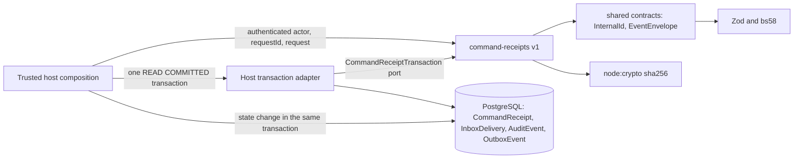

# Command receipts v1 (idempotent commands, audit and outbox)

[Idempotency conventions](../RAID_AGENT_BLUEPRINT.md#261-common-conventions) · [Outbox/inbox behavior](../RAID_AGENT_BLUEPRINT.md#273-outboxinbox-behavior) · [Deduplication keys](../RAID_AGENT_BLUEPRINT.md#275-deduplication-keys) · [Module reuse](raid-module-reuse.md) · [Task plan](tasks/T019-plan.md) · [Shared contracts](raid-shared-contracts.md) · [Migration plan phase P3](tasks/T003-migration-plan.md)

**Status: IMPLEMENTED_UNVERIFIED, disposable-database tested only. Independent implementation review has not happened; all 27 T019 completion criteria remain NOT VERIFIED.** Nothing here is wired into an existing route or business flow, deployed, migrated on a live database or backfilled.

## Purpose and non-goals

Makes a retried business action produce one business outcome. For each command the module persists `actor + command kind + client idempotency key` with a canonical SHA-256 request digest and an opaque result reference. In one database transaction it commits the caller's state change, append-only audit events and outbox intents. It also deduplicates provider deliveries by `provider + verified delivery id`.

Owned requirements: R15, R16; I05, I08 (the digest binds the exact request, including any expected terms version), I09 (intent recorded in the same transaction as the state change; delivery is a later step), I13; blueprint 26.1, 27.1, 27.3, 27.5. Acceptance: AC69 (changed payload conflicts, original untouched), AC32 at the foundation level (a repeated delivery produces one callback run), AC73/AC74 through the alternate port and the standalone host.

Non-goals (not delivered here): any business command (engagement acceptance is T020), HTTP routes, authentication or authorization, capacity or terms logic, money or ledger entries, an outbox worker or dispatcher, provider calls and webhook signature verification, retention or deletion, UI, feature flags. A receipt grants no permission and does not prove funds, access or acceptance.

## Dependency and host contract



- Public entry point: `src/command-receipts/index.ts`. Copy `src/command-receipts` and `src/contracts` as sibling directories. Dependencies: Zod and bs58 through the shared contracts, and the Node built-in `node:crypto`. No Next.js, Prisma SDK type, environment variable, global client or clock import (enforced by `tests/command-receipts-boundary.test.ts`).
- The host supplies a `CommandReceiptTransaction` port: `{ dialect: 'POSTGRESQL', isolation: 'READ_COMMITTED', query(sql, bindings) }`. The module owns its parameterized SQL; the host owns the connection, transaction boundary, authorization and retry policy.
- Reference Prisma adapter: `src/lib/command-receipts-adapter.ts` (`createPrismaCommandTransaction`, `classifyCommandReceiptFailure`, `runCommandTransaction`). It lives outside the public module, checks `SHOW transaction_isolation` once per transaction and rejects anything other than `read committed`.
- The host database must hold the four tables, constraints and triggers from `prisma/migrations/202610090001_command_receipts/migration.sql`.
- The composing host authenticates the caller and passes the verified account as `actorId`; the module cannot authenticate it. For provider deliveries the host verifies the provider signature or origin first and only then passes `verifiedDeliveryId`.

## Public interface

| Export                                                                                                | Behavior                                                                                                                                                                                                                                                                                                                                                                                                  |
| ----------------------------------------------------------------------------------------------------- | --------------------------------------------------------------------------------------------------------------------------------------------------------------------------------------------------------------------------------------------------------------------------------------------------------------------------------------------------------------------------------------------------------- |
| `executeIdempotentCommand(tx, { actorId, commandKind, idempotencyKey, requestId, request }, handler)` | Validates input before any SQL, computes the digest, claims the receipt with `INSERT ... ON CONFLICT DO NOTHING`, then either replays or runs `handler({ receiptId })`. The handler returns `{ resultRef, events }`; the module then inserts one audit row per event, an outbox row per publishing event and finalizes the receipt. Returns `{ status: 'EXECUTED' or 'REPLAYED', receiptId, resultRef }`. |
| `processInboundDelivery(tx, { provider, verifiedDeliveryId, payload }, handler)`                      | Same claim pattern on `(provider, deliveryId)`; stores only the payload digest. Returns `{ status: 'PROCESSED' or 'DUPLICATE', deliveryRecordId, resultRef }`. Audit actor is `provider:<provider>`, correlation is `delivery:<provider>:<id>`.                                                                                                                                                           |
| `canonicalRequestDigest(value)`                                                                       | SHA-256 hex over a canonical JSON form with sorted keys. Rejects `undefined`, bigint, Date, Map, functions, NaN/Infinity, unsafe integers, depth over 32 and text over 64 KiB (`INVALID_INPUT`). Put amounts and identifiers in strings.                                                                                                                                                                  |
| `retryWholeTransaction(attempt, { maxAttempts, isRetryable })`                                        | Re-runs the entire attempt while `RETRY_TRANSACTION` (default) or the host classifier says retry. Default 3 attempts, maximum 10. Other errors propagate on the first occurrence.                                                                                                                                                                                                                         |
| `runCommandTransaction(db, work, options)` (Prisma adapter)                                           | Opens a fresh READ COMMITTED Prisma interactive transaction per attempt, hands `work` the port and the transaction client, and retries the whole transaction on deadlock/serialization failure. Exhaustion throws `RETRY_TRANSACTION`.                                                                                                                                                                    |
| `CommandReceiptError` / `CommandReceiptCode`                                                          | `INVALID_INPUT`, `IDEMPOTENCY_KEY_REUSED`, `DELIVERY_PAYLOAD_CONFLICT`, `STORAGE_CONTRACT`, `RETRY_TRANSACTION`, `STORAGE_UNAVAILABLE`. The message is the code only. `IDEMPOTENCY_KEY_REUSED` maps to HTTP 409 in the shared `ERROR_CONTRACT`.                                                                                                                                                           |

Event inputs reuse the shared `EventEnvelopeSchema`: `type` such as `work.engagement_committed.v1`, `aggregateId`, `aggregateVersion`, optional `guildId`, and an identifier-only `payload` limited to `termsVersionId`, `submissionId`, `operationId`, `claimId`, `identityLinkId`. Free-text or unknown payload fields are rejected. Up to 20 events per command. `publish: false` keeps an event audit-only. Occurrence time is assigned by the database.

Semantics worth knowing:

- Same actor + kind + key and same digest: the handler does not run; the original `receiptId` and `resultRef` return. The first `requestId` is kept.
- Same key and a different digest: `IDEMPOTENCY_KEY_REUSED`, nothing is written and nothing is overwritten. The digest must therefore cover everything that defines the command, including the expected revision or terms version.
- A handler error, an invalid outcome or any later failure rolls the whole transaction back. No receipt remains, so a retry with the same key is evaluated again. Only committed outcomes replay. A deterministic rejection is not remembered.
- Two simultaneous identical commands: the second blocks on the unique index until the first transaction ends, then replays it (committed) or runs (rolled back). The module needs no application lock.

## Entity and state ownership

| Record           | Rules                                                                                                                                                                                                                                                                                                                                                            |
| ---------------- | ---------------------------------------------------------------------------------------------------------------------------------------------------------------------------------------------------------------------------------------------------------------------------------------------------------------------------------------------------------------- |
| `CommandReceipt` | Unique `(actorId, commandKind, idempotencyKey)`. Immutable except one NULL-to-value transition of `resultRef` in the claiming transaction (trigger `command_receipt_guard_v1`). A deferred constraint trigger rejects commit while `resultRef` is NULL. No foreign key to `User`: actors may be system or provider identities and history must outlive accounts. |
| `InboxDelivery`  | Unique `(provider, deliveryId)`, `payloadDigest` only. Same immutability and result rule as receipts.                                                                                                                                                                                                                                                            |
| `AuditEvent`     | Append-only (trigger `audit_event_guard_v1`). Exactly one of `receiptId` or `inboxId`; ordinal 0 to 19 unique per source; identifier-only JSON object payload up to 2 KiB.                                                                                                                                                                                       |
| `OutboxEvent`    | Append-only intent referencing one `AuditEvent` (unique FK). It has no delivery state: dispatch bookkeeping belongs to a later worker task, which adds its own side table.                                                                                                                                                                                       |

State transition: absent claim, then claimed (uncommitted, key held by the open transaction), then committed with result, audit and outbox; there is no other persisted state. All foreign keys are `RESTRICT`. `TRUNCATE` is not blocked by row triggers; only a privileged database owner can bypass these guards.

Lock order: the receipt claim comes first, matching the shared lock plan (receipt, then admission/source/terms, operators, participants). The handler takes later locks.

## Permissions and trust boundary

The module authorizes nothing. The host decides who may call a command and which `actorId` to pass; never forward client-supplied actor values. Receipts, audit rows and delivery digests are internal records: do not expose them or their IDs in public responses, search or logs without review. Private payload bytes never enter these tables: requests and provider payloads are reduced to digests, audit payloads are identifier-only, and results are opaque references (I06). A digest of a low-entropy request can be guessed offline by someone who can read the table, so treat the tables as private.

## Configuration names

No secret is read by the module. The reference host and tests use:

- `DATABASE_URL` — PostgreSQL URL for the host's own test database. The example host accepts only a localhost URL for `useraid_command_host_test` or `useraid_test` and refuses `NODE_ENV=production`.
- `NODE_ENV` — must not be `production` for the example.
- Repository tests additionally use `RUN_DB_TESTS=true` and `DEMO_MODE=false`.

## Transaction, retry and sanitized errors

Run each command in one interactive transaction at READ COMMITTED. The read after `ON CONFLICT DO NOTHING` needs fresh statement visibility, so the port rejects other isolation levels. Deadlock (`40P01`), serialization (`40001`), Prisma `P2034` and Prisma `P2010` wrapping those become `RETRY_TRANSACTION`. Retry the **entire** transaction with the same command identity (`runCommandTransaction` does this, default 3 attempts); never retry only the last statement and never swallow an error inside the transaction. Unknown driver or connection failures become `STORAGE_UNAVAILABLE`; the driver message is never exposed. Handler errors, including domain rejections, pass through unchanged. The module has no timeout, cancellation or rate limit; the host owns them (`transaction.timeout` and `maxWait` are options of the Prisma adapter).

Do not call GitHub, Solana, a model or a wallet inside the handler. External effects are recorded as outbox intents or provider operation records and dispatched after commit by a worker that must itself be idempotent (I09).

## Substitution and versioning

Any adapter implementing `CommandReceiptTransaction` for PostgreSQL at READ COMMITTED can replace the Prisma adapter; `examples/command-receipts/host.ts` serves a stored receipt from a scripted alternate port and shows that a SERIALIZABLE or non-PostgreSQL port fails closed with `STORAGE_CONTRACT`. Switching adapters never changes a stored receipt, digest, result reference or audit row. In-flight transactions end on the old adapter before the switch; there is no cross-adapter state. Version `v1`: additive changes only. Changing the digest format, table shape, error codes or SQL semantics needs a new version, a reviewed forward migration and updated consumers and tests together, because a changed digest would make old keys look like conflicts.

## Observability

No metrics or logs are emitted. Hosts should count the six error codes, the retry rate and `IDEMPOTENCY_KEY_REUSED` per actor, and alert on `STORAGE_CONTRACT` and sustained `STORAGE_UNAVAILABLE`. Useful queries: receipts missing audit rows (`LEFT JOIN`), audit rows without an outbox row where `publish` was expected, and the age of the oldest outbox row once a worker exists. Do not log request bodies or payloads. Correlation chain: request ID, receipt, audit event, outbox row.

## Failure and recovery runbook

| Situation                                     | Action                                                                                                                                                              |
| --------------------------------------------- | ------------------------------------------------------------------------------------------------------------------------------------------------------------------- |
| `RETRY_TRANSACTION`                           | Retry the whole transaction, bounded; same identity.                                                                                                                |
| `IDEMPOTENCY_KEY_REUSED`                      | Client bug or key collision: generate a new key for a genuinely different command. Never delete the stored receipt.                                                 |
| `DELIVERY_PAYLOAD_CONFLICT`                   | Provider sent different bytes under one delivery ID; quarantine and investigate. The original outcome stays.                                                        |
| `INVALID_INPUT`                               | Caller or handler produced a malformed identifier, kind, event or payload; fix the code, do not relax the checks.                                                   |
| `STORAGE_CONTRACT`                            | Wrong isolation or dialect, malformed rows or a receipt without a result; stop and investigate.                                                                     |
| SQLSTATE `23000` from a guard trigger         | Something tried to change or delete an immutable record; use a reviewed recovery procedure (not defined; retention is OPEN O11).                                    |
| Crash after external effect but before commit | Nothing is stored; the client retries with the same key. External effects must be reconciled by the provider operation record, not by this module.                  |
| Application rollback after receipts exist     | Keep the tables, indexes and triggers. Removing them loses idempotency memory and audit history (T003 rule). Before any consumer writes, the tables may be dropped. |
| Database restore                              | Restore the whole database; receipts return with their results. Reconcile external effects before enabling dependent commands (AC68 is not verified here).          |

Retention and deletion of receipts and audit events is OPEN (O11). There is no delete path in v1.

## Limitations

- Disposable-database evidence only; no live rollout, backfill, deployed worker or independent implementation review.
- No outbox dispatcher: rows are intents only, and exactly-once delivery is not claimed (consumers must be idempotent).
- Isolation is fixed at READ COMMITTED; a handler that needs SERIALIZABLE semantics must enforce them with its own constraints or locks.
- A command rejected by business rules leaves no record, by design.
- Digest stability depends on the canonical JSON rules above; requests containing floats are digested by their JSON text, so send exact amounts as strings.
- Full-suite status and criteria C01 to C22 remain NOT VERIFIED until independent review.

## Run the standalone consuming host

The example has its own `package.json`, a minimal `HostCredit` business table, the four receipt tables and two migrations (a host table and the exact receipts migration). It never loads RAID configuration or `src/lib/db`. Copy to a fresh directory, dereferencing the symlinks to the canonical source, install, migrate against an explicit disposable database and run:

```sh
raid_receipts_source="$(pwd)"
raid_receipts_host="$(mktemp -d)"
cp -RL "$raid_receipts_source/examples/command-receipts/." "$raid_receipts_host/"
cd "$raid_receipts_host"
npm install --ignore-scripts --no-audit --no-fund
export NODE_ENV=test
export DATABASE_URL='<explicit local synthetic URL for useraid_command_host_test>'
npx prisma generate
npx prisma migrate deploy
npm start
```

Expected output is one JSON line with `synthetic`, `realDatabase`, `replayedWithoutSecondEffect`, `changedPayloadConflict`, `duplicateDeliveryOneOutcome`, `alternatePort`, `capabilityGapFailsClosed` and `sanitizedFailure` all `true`. The host credits a synthetic claim, replays the command, shows a changed payload conflicting, delivers the same provider event twice, serves a replay from an alternate port, rejects a weaker port and sanitizes a driver failure.

Repository tests:

```sh
RUN_DB_TESTS=true NODE_ENV=test DEMO_MODE=false DATABASE_URL='<synthetic test URL>' \
  npm test -- tests/command-receipts.test.ts tests/command-receipts-db.test.ts tests/command-receipts-boundary.test.ts
```

Database tests truncate the target; point them only at an explicitly disposable database named `useraid_test`. Migration check: `npx prisma migrate deploy` (second run reports no pending migrations) and `npx prisma migrate diff --from-url "$DATABASE_URL" --to-schema-datamodel prisma/schema.prisma --exit-code` (exit 0).
