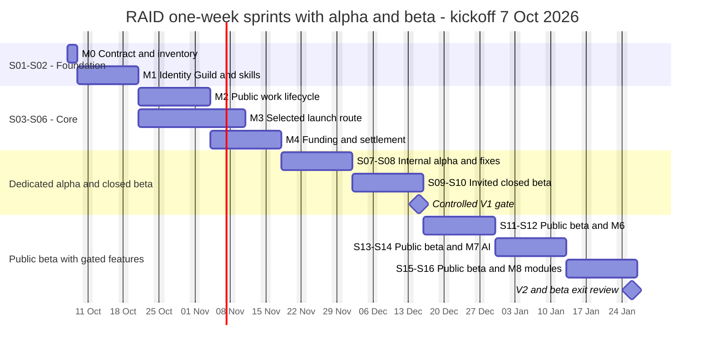
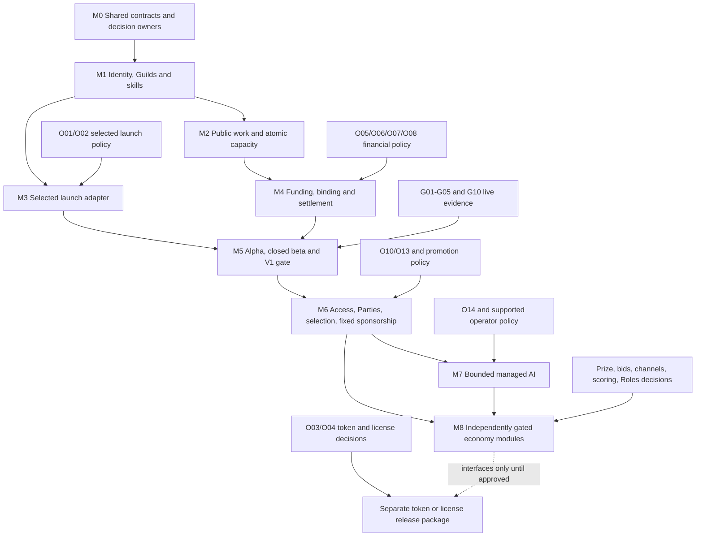

# RAID accelerated delivery timeline

**One-week sprints: internal alpha in S07–S08, closed beta in S09–S10, public beta from S11. First controlled release target: 50 working days (10 weeks); broader selected feature target: 80 working days (16 weeks).** These are conditional planning estimates from the current repository, not a claim that the blueprint is implemented or a promise of mainnet readiness.

[One-week sprint and alpha/beta plan](raid-sprint-plan.md) · [Development and testing phases](raid-development-phases.md) · [Requirement, scenario and decision coverage](raid-delivery-coverage.md) · [Canonical blueprint](../RAID_AGENT_BLUEPRINT.md) · [Full blueprint index](../RAID_BLUEPRINT_MAP.md)

## Contents

- [Planning assumptions](#planning-assumptions)
- [Current repository baseline](#current-repository-baseline)
- [Master timeline](#master-timeline)
- [Dependency map](#dependency-map)
- [Sprint deliverables](#sprint-deliverables)
- [Development and testing cadence](#development-and-testing-cadence)
- [Release checkpoints](#release-checkpoints)
- [Schedule risks and decision deadlines](#schedule-risks-and-decision-deadlines)
- [Progress and handoff](#progress-and-handoff)

## Planning assumptions

Prepared on **6 October 2026**, against baseline `2bd3312` on `main`. The illustrative kickoff is **Wednesday, 7 October 2026**, in Asia/Kathmandu. D1–D80 count Monday–Friday and omit no public holidays or leave; rebase dates at actual kickoff. A delivery week is five working days from kickoff, so its boundaries are Wednesday–Tuesday here. Dates are targets until estimates are confirmed after M0.

The fastest credible path assumes **four full-time delivery contributors**, with overlapping responsibilities: domain/backend; frontend/trust; Solana/treasury; and QA/operations/integration. The project owner resolves policy/provider decisions promptly, and targeted independent security/program reviewers are available where required. AG01–AG10 are responsibility labels that these contributors can share. This document does not spawn agents, hire people, or authorize spending/deployment.

Use the existing TypeScript/Next.js/PostgreSQL/worker foundation. Start with public human work, manual relevant skill assessments, one selected launch route, and one reviewed payment asset. Model reward bundles early; enable each additional asset only after its own adapter and financial gates. Begin fixed sponsored slots before auctions, selection Challenges before prize mode, and manual content evidence before automatic publication. Token issuance and token license activation have separate unresolved policy dependencies.

M3 launch work overlaps M2 work lifecycle. M4 starts real funding integration after M2 exits at D20. M3 starts beside M2 and finishes by D25. S07–S08 and S09–S10 reserve two weeks each for internal alpha and invited closed beta, with no new feature expansion. Public beta starts in S11 if the closed-beta gate passes; M6–M8 expand only independently gated capabilities. M6 private access, Parties, selection and fixed sponsorship can be delivered in separate slices using stable common contracts. Serialize migrations and shared contracts; review independent work in parallel.

**Re-estimation rule:** M0 confirms inventory and capacity; D10 confirms launch/provider feasibility; D10 confirms custody/finality/assets before adapter work; D20 reconfirms integration readiness. If these fail, move only the affected dependency chain, publish new dates and preserve earned obligations. Do not remove tests, make up commercial values, or weaken capacity/privacy/financial invariants to keep a date.

## Current repository baseline

This planning pass inspected source, schema, routes, package scripts, CI configuration and earlier verification records. It did not execute application/database/browser/provider tests. Historical counts in [verification.md](verification.md) remain historical evidence, not freshly verified blueprint compliance.

| Area                              | Evidence inspected                                                                                                                                     | Planning treatment                                                                                                                                                                   |
| --------------------------------- | ------------------------------------------------------------------------------------------------------------------------------------------------------ | ------------------------------------------------------------------------------------------------------------------------------------------------------------------------------------ |
| Account and wallet authentication | `src/lib/auth.ts`, `src/lib/wallet-auth.ts`, `src/lib/account-merge.ts`; User and WalletIdentity models                                                | Reuse and verify identity preservation; add canonical work participant/capacity semantics.                                                                                           |
| Campaign/Studio work              | `src/app/api/raids/`, `src/lib/campaigns.ts`, `src/lib/tracking.ts`; Raid, RaidEnrollment, PostSubmission and ContributionDecision                     | Existing attention campaign flow is a baseline. Commissioned terms, offers, structured deliverables and one active engagement require new contracts.                                 |
| Rewards and money operations      | `src/lib/raid-funding.ts`, `src/lib/studio-finance.ts`, `src/lib/usdc-chain.ts`, `src/lib/usdc-reconcile.ts`; balance/allocation/transfer models       | Reuse exact-money/reconciliation infrastructure only after comparing authority with selected escrow obligations. Existing manual payouts are not proof of blueprint mediated escrow. |
| Launch infrastructure             | `src/lib/pump-sdk.ts`, launch signing/key modules, TokenLaunch; `src/lib/release.ts` sets `launchpadsAvailable=false`                                  | Candidate adapter under O01 review; remains disabled until actual route/gate evidence.                                                                                               |
| Missing distinct domain contracts | Inspected Prisma schema has no named Guild, SkillAssessment, Engagement, ActiveCommitment, Party, Challenge or AccessGrant models                      | Design additive contracts and inspect equivalent existing behavior during M0. Model-name absence is inventory evidence, not an exhaustive correctness audit.                         |
| Discovery/UX and worker           | `src/app/`, `src/components/`, `src/lib/discovery-rows.ts`, `src/lib/queue.ts`, `src/worker.ts`                                                        | Extend existing surfaces, queue and operational patterns; preserve legacy accepted campaign versions.                                                                                |
| Verification infrastructure       | `package.json`, `.github/workflows/checks.yml`, `tests/docs-links.test.ts`, existing database/browser suites                                           | Existing gates are reusable; add blueprint-specific scenario evidence as behavior lands.                                                                                             |
| Deployment                        | PR #1 previously reported a failed Cloudflare Pages check; [coming-soon deployment](coming-soon-deploy.md) is separate from full web/worker deployment | Diagnose current failure in M0/M5, confirm web/worker/PostgreSQL target under O18, then verify deployment separately from merging.                                                   |

**Status at planning kickoff:** blueprint milestones are **NOT_STARTED in this delivery register** until M0 establishes feature evidence. Existing code is useful prior work; this status does not erase it or label every existing feature unimplemented. No milestone is PILOT_ENABLED or PRODUCTION_ENABLED based on this document.

## Master timeline

Dates below assume the kickoff and staffing above. Each detailed phase includes its entities, permissions, state transitions, repository mapping, development checklist, testing checklist and exit evidence.

| Phase                                                                                                                                                                     | Working days | Development window                      | Test/review window                 | Target dates             | Output                                               |
| ------------------------------------------------------------------------------------------------------------------------------------------------------------------------- | ------------ | --------------------------------------- | ---------------------------------- | ------------------------ | ---------------------------------------------------- |
| [M0](raid-development-phases.md#m0-contract-and-foundation) — Contract and foundation                                                                                     | D1–D2        | D1–D2                                   | D2                                 | 2026-10-07 to 2026-10-08 | Shared contract and gap register                     |
| [M1](raid-development-phases.md#m1-identity-guilds-skills-and-discovery) — Identity, Guilds, skills and discovery                                                         | D3–D10       | D3–D8                                   | D6–D10                             | 2026-10-09 to 2026-10-20 | Verified identity/Guild and skill foundations        |
| [M2](raid-development-phases.md#m2-public-work-lifecycle-and-one-active-engagement) — Public work lifecycle and one active engagement                                     | D11–D20      | D11–D18                                 | D13–D20                            | 2026-10-21 to 2026-11-03 | Synthetic work loop and real capacity races          |
| [M3](raid-development-phases.md#m3-selected-launch-route-and-verified-guild-linkage) — Selected launch route and verified Guild linkage                                   | D11–D25      | D11–D22                                 | D20–D25                            | 2026-10-21 to 2026-11-10 | One tested launch adapter and verified Guild linkage |
| [M4](raid-development-phases.md#m4-verified-funding-escrow-settlement-and-disputes) — Verified funding, escrow, settlement and disputes                                   | D21–D30      | D21–D27                                 | D23–D30                            | 2026-11-04 to 2026-11-17 | Tested funding/settlement mechanism and recovery     |
| [M5](raid-development-phases.md#m5-alpha-closed-beta-and-controlled-first-release) — Alpha, closed beta and controlled first release                                      | D31–D50      | D31–D35 alpha fixes; D41–D45 beta fixes | D31–D40 alpha; D41–D50 closed beta | 2026-11-18 to 2026-12-15 | Controlled V1 if live gates pass                     |
| [M6](raid-development-phases.md#m6-private-trust-parties-selection-challenges-and-fixed-sponsorship) — Private trust, Parties, selection Challenges and fixed sponsorship | D51–D60      | D51–D57                                 | D54–D60 plus public beta           | 2026-12-16 to 2026-12-29 | Feature-gated V1.5 trust/team/discovery              |
| [M7](raid-development-phases.md#m7-managed-ai-execution-and-bounded-recommendations) — Managed AI execution and bounded recommendations                                   | D61–D70      | D61–D67                                 | D64–D70 plus public beta           | 2026-12-30 to 2027-01-12 | Bounded managed execution pilot                      |
| [M8](raid-development-phases.md#m8-advanced-guild-economy-and-feature-release-gates) — Advanced Guild economy and feature release gates                                   | D71–D80      | D71–D77                                 | D74–D80 plus public beta           | 2027-01-13 to 2027-01-26 | Selected V2 modules; token issuance separately gated |

### Calendar visualization

The Gantt chart is a planning view. The table remains the authoritative readable fallback. Development and QA detail is in each phase; full-program regression/recovery and feature gates accompany every release.



## Dependency map



The earliest critical chain is M0 → M1 → M2 → M4 → M5. M3 runs beside it but still blocks calling V1 a working launchpad. If M3 is delayed and work/payment/operating gates pass, a verified-existing-project work pilot can ship under that exact label; it does not satisfy AC66 or replace the launch milestone.

## Sprint deliverables

Each sprint is five working days (one week), with one primary user outcome and its own development/test/demo review. The [weekly sprint plan](raid-sprint-plan.md) lists concrete tasks and preserves two weeks each for alpha and closed beta across paired weekly sprints.

| Sprint | Days and dates                    | One primary outcome                                                                                                                            | Phase    |
| ------ | --------------------------------- | ---------------------------------------------------------------------------------------------------------------------------------------------- | -------- |
| S01    | D1–D5; 2026-10-07 to 2026-10-13   | Agree the shared contracts and preserve one canonical person across linked wallets.                                                            | M0/M1    |
| S02    | D6–D10; 2026-10-14 to 2026-10-20  | Show verified project relationships and relevant skill evidence without granting token holders administration.                                 | M1       |
| S03    | D11–D15; 2026-10-21 to 2026-10-27 | A founder publishes clear work and a Raider can accept exactly one funded/simulated assignment; launch adapter preparation runs independently. | M2/M3    |
| S04    | D16–D20; 2026-10-28 to 2026-11-03 | A Raider submits evidence, receives bounded review, and closes the synthetic work loop with truthful state.                                    | M2/M3    |
| S05    | D21–D25; 2026-11-04 to 2026-11-10 | Verify the selected launch artifacts and protect exact per-asset work reserves on the selected test path.                                      | M3/M4    |
| S06    | D26–D30; 2026-11-11 to 2026-11-17 | Prove authorized claims/refunds/finality and reconcile late/duplicate financial effects.                                                       | M4       |
| S07    | D31–D35; 2026-11-18 to 2026-11-24 | Run the integrated core with internal fixtures; identify real journey and accessibility failures.                                              | M5 alpha |
| S08    | D36–D40; 2026-11-25 to 2026-12-01 | Retest fixes, rehearse restore/incidents, and decide if outside testers can enter.                                                             | M5 alpha |
| S09    | D41–D45; 2026-12-02 to 2026-12-08 | Observe invited founder/newcomer/experienced Raider workflows under a staffed approved beta model.                                             | M5 beta  |
| S10    | D46–D50; 2026-12-09 to 2026-12-15 | Resolve blockers and decide whether the stable core is ready for public beta.                                                                  | M5 beta  |
| S11    | D51–D55; 2026-12-16 to 2026-12-22 | Open the eligible core cohort conservatively and prove explicitly scoped confidential work.                                                    | M6       |
| S12    | D56–D60; 2026-12-23 to 2026-12-29 | Introduce independent team/selection/placement slices with consent, funding and recovery evidence.                                             | M6       |
| S13    | D61–D65; 2026-12-30 to 2027-01-05 | An accountable evaluated worker can be admitted under operator capacity and sandbox restrictions.                                              | M7       |
| S14    | D66–D70; 2027-01-06 to 2027-01-12 | One permitted capped run submits useful evidence for ordinary authorized review.                                                               | M7       |
| S15    | D71–D75; 2027-01-13 to 2027-01-19 | Implement only approved prize/auction/asset slices and prove liability, claim and delivery boundaries.                                         | M8       |
| S16    | D76–D80; 2027-01-20 to 2027-01-26 | Verify selected channel/Role/scoring additions, repeat core beta evidence and record the release decision.                                     | M8       |

S11–S16 expansion is conditional on core public-beta stability and staffed support. Move incomplete scopes into later weekly sprints when necessary; token issuance has no promised sprint.

## Development and testing cadence

Testing is part of every development phase. One final test week cannot establish transactional capacity, financial safety or private data boundaries for code already built around the wrong contracts.

| Rhythm                                 | Development responsibility                                                                                    | Verification and evidence                                                                                                   |
| -------------------------------------- | ------------------------------------------------------------------------------------------------------------- | --------------------------------------------------------------------------------------------------------------------------- |
| Start of each task                     | Read relevant blueprint domains, IDs, existing contracts and OPEN dependencies; create section 40 task packet | Name exact scenarios, fixture/environment and expected adverse outcomes before coding.                                      |
| Every implemented slice                | Deliver server command, persistence/state changes, UI/error states and recovery together                      | Run meaningful domain/DB/adapter tests, including negative authorization and concurrency where affected.                    |
| Every PR                               | Freeze shared contract changes; use additive migrations; integrate UI/server consumers                        | Run required static/DB/build/browser checks for scope; link result to commit SHA. Keep unrelated baseline failures visible. |
| Daily integration                      | Merge independent completed slices; one owner serializes schema and authority changes                         | Review oldest incident/commitment, failing tests and next blocker; refresh status/forecast.                                 |
| Each phase gate                        | Review actual user outcome, privacy/money/capacity authority, remaining decisions and operational owner       | Execute phase scenarios; label simulation/test network; attach results and findings.                                        |
| Before alpha/beta/live stage promotion | Verify exact configuration, provider/program versions, network/asset identities and enablement policy         | Complete relevant G01–G10, migration/restore rehearsal, support staffing and agreed live validation.                        |

Reuse existing scripts. These commands are planned gates; listing them does not mean they ran for this documentation change:

```sh
npm run typecheck
npm run lint
npm run audit:check
npm run build
npm test
npx vitest run tests/docs-links.test.ts
npm run test:browser
npm run test:live
npm run test:browser:live
npm run test:browser:studio
```

For changed Markdown, run targeted Prettier checks. At an application release, `npm run format:check` covers the full repository. Follow [the existing database test setup](../README.md#verification): database suites require a guarded disposable `useraid_test` database, correct migrations and `RUN_DB_TESTS=true DEMO_MODE=false`. Fixtures and mocked providers do not move real SOL/USDC or prove mainnet/provider readiness. Studio browser tests currently require local preview and are outside CI; see [verification.md](verification.md#continuous-integration).

Use test evidence at the boundary: real PostgreSQL for competing transactions, selected escrow/program environment for signer/refund/claim races, actual isolation for managed tools, and effective provider scopes for private access. Unit mocks alone cannot pass those gates.

## Release checkpoints

| Checkpoint                        | Target            | Audience and evidence                                                                                                             | Release label                                 |
| --------------------------------- | ----------------- | --------------------------------------------------------------------------------------------------------------------------------- | --------------------------------------------- |
| Foundation gate                   | D10, 20 October   | Canonical identity/Guild/skill paths; M1 tests                                                                                    | Staging.                                      |
| Work prototype gate               | D20, 3 November   | Synthetic work journey and real capacity races; M2 tests                                                                          | Prototype with simulated money.               |
| Launch proof                      | D25, 10 November  | Selected test-network artifacts and verified Guild linkage; M3 evidence                                                           | Test-network launch proof.                    |
| Alpha entry                       | D30, 17 November  | M1–M4 integrated, no known blocking security/money/capacity defect, observable isolated test environment                          | Internal alpha starts S07.                    |
| Alpha exit / beta entry           | D40, 1 December   | Core functional/adversarial/recovery/accessibility results; blocker fixes retested; applicable live gates if beta uses real funds | Closed beta starts S09 if approved.           |
| Closed beta exit / V1 gate        | D50, 15 December  | Founder/novice/experienced Raider journeys, staffed support, feedback closure, G01–G05/G10 for enabled live paths                 | Controlled V1 / public beta eligible.         |
| Public beta readiness review      | D60, 29 December  | Stable core public cohort evidence; M6 gates separately                                                                           | Public beta; gated V1.5 modules where proven. |
| Managed AI pilot gate             | D70, 12 January   | M7 operator/sandbox/budget/review evidence and G07                                                                                | Small managed-agent pilot within beta.        |
| Public beta exit / V2 review      | D80, 26 January   | Repeated full loop, operations and no unresolved release-blocking defects; each selected M8 module’s gates                        | V2/GA candidate only if beta exit passes.     |
| Token or optional license release | No committed date | O03/O04 and relevant economics/launch/asset/terms assurance                                                                       | Separately scheduled and gated.               |

Beta is a release label, not an exemption from custody, financial finality, access controls or operating terms. A test-network beta must identify its network and synthetic assets. A live beta requires all gates applicable to its enabled actions. G06/G07/G08/G09 additionally apply as private resources, AI, automatic publication and promotion activate.

## Schedule risks and decision deadlines

These are planning allowances, not external provider lead-time claims. Record actual delays at the first checkpoint and revise the affected dates.

| Risk                                                     | Detection/deadline                                    | Response and schedule effect                                                                                                                                                                                                  |
| -------------------------------------------------------- | ----------------------------------------------------- | ----------------------------------------------------------------------------------------------------------------------------------------------------------------------------------------------------------------------------- |
| Four contributors unavailable                            | M0, D2                                                | Re-estimate based on actual throughput. With two contributors, use 24–32 weeks as a provisional whole-plan range; with one, 32–48 weeks. These are rough capacity scenarios, not commitments.                                 |
| No selected launch route                                 | O01/O02 by D10                                        | Continue work/Guild UI and existing-project verification; move M3 and complete-launchpad V1 until resolved.                                                                                                                   |
| Existing custody cannot meet binding/refund/finality     | O05/O06 and mechanism feasibility by D10              | Select a compatible reviewed provider or scope a custom program. Allow at least 2–6 additional development weeks as a provisional buffer, plus separately scheduled assurance; mainnet date stays uncommitted until reviewed. |
| Assets/fees/operating terms unresolved                   | O07/O08 by D10; O11/O12 by D30                        | Continue synthetic/test-network integration; block only dependent live operations.                                                                                                                                            |
| Provider credentials, audits or infrastructure not ready | Assess at D10/D20, confirm by D30                     | Track external owner and earliest evidence date; no fabricated passing gate. A custom program or unavailable assurance can exceed the 80-day schedule.                                                                        |
| Legacy campaign obligations conflict with new rules      | M0 inventory; M2 migration review                     | Keep existing frozen contracts, stage migration/backfills and reconcile all obligations. Apply new policies only through valid version/amendment paths.                                                                       |
| Deployment/build/restore failures                        | Baseline D2; release rehearsal by D38                 | Repair against selected O18 environment; repeat affected checks. Merging docs does not deploy or prove recovery.                                                                                                              |
| GitHub access/judging/sponsor policy unavailable         | O10/O13/promotion O08 by D48                          | Ship independent M6 features; defer dependent confidential/Challenge/placement activation.                                                                                                                                    |
| AI data/tool/cost policies unavailable                   | O14 by D58; O15 before broader operator enablement    | Preserve human/external evidence flow; keep managed execution or organization scaling disabled.                                                                                                                               |
| Advanced economics/channel/Role decisions pending        | O03/O04/O09/O16/O17/O19 by D68 for selected D80 scope | Deliver independent modules and interfaces. Remove blocked activations from D80 forecast, keeping them in the decision/backlog register.                                                                                      |

Reserve the last 1–2 days of each larger phase for integration/fix work within its stated window. If a required test fails, use that allowance first; if it exceeds the allowance, move the gate. Do not silently shorten another feature’s required testing. Review estimates at D2, D10, D20, D30, D40, D50 and every five working days thereafter.

## Progress and handoff

Maintain one evidence record per feature and environment. Use only the blueprint status vocabulary: `NOT_STARTED`, `IN_PROGRESS`, `IMPLEMENTED_UNVERIFIED`, `VERIFIED_IN_TEST`, `PILOT_ENABLED`, `PRODUCTION_ENABLED`. Phase IDs aggregate evidence; they are not automatic state transitions.

| Field        | Required entry                                                                     |
| ------------ | ---------------------------------------------------------------------------------- |
| Scope        | Phase/task ID, user outcome, blueprint sections and R/P/D/I/AC references          |
| Ownership    | Accountable role/person and reviewers; decision/incident owner                     |
| Change       | Actual files, schema/API/events, permissions and state transitions                 |
| Progress     | Status per feature and environment; current target and dependency forecast         |
| Verification | SHA, date, command/scenario, fixture/network/provider version, result and artifact |
| Remaining    | OPEN IDs, gate IDs, reproducible defects and bounded next task                     |
| Release      | Enablement decision, migration/backfill, recovery/rollback plan and operator hours |

Use [blueprint handoff templates](../RAID_AGENT_BLUEPRINT.md#40-handoff-templates). At kickoff, replace assumptions with named contributors and evidence; do not check phase tasks complete based on the existence of these documents. The [coverage register](raid-delivery-coverage.md) is a delivery index: canonical requirement wording stays in the blueprint.
