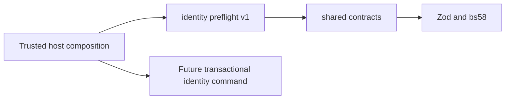

# Identity preflight v1

[Blueprint identity](../RAID_AGENT_BLUEPRINT.md#07-identity-and-onboarding) · [Acceptance packet](tasks/T006-contract-plan.md) · [Module reuse](raid-module-reuse.md)

This pure module prepares identity decisions before canonical persistence exists. `inspectVerifiedLink` proposes attaching a fresh verified credential to the existing HUMAN participant, preserving its active engagement reference. `inspectAccountRemoval` identifies retained-rights blockers and never approves merge or deletion. Neither function authenticates a caller, verifies a signature, consumes a nonce, writes records, supplies a Guild permission or changes a beneficiary. Full T006 and AC01 remain unverified at the storage/application boundary.

Owned requirements: R04/R12/R13, D13, I01/I07/I08/I10/I13, with bounded R15/R16 and AC73–75 preparation. Canonical account/participant IDs come from the existing shared contracts; they are not derived from wallet addresses. Only HUMAN identity is covered. AI/operator registration, capacity acquisition, treasury recovery, session issuance, revocation commands, UI and actual provider/storage adapters remain with their owners. The module is not wired into the existing wallet/X login or automatic legacy account absorption.

## Dependency and host contract



Public entry point: `src/identity/index.ts`. Copy `src/identity` and `src/contracts` as sibling directories to consume it. Dependencies are Zod and bs58 through the shared contracts; the example also declares tsx and Node >=22.12. There is no Next.js, Prisma, environment variable, clock singleton, network call, credential or app configuration import.

The trusted server host supplies every observation and the current UTC clock. It must resolve the actual authenticated session, immutable provider subject, current canonical participant/revision/restriction/commitment, stored proof and subject ownership. A proof schema passing validation does **not** verify control. These observation objects must never be accepted as authenticated HTTP input. The future composition root must use real verifiers and storage, origin/CSRF/cookie/rate-limit policy and transaction-time authorization.

The injected link policy declares exact domain, allowed URI, wallet network identities and provider namespaces. Empty network/provider lists deny that family. Network identities use the configured canonical Solana network/genesis identity, not a display ticker; provider subjects are immutable opaque values. No case folding, display-name matching or provider-adapter instance name determines ownership. The example's domain, IDs and times are synthetic, not operating defaults or real verification evidence.

## Public interface and observations

| Export                                                                                           | Inputs and result                                                                                                                                                                                                                                                                                                                     |
| ------------------------------------------------------------------------------------------------ | ------------------------------------------------------------------------------------------------------------------------------------------------------------------------------------------------------------------------------------------------------------------------------------------------------------------------------------- |
| `IDENTITY_PREFLIGHT_VERSION`                                                                     | `v1`; initial draft contract, no deployed compatibility claimed.                                                                                                                                                                                                                                                                      |
| `IdentitySubjectSchema` / `identitySubjectKey`                                                   | Wallet: kind WALLET, networkIdentity, 32-byte base58 address. Provider: kind PROVIDER, provider namespace, exact immutable subject. Key is a JSON tuple with explicit kind/network/namespace; malformed subject throws a schema error. No subject reassignment is performed.                                                          |
| `IdentitySnapshotSchema`                                                                         | Existing shared HUMAN participant, revision, ACTIVE/RESTRICTED status, nullable current engagement ID. A single reference is an observation; it does not prove database uniqueness.                                                                                                                                                   |
| `IdentityLinkPolicySchema`                                                                       | Exact domain/URI plus supported wallet networks/provider namespaces. No production provider is selected.                                                                                                                                                                                                                              |
| `SubjectOwnershipSchema`                                                                         | Subject-bound UNKNOWN, UNCLAIMED, LINKED(accountId) or REVOKED(accountId) observation. History is not treated as a current active link.                                                                                                                                                                                               |
| `LinkProofObservationSchema`                                                                     | Host-verified proof reference/state, exact account/subject/intent/domain/URI, issued-at/expiry, consumed marker. No signature/private key/provider token is accepted.                                                                                                                                                                 |
| `VerifiedLinkPreflightSchema` / `inspectVerifiedLink(input, policy, now)`                        | Strict runtime validation; authenticated actor/session, expected revision, subject and observations. Returns only `BLOCKED` plus code, or `READY_FOR_TRANSACTION` plus original account/participant/revision/engagement, subject key and proof reference. No new ID, payout destination, role or private content enters the proposal. |
| `RetainedIdentityRightSchema` / `AccountRemovalPreflightSchema` / `inspectAccountRemoval(input)` | MERGE(keep/drop) or DELETE(drop) plus subject/revision-bound rights inventory. Returns `BLOCKED` on every path. Inventory contains identifier-only typed retained references and COMPLETE/UNKNOWN observation status.                                                                                                                 |

Inputs reject extra keys. Core snapshot/proof objects and outputs are readonly; these pure functions do not mutate input objects. Identifiers/subjects are internal authorized context, not public account-discovery or general-log payloads. Error output contains only a fixed stage and reason; schema details or private input are not echoed by inspection functions. The subject-key helper's thrown Zod error is for internal validation; hosts must sanitize it before any external response.

## Actors, transitions and failure reasons

| Actor/context                                                                                                                         | Preflight result                                                                                                                                         |
| ------------------------------------------------------------------------------------------------------------------------------------- | -------------------------------------------------------------------------------------------------------------------------------------------------------- |
| Actual authenticated subject, own ACTIVE snapshot, fresh exact LINK proof, known supported unclaimed/own linked subject               | Proposal preserves the original canonical participant and active engagement. No capacity is consumed/released and no credential/session mutation occurs. |
| Missing/malformed context                                                                                                             | INVALID_COMMAND; host still owns authentication and resource authorization.                                                                              |
| Revoked/expired session, session/actor/account mismatch                                                                               | AUTHENTICATION_REQUIRED or FORBIDDEN.                                                                                                                    |
| Restricted account or stale revision                                                                                                  | ACCOUNT_RESTRICTED or REVISION_CHANGED; restrictions do not confiscate claims. Safe claim/case channels remain a separate required implementation.       |
| Unverified/revoked/consumed proof; wrong account/subject/intent/domain/URI; future-issued or expired proof                            | PROOF_INVALID; expiry equal to now is expired. No maximum lifetime policy is invented.                                                                   |
| Unsupported network/provider or unknown/mismatched ownership observation                                                              | UNSUPPORTED_IDENTITY or OWNERSHIP_UNKNOWN.                                                                                                               |
| Subject belongs to another account, including a revoked subject                                                                       | IDENTITY_CONFLICT; a supposedly empty account cannot bypass ownership through this function.                                                             |
| Own revoked subject                                                                                                                   | IDENTITY_REVOKED; reactivation requires the still-undelivered recovery policy/command.                                                                   |
| Merge of two busy participants                                                                                                        | CAPACITY_CONFLICT, including two different participant commitments in the same engagement. Neither assignment is hidden or released.                     |
| Drop account has commitment or retained terms/consent/history/skill/claim/ledger/case/role/audit/receipt/outbox/media/other reference | RIGHTS_RETAINED. Unknown reference kinds reject validation rather than disappearing.                                                                     |
| Missing, unknown, wrong account/participant or stale removal inventory                                                                | INVALID_COMMAND or INVENTORY_UNKNOWN.                                                                                                                    |
| Empty complete removal inventory                                                                                                      | SCOPED_REVIEW_REQUIRED; it never grants deletion/merge authority.                                                                                        |

Reasons are internal preflight codes, not a new HTTP error-envelope version. Existing canonical code meanings are retained. Downstream routes must map reason/status with authorized non-enumerable responses; no route is delivered here. Login/linking cannot establish Guild authority, private access, assessed skill or payout control. An operations reviewer cannot turn a supplied `approved` boolean into authority; such extra fields are rejected.

## Transaction, retry, substitution and recovery limits

A READY_FOR_TRANSACTION result is disposable advice. The actual future command must claim the actor/operation/idempotency key and compare its digest, re-read and lock the real subjects/accounts/participants in the reviewed common order, revalidate proof/session/revision/ownership, consume proof atomically, enforce restrictive references/uniqueness, and commit the link with audit/receipt/outbox. Provider verification waits happen outside locks. AC69 digest conflicts, whole-transaction retry and shared work/treasury races remain unimplemented. Repeating this pure function has no side effects; repeating a nonce in a real auth command is not authorized by a repeated proposal.

The example demonstrates replacement of deterministic **fixture observation suppliers**, preserving the exact subject and canonical mapping. It does not certify a new real provider adapter or complete AC73 auth substitution. A live adapter switch must retain provider namespace, network, immutable subject, proof provenance, pending-operation binding and accepted claims/terms; replacing an SDK cannot substitute those values. UNKNOWN or unsupported evidence must stay blocked. There is no timeout/cancellation/rate-limit/secret ownership or external-effect receipt inside this synchronous helper; real adapters must declare these before they are delivered.

Merge/recovery approval and deletion/retention under O11 are unresolved. No duration, KYC requirement or blanket denial policy for the complete future feature is adopted here. Removal never returns an execution permit; these conservative prerequisite checks do not replace scoped proof/review, rights disposition or database constraints. Keep originals when recovery is uncertain, and escalate through the approved case owner. Logging should aggregate safe reason codes; never dump proof or subject objects. No DB/network health signal is provided by a pure function.

The [T003 execution gate](tasks/T003-migration-plan.md#3-audit-gate-before-any-migration-execution) remains required before dependent migrations/backfills. The app is undeployed. A later [owner-authorized disposable local target](tasks/T006-target-handoff.md) is prepared, with independent target entry review pending; no live persistence target/custodian is supplied. The prior synthetic restore rehearsal proves legacy mechanics only. This slice adds no migration, schema, HTTP API, event, provider/configuration change or new stored account right. Rollback removes this unused module/example/tests/docs; it cannot undo external operations. Do not wire it into legacy merge as if it enforces concurrency.

## Run the synthetic consuming host

From the repository root, create a fresh directory and copy the two explicit source dependencies. Do not copy `.env`, application code or production data.

```sh
raid_identity_source="$(pwd)"
raid_identity_host="$(mktemp -d)"
cp -R "$raid_identity_source/src/identity" "$raid_identity_host/identity"
cp -R "$raid_identity_source/src/contracts" "$raid_identity_host/contracts"
cp "$raid_identity_source/examples/identity-preflight/host.ts" "$raid_identity_host/host.ts"
cp "$raid_identity_source/examples/identity-preflight/package.json" "$raid_identity_host/package.json"
cd "$raid_identity_host"
npm install --ignore-scripts --no-audit --no-fund
npm start
```

The host asserts the same participant/commitment after fixture supplier replacement and checks collision, consumed proof, revoked link, retained claim and unknown inventory denial. Its output labels `simulation: true` and `executionEnabled: false`; there is no real signature, challenge persistence or protected-resource authorization. The repository example uses links to canonical source for convenience; the standalone commands above copy only the required owned directories.

```sh
npm test -- tests/identity-preflight.test.ts tests/identity-preflight-boundary.test.ts
```

Vitest discovers these tests through its unchanged `tests/**/*.test.ts` include. The CI inventory lists both files under E01/E02 without promoting the full domain to implemented. The automated consumer runs outside the app with the explicit existing test runtime; a separate fresh package install/run is recorded in the task evidence. [Execution evidence and next step](tasks/T006-contract-evidence.md) record actual test-first results and full-task gaps. Independent review, real DB races, AC01 application behavior, full auth consuming host and release gates must remain unverified until separately demonstrated.
