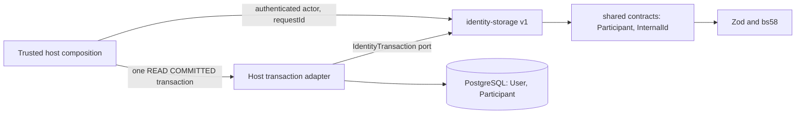

# Identity storage v1 (HUMAN participant mapping)

[Blueprint identity](../RAID_AGENT_BLUEPRINT.md#07-identity-and-onboarding) · [One active Raid](../RAID_AGENT_BLUEPRINT.md#13-one-active-raid) · [Module reuse](raid-module-reuse.md) · [Storage plan](tasks/T006-storage-plan.md) · [Proposal review](tasks/T006-storage-review.md) · [Identity preflight](raid-identity-preflight.md)

**Status: IMPLEMENTED_UNVERIFIED, disposable-database tested only. Full T006 and all 27 completion criteria remain NOT VERIFIED.** The separate non-author [storage review](tasks/T006-storage-independent-review-record.md) accepted the bounded READ COMMITTED / ordinary-DML slice at `c196ee7` with host conditions. Current B1 auth-host changes still require final independent review. Nothing here is deployed, migrated on a live database or backfilled.

## Purpose and non-goals

Gives every existing legacy `User` at most one immutable canonical HUMAN `Participant` row, so later work can key capacity and history to a participant ID rather than a wallet or display handle. It also fences the legacy wallet/X account-merge and delete paths so a mapped account cannot be absorbed or deleted silently.

Owned requirements: R04, R13 (identity half only), R15, R16; I01, I05, I06, I07, I10, I11, I13; D01, D13. Blueprint §§07, 13, 24.6–24.7, 25, 28, 30, 32.

Non-goals (not delivered here, still due under T006 and later tasks): automatic backfill, login auto-provisioning, wallet/provider linking commands (additional verified wallets are delivered separately as [wallet links v1](raid-wallet-links.md), which reuses this module's participant mapping and port), account recovery, capacity or one-active-engagement enforcement, AI or operator participants, session issuance, HTTP routes, UI, events, receipts or outbox. A mapping grants no Guild role, private access, skill rank, work slot or payout entitlement. Mapping a legacy account does not move balances, enrollments, transfers or payout destinations.

## Dependency and host contract



- Public entry point: `src/identity-storage/index.ts`. Copy `src/identity-storage` and `src/contracts` as sibling directories. Dependencies: Zod and bs58 through the shared contracts. No Next.js, Prisma SDK type, environment variable, global client, clock or credential import (enforced by `tests/identity-storage-boundary.test.ts`).
- The host supplies an `IdentityTransaction` port: `{ dialect: 'POSTGRESQL', isolation: 'READ_COMMITTED', query(sql, bindings) }`. The module owns its parameterized SQL; the host owns connection, transaction boundary, retry and authorization.
- Reference Prisma adapter: `src/lib/identity-storage-adapter.ts` (`createPrismaIdentityTransaction`, `classifyIdentityStorageFailure`). It lives outside the public module. It runs `SHOW transaction_isolation` once per transaction and rejects anything other than `read committed`.
- Host database must already hold a `User` table whose `id` is a text primary key, plus the `Participant` table, constraints, index and trigger from `prisma/migrations/202610080001_participant_mapping/migration.sql`.
- The composing host must authenticate the caller and pass the verified account as `actorAccountId`. The module checks only that `actorAccountId === accountId`; equality of two strings cannot authenticate an HTTP assertion. Never forward client-supplied actor values.

## Public interface

| Export                                                                 | Behavior                                                                                                                                                                                                                                                                                                                                           |
| ---------------------------------------------------------------------- | -------------------------------------------------------------------------------------------------------------------------------------------------------------------------------------------------------------------------------------------------------------------------------------------------------------------------------------------------- |
| `findHumanParticipant(tx, accountId)`                                  | Returns the shared HUMAN `Participant` DTO (`id`, `kind: 'HUMAN'`, `accountId`) or `null`. More than one row, wrong kind or wrong account throws `STORAGE_CONTRACT`.                                                                                                                                                                               |
| `hasHumanParticipant(tx, accountId)`                                   | Boolean reference check; `STORAGE_CONTRACT` if the result shape is wrong.                                                                                                                                                                                                                                                                          |
| `ensureHumanParticipant(tx, { accountId, actorAccountId, requestId })` | Validates IDs, denies actor/account mismatch before any SQL (`WRONG_ACTOR`), takes `FOR KEY SHARE` on the `User` row (`ACCOUNT_NOT_FOUND` if absent), inserts with `ON CONFLICT ("accountId") DO NOTHING`, then returns the winning row. A retry or concurrent loser returns the first mapping; the first actor and request are never overwritten. |
| `IdentityStorageError` / `IdentityStorageCode`                         | `INVALID_INPUT`, `WRONG_ACTOR`, `ACCOUNT_NOT_FOUND`, `STORAGE_CONTRACT`, `RETRY_TRANSACTION`, `STORAGE_UNAVAILABLE`, `UNIQUE_CONFLICT`. The message is the code only.                                                                                                                                                                              |
| `IdentityTransaction`, `HumanParticipant`, `ProvisionHumanInput`       | Types for the port and DTOs.                                                                                                                                                                                                                                                                                                                       |

IDs must satisfy the shared `InternalId` schema. No merge, delete, link, session, work or payment function is exported.

## Entity and state ownership

| Record                                   | Owner                          | Rules                                                                                                                                                                                                                        |
| ---------------------------------------- | ------------------------------ | ---------------------------------------------------------------------------------------------------------------------------------------------------------------------------------------------------------------------------- |
| `User`                                   | Legacy application (unchanged) | Account authority stays here. Profile edits stay possible.                                                                                                                                                                   |
| `Participant`                            | This module                    | One row per `accountId` (unique). UUID `id` from `gen_random_uuid()`. `kind` fixed to `HUMAN`. `provisionActorAccountId` must equal `accountId`; `provisionRequestId` and `createdAt` record first-creation provenance only. |
| Foreign key `Participant_accountId_fkey` | Database                       | `ON DELETE RESTRICT ON UPDATE RESTRICT`: a mapped `User` cannot be deleted or re-keyed.                                                                                                                                      |
| Trigger `participant_mapping_guard_v1`   | Database                       | `BEFORE UPDATE OR DELETE`: any change to a row or any delete raises SQLSTATE `23000`. No-op updates are allowed.                                                                                                             |

State transition: existing `User` with no mapping → exactly one immutable HUMAN mapping. There is no reverse transition in this module. Removal needs a reviewed recovery or retention procedure (OPEN, O11); none is adopted.

Legacy merge guard: `src/lib/account-merge.ts` now refuses a mapped drop account before any existing mutation. For older binaries, the restrictive foreign key rejects the final `User` delete and the whole legacy transaction rolls back (wallet challenge consumption, sessions, OAuth attempts, wallet and X subject changes, moderation snapshot). An unmapped empty source may still merge into a mapped keeper through the unchanged verified legacy flow.

## Permissions and trust boundary

Provisioning authorizes nothing. The host decides who may call `ensureHumanParticipant`, which must only be an authenticated account acting for itself. Treat `accountId` and participant IDs as internal authorized context: do not put them in public responses, search or logs without review. A privileged database owner can alter the schema or trigger; row-level fences do not contain that. Row triggers also do not protect against TRUNCATE. Before live rollout, independently prove that runtime credentials are non-owner/non-superuser and lack TRUNCATE, schema alteration and trigger-disable privileges, with separate migrator credentials (SI02). This live-role proof remains NOT VERIFIED.

## Configuration names

No secret is read by the module. The reference host and tests use these names; supply values only through your own secret delivery:

- `DATABASE_URL` — PostgreSQL URL for the host's own test database. The example host accepts only a localhost URL for `useraid_identity_host_test`, `useraid_test` or `useraid_test_<suffix>` and refuses `NODE_ENV=production`.
- `NODE_ENV` — must not be `production` for the example.
- Repository tests additionally use `RUN_DB_TESTS=true` and `DEMO_MODE=false`.

## Transaction, retry and sanitized errors

Run every command inside one interactive transaction at READ COMMITTED. B1 explicitly selects it in legacy wallet verification, wallet rotation and X connection hosts; database defaults are insufficient (SI01). Nondefault-isolation regressions exercise permitted wallet/X folds and rotation-versus-link exclusion. The separate read after `ON CONFLICT DO NOTHING` needs fresh statement visibility, so the port rejects other isolation levels. On `RETRY_TRANSACTION` (SQLSTATE `40001`/`40P01`, Prisma `P2034`, or Prisma `P2010` wrapping those) retry the **entire** business transaction with the same `accountId` and `requestId`, never only the final statement. Do not catch an error inside the transaction and commit partial work. `UNIQUE_CONFLICT` classifies SQLSTATE `23505` or Prisma `P2002`, including raw-query wrappers. Hosts must handle this seventh code explicitly: roll back the whole transaction and return a sanitized conflict (HTTP 409 for HTTP hosts), without exposing driver messages, constraint details or another account's identity. Do not retry it as a transient error or remap ownership. Unknown driver or connection failures become `STORAGE_UNAVAILABLE`; the driver message is never exposed. The module has no timeout, cancellation or rate-limit of its own; the host owns them.

## Substitution and versioning

Any adapter that implements `IdentityTransaction` for PostgreSQL at READ COMMITTED can replace the Prisma adapter; `host.ts` demonstrates an in-memory alternate port. A different SQL dialect or weaker isolation is rejected with `STORAGE_CONTRACT`, not emulated. Replacing the adapter never changes a stored mapping, ID or provenance. Version `v1`: additive changes only; changing the table shape, error codes or SQL semantics needs a new version, a reviewed forward migration and updated consumers and tests together.

## Observability

No metrics or logs are emitted. Hosts should count the seven error codes and the retry rate, and alert on `STORAGE_CONTRACT` (unexpected shape) and sustained `STORAGE_UNAVAILABLE`. Do not log accountIds with request payloads. Operators can audit provenance with `SELECT "accountId", "provisionRequestId", "createdAt" FROM "Participant"`. There are no receipts or outbox events: provenance is a creation audit only, not a command receipt.

## Failure and recovery runbook

| Situation                                 | Action                                                                                                                                                   |
| ----------------------------------------- | -------------------------------------------------------------------------------------------------------------------------------------------------------- |
| `RETRY_TRANSACTION`                       | Retry the whole transaction, bounded; same identity.                                                                                                     |
| `ACCOUNT_NOT_FOUND`                       | Account was removed or never existed; do not create a mapping elsewhere.                                                                                 |
| `WRONG_ACTOR` / `INVALID_INPUT`           | Host bug or hostile input; fix the caller, do not relax checks.                                                                                          |
| `STORAGE_CONTRACT`                        | Wrong isolation, duplicate or malformed rows, or a mismatched table; stop and investigate.                                                               |
| SQLSTATE `23000` from the trigger or FK   | A write tried to change or remove a mapped account; use the reviewed recovery process (not defined yet), keep originals.                                 |
| Application rollback after mappings exist | Keep the `Participant` table, FK and trigger in place. Removing them reopens deletion and merge of mapped accounts.                                      |
| Database restore                          | Restore the whole database; mappings come back with provenance. Reconcile external effects before enabling dependent commands (AC68, not verified here). |

Retention and deletion policy for provenance is OPEN (O11).

## Limitations

- Disposable-database evidence only; historical independent storage review has binding host conditions. No live rollout, backfill or deployed custodian; final B1 delta review and actual runtime-role proof remain due.
- Host-loss durability, second-wallet reuse, capacity, recovery and the rest of full T006 are not delivered.
- Migration run on `useraid_test` of an accepted disposable copy; repeat deploy, fresh 19-migration bootstrap and Prisma drift were checked there only.
- `next-env.d.ts` drift in the working tree is generated Next state, not part of this module.

## Run the standalone consuming host

The example has its own `package.json`, minimal `User`/`Participant` schema and its own two migrations (a bootstrap `User` table and the exact mapping migration). It never loads RAID configuration or `src/lib/db`. Copy to a fresh directory, dereferencing the symlinks to the canonical source, install, migrate against an explicit disposable database and run:

```sh
raid_storage_source="$(pwd)"
raid_storage_host="$(mktemp -d)"
cp -RL "$raid_storage_source/examples/identity-storage/." "$raid_storage_host/"
cd "$raid_storage_host"
npm install --ignore-scripts --no-audit --no-fund
export NODE_ENV=test
export DATABASE_URL='<explicit local synthetic URL for useraid_identity_host_test>'
npx prisma generate
npx prisma migrate deploy
npm start
```

Expected output is one JSON line with `synthetic`, `realDatabase`, `stableIdentity`, `alternatePort`, `wrongActorDenied` and `sanitizedFailure` all `true`. The host creates a synthetic `User`, provisions twice with different request IDs (identical result), reads through an alternate port, denies a foreign actor and sanitizes a driver failure.

Repository tests:

```sh
RUN_DB_TESTS=true NODE_ENV=test DEMO_MODE=false DATABASE_URL='<synthetic test URL>' \
  npm test -- tests/identity-storage.test.ts tests/identity-storage-db.test.ts tests/identity-storage-boundary.test.ts tests/account-merge-canonical.test.ts
```

Database tests truncate the target; point them only at an explicitly disposable database. Migration check: `npx prisma migrate deploy` (second run reports no pending migrations) and `npx prisma migrate diff --from-url "$DATABASE_URL" --to-schema-datamodel prisma/schema.prisma --exit-code` (exit 0).

## Lock protocol candidate, 13 October 2026

The bounded [shared protocol](raid-identity-locks.md) adds optional `ProvisionHumanInput.locks`. Standalone provisioning takes one KEY SHARE root and Participant coverage; prelocked provisioning validates the same live transaction's opaque capability and does not acquire or upgrade another root. Batch/multi-command callers plan the full account set before the first call. The shared root query needs only User.id, preserving the minimal host schema. New identity-locks dependencies are included in the copied example. Current evidence is SELF-EVALUATED; independent implementation acceptance remains pending.
