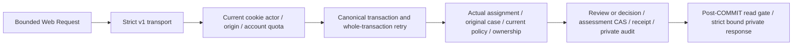

# Protected practice assessment HTTP — v1

Appointed evaluators can save an attributable assessment review and an explicit reasoned reassessment/revocation decision through the existing canonical PostgreSQL modules. R05/R06/R11/R12/R15/R16/I05/I06/I07/I10/I11/I13; blueprint07–10/13/24.6–8/25.3/26/28/33.5+7/AC73–75. Bounded implementation status and actual evidence are in [the task](tasks/2026-10-21-T013-assessment-http.md). Full T013/independent review/UAT/operating/release acceptance remain NOT VERIFIED.

The transport owns Web Request parsing and private response validation. Existing [assessment storage](raid-practice-trial-assessments.md) and [decision storage](raid-practice-assessment-decisions.md) own domain policy, state, current authority, clocks, concurrency, persistence and audits. No schema, approved policy, real appointment, flag enablement, provider, reputation/account restriction, permission, capacity or financial effect is introduced by the transport. VERIFY can create a committed skill version under the existing manual E–A/rubric/tools/current confirmed ownership rules. Nonverification reviews preserve current skill state; explicit decisions alone perform VERIFIED→REASSESSMENT_REQUIRED or VERIFIED/REASSESSMENT_REQUIRED→REVOKED. S/repeated evidence and automated result sources remain unsupported by this bounded store. No fraud threshold or appeal-finality policy is invented.

## Routes and input

All routes are dynamic Node handlers under `/api/v1/practice/reviews/{assignmentId}/submissions/{submissionId}`. IDs are strict UUID path fields. Actual ASSESSMENT_REVIEW purpose is fixed by the canonical storage contract; a caller-supplied purpose, role, subject or namespace never supplies authority.

| Suffix                  | Methods         | Read revision / write schema                                                          |
| ----------------------- | --------------- | ------------------------------------------------------------------------------------- |
| `/assessment`           | GET, HEAD, POST | Optional review revision; `RecordPracticeTrialAssessmentInputSchema`                  |
| `/assessment/state`     | GET, HEAD       | Optional committed assessment revision                                                |
| `/assessment/decisions` | GET, HEAD, POST | Optional committed assessment revision; `RecordPracticeAssessmentDecisionInputSchema` |

GET accepts only a single optional canonical positive decimal `revision` (1–2147483647), without leading zero/exponent. Omit it for current. Review revision and assessment revision are different counters. An original VERIFIED assessment version has no reassessment/revocation decision, so `/decisions?revision=1` returns404 for that version. Denied/missing case is also404; disabled read service is503. Historical author/assignment may differ from the current reader, whose current appointment is always required by storage.

POST accepts no query, requires `Content-Type: application/json`, a valid stable `Idempotency-Key` (canonical InternalId) and a strict canonical body matching both path IDs. Maximum body256KiB, including streaming/chunked bytes;415 unsupported media,413 too large,422 malformed. JSON parser is shared with other protected commands. Origin is checked before authentication, quota or body. Root derives actor from `requireUser`, current configured session cookie and its hash; quota is30/minute/account across these endpoints. No client identity or approval field is accepted.

A review binds original submission/definition/rubric, current approved assessment policy, nullable expected ownership/current review/current participant-skill assessment, decision, normalized reason/confidence, every criterion and optional future reassessment time. A decision binds current assessment/review/ownership/policy, action/category, specific normalized findings, reason and dueAt. See storage documentation for exact canonical rules. Use actual audited observations, never guessed revisions. Assessment context discovery and the action form are a following slice; this API is not a complete evaluator screen.

## Portable host and response contract

`src/skills/practice-assessment-http.ts` exports `createPracticeAssessmentHandlers(host)`, `PracticeAssessmentHttpHost`, typed authority error, private headers and five strict read/write result schemas. It returns `{review:{GET,POST},state:{GET},decisions:{GET,POST}}`; each takes `(Request, unknownOrAsyncPathParams)` and returns a Response. Next derives HEAD from GET with the same read authority. Non-Next hosts must strip response bodies for HEAD when writing to their socket.

The trusted v1 host supplies requestId, same-origin enforcement, actual own-session actor, account quota and `readReview`, `recordReview`, `readState`, `readDecision`, `recordDecision` ports. Every port resolves after COMMIT and a final read-configuration check; the host owns transaction/retry/cancellation and rollback. Runtime dependencies: Node>=22.12 Web APIs/crypto, Zod4, existing canonical storage/receipt/contracts and shared bounded JSON helper. Storage requires PostgreSQL16 READ_COMMITTED and its actual minimal migrations through35, account/session/HUMAN/catalog/case/policy/ownership/provenance/receipt/audit dependencies. No Root singleton, Next, Prisma or global credentials enter the portable module. A network consumer must implement real cookie/session/origin/quota capabilities; the finite offline example explicitly injects synthetic sessions and has no listener.

Root composition is `src/lib/practice-assessment-http.ts`, existing assessment/decision hosts and the three route files. Existing exacttrue/defaultfalse flags remain `PRACTICE_REVIEW_READS_ENABLED`, `PRACTICE_TRIAL_ASSESSMENTS_ENABLED`, `PRACTICE_ASSESSMENT_DECISIONS_ENABLED`; explicit valid `PRACTICE_ASSESSMENT_CATALOG_ID` is required for new writes. No defaults or secret values are added. Role/admin/token membership alone cannot appoint a reviewer. Root's new `readPracticeAssessmentDecisionFromHost` uses the existing audited SQL read and post-COMMIT read gate.

Read response is `{version:'v1',readsAvailable,unavailableReason,view}`;404 replaces an absent view. Write response adds `status:'EXECUTED'|'REPLAYED'` and `writesAvailable`. Write unavailability is null/DISABLED/MISCONFIGURED. A committed200 with `view:null,readsAvailable:false` acknowledges success while withholding private fields. Clients must never interpret that as an uncommitted failure. Strict canonical nested schemas and input/result binding reject wrong source, actor, references, review progression, criterion/findings/reason/date, decision or new assessment lineage. All exported operations return `Cache-Control: private, no-store` and `Vary: Cookie`; no CORS grant. Private diagnostics and bodies are absent from errors and public metadata.

Safe protocol errors include401 AUTHENTICATION_REQUIRED;403 FORBIDDEN/ACCOUNT_RESTRICTED;404 NOT_FOUND;409 REVISION_CHANGED/FAMILY_CHANGED/CURRENT_HIGHER_ASSESSMENT/IDEMPOTENCY_KEY_REUSED;422 INVALID_COMMAND/EVIDENCE_NOT_CONFIRMED/RUBRIC_NOT_MET/HIGH_RANK_EVIDENCE_REQUIRED/TOOLS_POLICY_NOT_MET;429 RATE_LIMITED;503 AUTOMATED_EVIDENCE_UNAVAILABLE/SERVICE_UNAVAILABLE. The seven additive shared error codes preserve existing envelope shape; messages contain no private source details. Untrusted thrown objects and storage diagnostics become generic503.

## Retry, substitution and operation

Keep the original key and normalized full body together during an uncertain request. Retry that exact command. The transport never rejects on a current write flag before receipt recovery; canonical storage can return the original historical result after policy withdrawal, namespace misconfiguration, writeoff or later correction, only under current case/session read authority. A changed same-key body returns409. Revision conflict requires reobserving actual source/context before a new reviewed action with a new key. A lost response is not permission to issue another action. Read snapshots, request correlation and access audits are not bearer grants, present eligibility or delivery proof.

Substitute host authentication/driver/policy implementations only with equivalent current resource authority, whole-transaction locks/CAS, receipt identity, commit and post-read gates. Keep slow provider/LLM work outside locks. Transport changes are additive v1 here; changing command, revision or authority meanings requires explicit compatibility review. Preserve immutable original review, rank, ownership, decisions, receipts and ID-only private audit events. No outbox or public event is added. Log safe request IDs/status/categories only; never raw input, result, session/hash or exception. Disable new-write flags for containment, retaining authorized history/recovery; do not rewind pointers or delete history. No destructive migration/backfill is needed.

[Independent minimal PostgreSQL HTTP host](../examples/practice-assessment-decisions/README.md) installs its own dependencies and exercises actual VERIFY, nonverification preserving rank, capability recheck, fraud-evidence revocation, current/history, stale/changed-key409, foreign actor404, original replay after policy withdrawal/writeoff, hidden post-COMMIT body and current grant revocation. Root adapter tests cover real composition ports through mocks; compiled-route smoke covers signed-out/origin behavior. Neither supplies representative human UAT, a live operating policy or independent review. The existing ownership preview remains a separate earlier-source screen. New assessment UI/browser journeys follow separately.

The [actual assessment context and form](raid-practice-assessment-ui.md) now compose these existing sources/commands with a private assigned page and explicit stable pending recovery. Pure assessment/results schemas preserve the existing public exports. No actual production enablement or independent/UAT acceptance is implied.
