# Assigned practice assessment context and editor — v1

An evaluator with a current actual ASSESSMENT_REVIEW appointment can inspect original evidence/current approved guidance and record a reasoned review or a separate current skill-state decision. This extends [protected HTTP](raid-practice-assessment-http.md), [assessment storage](raid-practice-trial-assessments.md) and [reasoned state decisions](raid-practice-assessment-decisions.md); their domain/SQL authority remains canonical. R05/R06/R11/R12/R15/R16/I05/I06/I07/I10/I11/I13; blueprint07–10/13/23/24.6–8/25.3/26/28/33.4–5+7/AC73–75. Actual evidence/status are in [the task](tasks/2026-10-21-T013-assessment-ui.md); full T013/independent/UAT/operating/release acceptance remains NOT VERIFIED.

```mermaid
flowchart LR
 Session[Current cookie actor / quota] --> Context[One transaction of canonical case observers]
 Context --> Sources[Original case / current approved policy / ownership / refs / review / same-case state]
 Sources --> Final[Final finite appointment and read check]
 Final --> Form[Private assessment editor]
 Form --> Pending[One immutable pending body and key]
 Pending --> HTTP[Protected assessment review or state-decision HTTP]
 HTTP --> SQL[Canonical authority / CAS / receipt / COMMIT]
 SQL --> Result[Strict bound saved result or explicit uncertainty]
```

## Source and authority

`readPracticeAssessmentContext(tx, actor, {version:'v1',assignmentId,submissionId,purpose:'ASSESSMENT_REVIEW'}, enabled)` composes actual original case, current approved policy, current ownership, audited current references, current case review and current same-case skill state, then the strict final assignment port and current read callback. Policy scope is observed before case/participant-skill locks. The consuming host supplies a single canonical READ_COMMITTED transaction and commits before delivery. Existing observers own audit-before-fields, actual own Session/account/finite assignment checks, policy scope, locks and current pointers. No caller-approved policy or role substitutes for these sources.

`PracticeAssessmentContextSchema` binds every present source to the original participant/submission/definition/rubric/skill family and observed current references, requires current assignment purpose and current approved matching policy, and rejects unknown fields. Assessment refs may name another current case for CAS; its private state stays absent. A missing same-case state is not permission to display another case's assessment. Missing policy remains read-only. Contexts, refs and audit IDs are snapshots rather than grants or current-eligibility tokens.

Root `loadPracticeAssessmentPage` uses existing actual cookie actor/account quota, transaction retry and a post-COMMIT read flag. It validates source/path/evaluator, and exposes separate review/decision write capabilities only for existing exacttrue flags and an exact current catalog namespace. No flag is enabled or actual appointment seeded. Missing/denied case404; session401→sign-in; quota429, forbidden and unavailable states have private-free content. The dedicated dynamic page is `/evaluator/practice/{assignmentId}/submissions/{submissionId}/assessment`, linked only from an assigned assessment case, with generic metadata/noindex and inherited private loading/notfound/error handling. UI action gating assists the evaluator; every server command reauthorizes.

## Portable controller and view

`src/skills/practice-trial-assessment-contracts.ts` is the pure canonical Zod input/output schema module extracted without changing existing storage exports. `src/skills/practice-assessment-results.ts` holds the shared strict HTTP result envelopes and command/result binding parsers; existing HTTP exports remain available. Three existing dependent examples declare the new pure contract link. The client imports these pure modules and a type-only context, avoiding PostgreSQL/Nodecrypto/Root dependencies in browser bundles.

`createAssessmentEditor(context, write?, key?)` exposes snapshot/subscribe, `save('review'|'decisions', editableFields)` and explicit retry. Default `writeAssessment` posts canonical JSON with same-origin credentials, no-store and Idempotency-Key to the existing protected endpoint. Hosts may inject a compatible wire transport/key generator; preserve exact command identity and current server resource authority. Runtime requirements are React19/ReactDOM, TypeScript/JSX, Zod4 and Web APIs, plus canonical pure contracts; context acquisition/SQL additionally needs the storage dependencies documented by HTTP. Root theme classes `orientation-card`, `orientation-fields`, `orientation-actions`, `button`/`secondary` are explicit host CSS dependencies; an alternate host supplies equivalent layout.

The controller accepts only editable review decision/reason/confidence/criteria/reassessment date or state action/category/reason/findings/due date. It rejects extra source/actor fields and constructs all refs from trusted actual context. Canonical schemas normalize and bound values; storage additionally validates original criterion completeness, live clocks, confirmed ownership/tools/manual source, namespace, policy and current state. The UI disables unsupported VERIFY (unconfirmed ownership, S rank or unavailable automated source), labels original ownership separately, and displays single-case confidence/sample size without inflating it. MORE_EVIDENCE/NOT_DEMONSTRATED preserve skill state; state decisions require readable same-case nonrevoked state plus actual current review/ownership/assessment refs. A capability recheck requires specific capability evidence and a future UTC due date; revocation requires specific assessment/ownership evidence. No default fraud threshold, automated conviction, reliability/account restriction, appeal-finality, grant/capacity/money or provider effect is added.

The accessible view `PracticeAssessmentEditor({context,write?,recheck?})` labels every control/criterion, preserves original escaped source and policy text, shows status/alerts, marks required fields, uses UTC timestamp text, and supports mobile/keyboard. Controls remain disabled during SSR/initial hydration until event handlers are ready. Both forms share one pending command. During BUSY/UNCERTAIN/BLOCKED, form changes and recheck are unavailable; beforeunload warns about an unresolved command. Drafts remain in component memory; no browser storage, reload autosubmit or background retry is introduced. An owner should keep the page open while an outcome is uncertain.

## Recovery, history and operation

Only a validated exact200 result can produce SAVED;200/nullview acknowledges a committed action while clearing private display. A malformed success, network failure or unknown503 retains the original frozen body/key and becomes UNCERTAIN. Retry sends the same kind/body/key, even after policy withdrawal/writeoff or a newer correction; actual storage decides original receipt recovery under current read authority. This can return a historical review/state decision; `SavedAssessmentResult` explicitly labels history and a newer current record. Recheck before another action. Known401/403/404 clears visible context. Revision/family/higher-assessment409 requires refreshed observations; key-reuse409 blocks new actions pending recovery. Definite typed validation rejections preserve editable drafts; private diagnostics never render.

Disabling new-write flags preserves current authorized history and receipt recovery. Do not delete immutable reviews/assessment versions/decisions, rewind pointers, invent missing refs or retry with a new key after an unknown result. Preserve private ID-only audit/receipt provenance and accepted original rules; no migration/backfill is needed. Safe logs contain request/status/category only. Retention, public notices/appeals, staffed operating approval, independent acceptance and release gates remain separate OPEN/unverified obligations.

The [independent minimal PostgreSQL/HTTP/React example](../examples/practice-assessment-decisions/README.md) installs its own dependencies, dereferences declared canonical links, reads real initial/current decision context and semantically renders the form, while exercising actual review/state HTTP commands/history/replay/revocation. Its offline quota fixture is not network-host authority. Root development/production browser checks separately prove actual cookie/origin/quota, browser layout/actions and cache behavior with dedicated synthetic fixtures. A retained development preview is an owner inspection environment, distinct from production-build verification and representative UAT.
