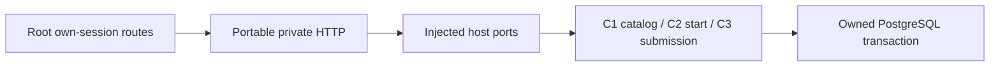

# Private practice portal boundary (v1)

This module connects actual published practice definitions and invariant-owning C2 starts/C3 submissions to a private own-session HTTP boundary. It changes no schema, assessment, rank, capacity, permission or money. Definitions use public/synthetic practice material; answers/explanations/declarations remain private and never enter public MediaAsset routes, notifications or logs.

`listOwnPracticeTrials(tx, actor, {version:'v1',taxonomyId,after}, canRead)` requires a current own Session and canonical HUMAN. It holds the same catalog12012/row SHARE scope used by C1 publication, reads current taxonomy, and returns current AVAILABLE definitions for exact active skill/domain. Publisher account IDs are stripped. Pages contain at most50 records; `after` is an exclusive C-collation family-ID cursor and `nextCursor` names the last returned record when another exists. This is a transport bound, not a new attempt policy. Changing catalog data between pages is allowed; starting always revalidates the actual current exact definition under C2 locks.

`readOwnPracticeTrialProgress(tx, actor, startId, canRead)` authorizes the actual own original start before any submission lookup. It shares C3 lock12016, selects only the owned submission ID, then uses C3's own current-session read for the exact private saved answer, explanation, tools and AI declaration. STARTED and original submission ownership UNCONFIRMED remain immutable history. Derived progress SUBMITTED means a saved submission exists; it does not claim evaluator assignment, completed ownership review, verification or rank. Original accepted definitions/rubrics survive retirement, current catalog revisions and new-write disablement. Expected minutes are an expectation, not a submission deadline.

`createPracticePortalHandlers(host)` takes explicit v1 ports: `actor`, `checkOrigin`, `rateLimit`, `list`, `read`, `start`, `submit`, `requestId`. The host owns actual transactions/current identity/authorization and durable receipts, not caller actor labels. All GET/POST success/error responses are `Cache-Control: private, no-store` and `Vary: Cookie`. GET authenticates/rate-limits before resources. POST verifies origin, authenticates/rate-limits before bounded JSON parsing, requires a stable `Idempotency-Key`, rejects extra fields/queries/participant selectors, and binds saved source/bytes to the original request. Faulty or incoherent host output produces a sanitized503. A missing/foreign own start has the same404. Method mismatch405 remains private.

Root routes:

- GET `/api/v1/practice?after=<optional-family-id>` — safe current catalog.
- POST `/api/v1/practice/starts` — original v1 definition/accommodation input (only actual supported null accommodations).
- GET `/api/v1/practice/starts/[startId]` — own original terms and saved progress/private submission.
- POST `/api/v1/practice/starts/[startId]/submission` — canonical C3 input; startId must match path, exact definition/rubric required.

Root requires exact `PRACTICE_PORTAL_READS_ENABLED=true` and explicit valid `PRACTICE_TRIAL_CATALOG_ID`; unset/invalid closes reads. Existing `PRACTICE_TRIAL_ATTEMPTS_ENABLED` and `PRACTICE_TRIAL_SUBMISSIONS_ENABLED` gate new commands only, exacttrue/defaultoff. No environment is enabled by this change. C2 adds an optional synchronous `canStart` callback with actual locked account/participant/catalog/skill/domain; C3 adds optional `canSubmit`. Omitted callbacks preserve prior host compatibility. Provided callbacks must return exactlytrue, are checked around waits/before mutation/final authority and fail closed on exceptions. They run only for new commands, so original receipt replay survives writeoff and catalog namespace changes under current own reads. Root checks current write/read flags through these callbacks. Historical accepted submissions use original consent, not current discovery availability. Current read configuration is checked again afterCOMMIT; a lost response may have committed. Clients must preserve exact original request/key on unknown-success retry and refresh stored state before a new intent.

The canonical bounded JSON reader keeps its existing16KiB default. This explicit feature opts into512KiB (host option constrained to1–1MiB): enough for the existing40,000 UTF16 answer,4,000 explanation/disclosure and50bounded tool labels even when JSON escaped. Content type, declared/streamed byte length, five-second deadline and fatal UTF8 validation remain enforced. Core character/UTF16/JSON-compatible bounds remain authoritative. This does not allow arbitrary file uploads, code execution, hidden runners or third-party storage.

The [independently installed minimal PostgreSQL/HTTP example](../examples/practice-portal/README.md) declares all canonical sources and its own npm/pg driver/identity/SQL/origin/rate dependencies. Browser-safe catalog contracts are separate; the server HTTP/progress schemas import Node storage modules. UI clients may use type-only progress imports; never import Node storage/HTTP runtime into a browser bundle. A subsequent UI slice owns actual private Raider screens/desktop-mobile preview. No independent review, representative UAT, operating approval or live enablement is inferred from local author tests.
