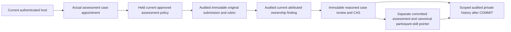

# Actual private trial assessment review and committed skill versions

R05/R06/R12/R15/R16/I05/I06/I07/I10/I13; blueprint07–09/13/24.6–8/25.3/28/33.7/AC73–75. This module persists an appointed evaluator's reasoned manual review and, for VERIFY, a separate real immutable VERIFIED assessment. It consumes actual original saved evidence/current ownership/current approved policy; a client proposal, claimed level, approved boolean or policy label cannot supply verification. No permission grant, work capacity, money, provider or reputation/account restriction is created. Original submission declarations remain UNCONFIRMED history.

`src/skills/practice-trial-assessment-storage.ts` exports v1 strict record/read input schemas, `PracticeAssessmentReviewRecordSchema`, `PracticeTrialAssessmentViewSchema`, command/options/scope/view types, `PracticeTrialAssessmentError`, `recordPracticeTrialAssessment(tx, command, options)` and `readPracticeTrialAssessment(tx, actor, input, canRead)` and `observePracticeTrialAssessmentContext(tx, actor, {version, assignmentId, submissionId}, canRead)`. Inject PostgreSQL READ_COMMITTED query port, actual account/session/HUMAN/catalog/definition/start/submission/assignment/policy/ownership/receipt/audit tables and migrations through34. The host owns BEGIN/COMMIT/ROLLBACK, whole-transaction retry classification, timeout/cancellation, authenticated actor and request limits. Domain code imports no Root singleton or vendor client. Never return private bytes before COMMIT or treat a returned snapshot/reference as a bearer permission.

V1 supports one actual case under original MANUAL evaluation with target E–A. S requires repeated strong independent evidence; automated evaluation requires an actual supported result source. Neither exists in this bounded store. VERIFY S rejects HIGH_RANK_EVIDENCE_REQUIRED; AUTOMATED_WITH_MANUAL_REVIEW rejects AUTOMATED_EVIDENCE_UNAVAILABLE. Nonverification review remains available. These are explicit source-capability limitations, not numeric promotion thresholds or a permanent product ban. O09 calibration/O11 retention, approved staffed operation and release acceptance remain separate unverified obligations. No actual operating policy, reviewer or rank is seeded in Root.

New input binds actual assignment/submission UUIDs, exact original submission/definition/rubric references, exact expected current approved policy, expected current ownership reference, expected current case-review reference and expected current participant-skill assessment reference. Nullable expectations mean no current source, not permission to ignore one. Criteria include every original criterion exactly once with MET/NOT_MET/UNCERTAIN and reason. Private reason/confidence/criterion reasons normalize whitespace and are1–2000UTF16 units, rejecting NUL/lone surrogates. Reassessment date is nullable or a future UTC timestamp at millisecond precision. Client rank, sample count, evidence or approval fields are rejected.

VERIFY requires current CONFIRMED ownership, all original required criteria MET, admitted tools/AI use conforming to the accepted original rules, supported evaluation source and strict current scoped host policy. Rank comes from the original definition, evidence from the actual saved submission, sampleSize1 from this one distinct case and assessmentPolicyVersion from the actual approved policy UUID. Repeating the same review does not inflate sample count. Original free-text pass conditions are the authorized manual reviewer's responsibility under the actual approved guidance; storage cannot independently prove a human interaction occurred. A lower new trial cannot silently replace an existing higher VERIFIED rank: CURRENT_HIGHER_ASSESSMENT requires a separate reasoned reassessment workflow.

MORE_EVIDENCE and NOT_DEMONSTRATED append private case-review history without creating or silently revoking/downgrading a current assessment. Review outcomes and skill-state transitions are separate. Original definitions, rubrics and accepted catalog provenance remain valid historical sources after retirement. Policy history remains attributable after publisher logout; withdrawal changes new use rather than rewriting past records.

`PracticeAssessmentReview`/`PracticeAssessmentReviewVersion` own one canonical current review per submission and contiguous immutable correction history. `SkillAssessment`/`SkillAssessmentVersion` own one canonical current assessment per participant/skill and immutable versions. Assessment family identity binds actual skillDomain/taxonomyId and cannot silently move to another catalog. Existing catalogs are individually versioned namespaces, not a proven global skill registry. The trusted consuming host must authorize the saved namespace; no caller namespace hint is authority.

Every review stores actual evaluator/time/assignment/original definition/policy/ownership and private case/policy/ownership access receipt FKs, normalized criteria/reasons/confidence, command receipt and request. VERIFY atomically creates the matching rank version and canonical pointer. Rank history identifies the actual review source, evaluator, original evidence/rubric/policy, issue/reassessment date and honest single-case sample/confidence. SQL guards enforce actual current nonself scope, source/clock/contiguity/immutable pointers, supported rank/method/criteria/tools, finalized matching receipt and identifier-only private audit/nooutbox. Policy-use access audit targets immutable submission revision1; ownership-access audit must target the exact dynamic finding revision. A matching identifier with a fabricated audit revision is rejected. Own Session and dynamic host configuration remain module/host authority, not a privileged-SQL substitute.

Lock order is outer command receipt, current evaluator User/own Session, assignment12017, canonical ASSESSMENT_REVIEW policy scope12019, ownership/review case mutex12020, then participant-skill mutex12022. Current sources and predicates repeat after waits and private result selection. Actual-scope synchronous predicates follow the final awaited authority/source check. There are no slow network/LLM/provider calls while locks are held. Same-transaction D2 case access audits before private answers; D4 current ownership access under the actual assessment assignment audits before findings; source locks stay held to COMMIT.

Reads require a current exact ASSESSMENT_REVIEW appointment/own unrestricted actor/session and current `canRead`. Admin role, claimant ownership or an OWNERSHIP_REVIEW appointment alone does not reveal assessment reasons. Read input is actual assignment/submission with optional historical revision. A fresh server UUID access receipt/audit precedes private review/assessment fields, and current authority repeats afterward. Missing/denied resources return null; authentication/restriction errors stay typed. Access audit means authorized attempt, not proof of delivery.

Initial context observation supplies actual original definition/rubric/catalog/submission references and current ownership/review/participant-skill references under the current exact assessment appointment. It needs no guessed revision, reads no private assessment/answer from another case, and audits before selecting new case/global current metadata. It returns no assessment snapshot or rank authority. Use the separate current approved-policy observer for policy discovery, then submit the observed references; normal CAS detects later changes. Root `observePracticeTrialAssessmentContextFromHost` uses current read scope and drops metadata if access closes before delivery.

A view contains private review, its separately created assessment snapshot or null, explicit current review/assessment references and `isCurrentReview`/`isCurrentAssessment`. A historical VERIFIED snapshot is not proof that version remains current. A nonverification review's null assessment does not mean an older actual assessment was revoked. Eligibility consumers must load the actual current committed source under their own permission/terms/freshness rules; they must not accept a client-supplied view or prepared proposal.

Original unknown-success retries use the original actor/kind/key and normalized semantic input. A changed request rejects IDEMPOTENCY_KEY_REUSED. Current authorized case readers can recover the original historical review/assessment after new writes are disabled, later corrections or policy withdrawal. New-write approval is deliberately not required for a historical replay. Never retry an unknown successful operation with a fresh key before reconciling the original receipt.

Private events are `skill.practice_assessment_review_recorded.v1`, `skill.assessment_issued.v1` and `skill.practice_assessment_review_access_authorized.v1`. Payloads contain only `practiceAssessmentReviewVersionId` or `skillAssessmentVersionId`; no reasons, criteria, answers, guidance, rank values, session material or public outbox. Never log private content or driver error text. Stable module errors include INVALID_INPUT, AUTHENTICATION_REQUIRED, ACCOUNT_RESTRICTED, RESOURCE_UNAVAILABLE, WRITES_DISABLED, REVISION_CHANGED, FAMILY_CHANGED, EVIDENCE_NOT_CONFIRMED, RUBRIC_NOT_MET, HIGH_RANK_EVIDENCE_REQUIRED, AUTOMATED_EVIDENCE_UNAVAILABLE, TOOLS_POLICY_NOT_MET, CURRENT_HIGHER_ASSESSMENT, STORAGE_CONTRACT and STORAGE_UNAVAILABLE; shared receipt retry/idempotency errors remain intact.

Root `src/lib/practice-trial-assessments-host.ts` uses guarded whole transactions. PRACTICE_TRIAL_ASSESSMENTS_ENABLED is exacttrue/defaultfalse; PRACTICE_ASSESSMENT_CATALOG_ID must explicitly identify the trusted approved namespace, with no chosen default. Enabled but absent/invalid namespace is MISCONFIGURED. Existing PRACTICE_REVIEW_READS_ENABLED separately gates actual case/policy/result access. Namespace/read/write predicates are read dynamically at each scope boundary. Writeoff or namespace changes preserve authorized original history; disabling reads drops private delivery even after a command already committed. Preserve successful status/original key for reconciliation. Namespace replacement needs reviewed migration of stable identities/history rather than silent remapping. No API/UI is included in this bounded storage slice.

Use the [independently installed PostgreSQL example](../examples/practice-trial-assessments/README.md). It declares every schema/module/runtime/types dependency, actual current actor/appointment/policy/ownership and canonical namespace, whole transaction/rollback/retry and local5s statement/2s lock/5s idle bounds. Copy canonical symlinks with dereferencing and install dependencies independently; a Root node_modules link does not prove consumption. Replacing pg or scoped policies must preserve actual source/identity/privacy/clock/concurrency/failure semantics. A compatible alternate host does not approve a real operating model.

Migration34 is additive with no real seed/backfill. Disable new writes/dependent use for recovery while preserving original submissions and all immutable review/rank/policy/ownership/receipt/audit history. Resolve unknown outcomes by original key. Do not reset revisions, delete history, mutate accepted terms or turn a nonverification review into a silent revocation. Actual reasoned reassessment/fraud history, committed eligibility projections and protected API/UI remain subsequent work, alongside full parent55/independent review/UAT/business/release obligations. This bounded staging merge does not waive them.

Migration35 and the [reasoned decision contract](raid-practice-assessment-decisions.md) extend committed versions with actual attributable reassessment/revocation provenance; original issued snapshots stay immutable. Use the separately audited private current-state read for current decision history. An original issuance view may retain VERIFIED while isCurrentAssessment is false; it is historical evidence, not current eligibility. Root decision writes remain separately default off.

[Protected v1 assessment HTTP](raid-practice-assessment-http.md) now exposes the existing canonical review/state/decision boundaries through dynamic Node routes and injected current cookie/origin/account-quota ports. It preserves exact source/CAS and original historical retry; no flag or real operating policy is enabled. Assessment context discovery/form and its browser evidence remain the next bounded slice.

The [actual assessment context and form](raid-practice-assessment-ui.md) now compose these existing sources/commands with a private assigned page and explicit stable pending recovery. Pure assessment/results schemas preserve the existing public exports. No actual production enablement or independent/UAT acceptance is implied.
