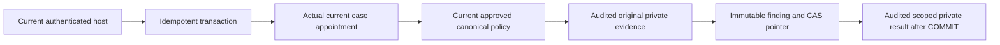

# Private attributed practice-trial ownership findings

R06/R12/R15/R16/I05/I06/I10/I13; blueprint07–09/13/24.6–8/25.3/28/33.7/AC73–75. This module records a scoped evaluator's reasoned manual finding about the exact original saved private submission. It does not scientifically prove originality, convict plagiarism/fraud, assign skill rank, grant private access, consume work capacity or create money/provider effects. Shared networks, similarity or permitted AI use do not alone establish culpability. Original definition/rubric/tool rules remain authoritative; no actual operating policy or numeric calibration is seeded.

`src/skills/practice-trial-ownership-storage.ts` exports v1 input/record/view schemas, `PracticeTrialOwnershipError`, command/options/scope types, `recordPracticeTrialOwnership(tx, command, options)` and `readPracticeTrialOwnership(tx, actor, input, canRead)`. All SQL is parameterized. Inject a PostgreSQL READ_COMMITTED transaction with actual account/session/HUMAN/definition/start/submission/assignment/policy/receipt/audit tables and migrations through33. Supply strict synchronous current `canRead`, `canUsePolicy`, `canReview` predicates; missing/throwing/nonboolean authority fails closed. No Root singleton is imported by the module. Host owns BEGIN/COMMIT/ROLLBACK, whole-transaction retry classification, timeout/cancellation, authenticated actor and per-request resource limits. Never deliver snapshots before COMMIT or reuse one as a later authorization token. Do not perform network/provider/LLM calls while transaction locks are held.

New-write input binds actual assignment/submission UUIDs and exact original submission/definition/rubric references, exact nonnull expected current approved policy reference, nullable expected ownership reference, decision, reason and observations. Reasons/details are normalized nonempty text up to2000UTF16 units; reject NUL/lone surrogates. There are1–20 observations with kind EXPLANATION/MODIFICATION/ATTRIBUTION/OTHER. These technical bounds do not specify a production scoring/retention or staff operating model. An authorized reviewer evaluates evidence under actual approved policy; a text assertion does not independently prove the underlying interaction occurred.

CONFIRM produces an attributed CONFIRMED finding; DISPUTE produces DISPUTED; MORE_EVIDENCE produces UNCONFIRMED. New decisions require current actual unrestricted evaluator/own live session and exact unexpired unrevoked OWNERSHIP_REVIEW assignment, current host policies, original D2 private case read with audit, and current canonical D3 approved OWNERSHIP_REVIEW policy in the same held transaction. Newly executed decisions repeat the held current policy, current case permission and decision policy after private result selection, including distinct actual-scope predicates after the final grant query with no later await, before returning for host COMMIT; original historical retries deliberately retain current read authorization only. The decision policy receives actual evaluator, case/participant, original definition/rubric/skill/domain, actual policy UUID/reference, current ownership reference and requested decision. Client flags, admin role or fabricated policy labels supply no authority. Direct self-review is denied; other related-party exclusions remain current host operating policy.

`PracticeTrialOwnershipVersion` preserves decision, private reason/observations, actual actor/time/assignment/original definition/policy version UUID, actual private case and policy access receipt FKs, command receipt and request. `PracticeTrialOwnership` stores one canonical current version/revision per actual submission. Every correction appends with exact CAS; original historical findings and the original submission's UNCONFIRMED declaration/receipt remain unchanged. Expired reviewer appointments, publisher logout or later policy withdrawal do not rewrite historical findings. Later assessment must consume the actual current ownership source under current authority, not the original submit DTO or an arbitrary past CONFIRMED snapshot.

Original successful retries use stable actor/kind/key and normalized semantic input; changed input rejects IDEMPOTENCY_KEY_REUSED. After writes are disabled, policy withdrawal or later correction, a currently authorized case reviewer can recover the original historical result. The returned `isCurrent` and `currentReference` describe the transaction observation; history never silently asserts it remains the current finding. Current assignment/read permission still applies to replay and result fields. Do not generate a new key after an unknown-success timeout until the original command is reconciled.

Private reads take actual assignment/submission/purpose (OWNERSHIP_REVIEW or ASSESSMENT_REVIEW) and optional historical revision. They require current exact case authorization, create a fresh server UUID access trace/identifier-only audit before selecting reason/observations, and repeat current authorization after waits and private selection. A read does not confer permission to record ownership; ASSESSMENT_REVIEW does not allow ownership writes. Missing/denied case or version returns null. Unauthenticated/restricted actors retain typed errors. An access audit describes an authorized attempt, not proof of delivery.

Material private events are `skill.practice_trial_ownership_recorded.v1` and `skill.practice_trial_ownership_access_authorized.v1`, with only opaque `practiceTrialOwnershipVersionId` in payload and no public outbox. Never log private answers, guidance, observations, reasons, session hashes or driver errors. Errors: INVALID_INPUT, AUTHENTICATION_REQUIRED, ACCOUNT_RESTRICTED, RESOURCE_UNAVAILABLE, WRITES_DISABLED, REVISION_CHANGED, STORAGE_CONTRACT, STORAGE_UNAVAILABLE; shared receipt retry/idempotency errors remain stable.

Lock order is outer command receipt, actual evaluator User/own Session, assignment mutex12017, canonical policy scope12019, then ownership submission mutex12020. Actual grants are rechecked after waits; current policy/decision predicates repeat before finalization. SQL guards enforce immutable history, normalized bounded JSON/text, exact original case/assignment/nonself evaluator/current approved canonical policy, chronology, contiguous history/current pointer, actual private access receipt/audit provenance, finalized matching command/audit and no outbox. Actual own Session and dynamic Root configuration remain application/host obligations; privileged SQL is not a permission bypass for callers.

Root `src/lib/practice-trial-ownership-host.ts` wraps the shared guarded transaction. PRACTICE_TRIAL_OWNERSHIP_ENABLED accepts only exact `true`, defaultfalse; PRACTICE_REVIEW_READS_ENABLED separately gates case/policy/result reads. Disabling new writes preserves original authorized retry/history; disabling reads drops private delivery even if a command already committed. Preserve successful status and original key for recovery. No API/UI or public answer storage is included in this bounded store.

Use [the standalone example](../examples/practice-trial-ownership/README.md): independently install all declared runtime/types dependencies, apply minimal real account/session/participant plus receipt/catalog/practice/assignment/policy/ownership SQL, verify real PostgreSQL current scope/correction/history/replay/revocation and local5s statement/2s lock/5s idle bounds. Replace driver or policy predicates only if all transaction/identity/audit/concurrency contracts remain. Canonical source symlinks must be dereferenced when copied; Root node_modules symlinks do not prove independent consumption.

Migration33 is additive, with no real finding/policy/reviewer seed/backfill. Disable new writes and dependent consumers for recovery while retaining immutable case/history/receipts/audits. Do not delete history, reset revisions, mutate accepted evidence or silently substitute a different policy. Recover unknown-success operations with their original key and inspect exact current history under scoped authority. Retention/erasure, appeals/staffed operation, numerical calibration, actual assessments/projections/APIUI, independent review/UAT/business/release acceptance remain separate obligations. This staging source merge does not close parent55 or waive those gates.
