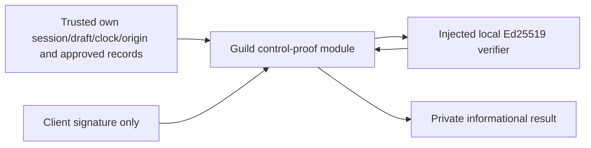

# Existing-project signed control proof

This Guild-owned module binds an Ed25519 project-wallet signature to an existing-project request. It implements an informational prerequisite of blueprint05.5/06.2/16.2/28.1–3, R01–04/R10/R15/R16/I06/I07/I10/I13 and AC71(partial)/73–75. Knowing a mint, holding its tokens, metadata, an X/admin allowlist or ordinary wallet sign-in never supplies project authority. Actual approved control-policy adoption, project evidence review and recognition remain NOT VERIFIED.

The module creates no storage, Guild, Founder, grant, token activation, public projection, audit, receipt, outbox, capacity or financial effect. It does not require a permanently revoked mint authority to sign; the host must supply a separately approved current project representative. Governance quorum verification, authority disputes/transfers/token migrations and provider/finality adapters remain separate scope. Approval statuses are trusted-host facts, never accepted client declarations.

The public entry point is `src/guild-profiles/control-attestation.ts`; the explicit crypto adapter is `ed25519-control-verifier.ts`. Shared identities/asset schemas belong to `src/contracts`. Domain code imports only zod, bs58 and these shared contracts; the adapter alone imports tweetnacl. No Next, Prisma, Solana SDK, auth singleton, RPC, global configuration, network request or signing key is needed. See the [independent consuming host](../examples/project-control/README.md).

`createProjectControlMessage(context)` validates `ProjectControlContextSchema` and returns a UTF-8 string starting `RAID existing-project control attestation v1`, followed by fixed-order pretty JSON. Context version/purpose, challenge ID, canonical origin, account, lowercase draft UUID/revision, exact AssetId(chain/networkIdentity/kind/mint/tokenProgram), signer, nonce, UTC issued/expiry and policy/authority/public-evidence record IDs/revisions are all signed. UTC timestamps canonicalize to millisecond ISO; fractions above three digits are rejected to prevent hidden precision loss. Object order never changes signed bytes. Symbols, decimals, marketplace verification or registry revisions cannot substitute for exact asset identity.

The server creates and persists the immutable challenge before requesting a signature. It generates a cryptographically random256-bit nonce (64 lowercase hex characters; the schema validates shape, not randomness), chooses a finite policy-approved expiry and binds the authorized origin/session/own draft. No API currently creates this challenge. Canonical origins require HTTPS, with HTTP allowed only on localhost/127.0.0.1/[::1]; credentials, paths, query/fragment, trailing slash and noncanonical spellings fail validation. Production origins and durations must be approved host configuration, not browser-controlled values.

`evaluateProjectControlProof(context, facts, input, verifier)` accepts only `{signature}` as untrusted input, canonical base58 encoding of64 bytes. It returns a frozen private `ProjectControlProofResult`: version/challengeId, state `SIGNATURE_BOUND|REJECTED`, reason, informationaltrue and explicit false flags for authorization token, persistence, Founder verification, Guild recognition, token activation, permission grant and nonce consumption. No signer, signature, nonce, asset, origin, owner, evidence or private provider bytes are returned. It is neither a public profile nor a portable authorization token.

The trusted `ProjectControlFactsSchema` contains current authorized account/session/restriction, own draft/current revision, request origin, challenge availability, current approval policy reference/status with explicit EXISTING_PROJECT_CONTROL purpose and PROJECT_WALLET_SIGNATURE route, current project authority reference/signer/asset and supporting public-evidence reference/asset/status. Authority/evidence must link to that exact policy reference, and public evidence also links to the exact authority reference. Authority/evidence each carry observedAt/validUntil; statuses alone cannot override an expired or future observation. The host chooses these finite validity limits from actual observation/review policy and preserves provenance; this helper cannot discover or verify a real project relationship by itself. If an observation is unavailable, the host must not manufacture `CURRENT`/`VERIFIED` facts.

| Prerequisite                                             | Result on failure                                 |
| -------------------------------------------------------- | ------------------------------------------------- |
| Current authenticated session                            | AUTHENTICATION_REQUIRED                           |
| Unrestricted account                                     | ACCOUNT_RESTRICTED                                |
| Own account and draft                                    | RESOURCE_UNAVAILABLE (same foreign/unknown shape) |
| Current draft revision                                   | REVISION_CHANGED                                  |
| Exact request origin                                     | ORIGIN_MISMATCH                                   |
| AVAILABLE challenge                                      | CHALLENGE_UNAVAILABLE                             |
| issuedAt ≤ now < expiresAt                               | CHALLENGE_NOT_YET_VALID or CHALLENGE_EXPIRED      |
| APPROVED current policy reference                        | POLICY_UNAVAILABLE                                |
| CURRENT exact signer/asset/reference and fresh authority | AUTHORITY_UNAVAILABLE                             |
| VERIFIED exact asset/reference and fresh public evidence | PUBLIC_EVIDENCE_UNAVAILABLE                       |
| Correct signature for canonical context                  | SIGNATURE_INVALID                                 |

Crypto runs after these checks. `ProjectControlSignatureVerifier` is versionv1/algorithmED25519 with synchronous `verify({message,signature,signer}): boolean`. The built-in local tweetnacl1.0.3 adapter owns no secret and uses existing bs586.0.0. An alternate Node22 `crypto.verify` adapter in tests/example verifies the same signed bytes; live provider or governance capability is not implied. A different version/algorithm, missing function or nonboolean/async response fails with INVALID_HOST_CONTRACT. Verifier exceptions become VERIFIER_UNAVAILABLE without leaking error text. False means a rejected proof; never retry an unapproved/invalid proof as a success.

Typed `ProjectControlContractError` codes are INVALID_INPUT (malformed/extra caller fields or signature length), INVALID_HOST_CONTRACT (malformed context/facts/adapter response), VERIFIER_UNAVAILABLE (local verifier error). The signature64 zero bytes has valid shape but is rejected by cryptography. The local adapter also returns false on malformed direct verifier input. No exceptions log secrets or echo private facts. Host routes must map errors privately, apply actual cookie/CSRF/origin/rate policies and reauthorize before loading private records; none is added here.

Replay and races remain a host obligation. This pure evaluation **does not consume a nonce**. Repeating the same proof with AVAILABLE facts can repeat informational success. A future persistent command must atomically check/consume challenge plus immutable receipt, recheck current session/ownership/draft/policy/authority/evidence under the actual lock order, enforce one recognized Guild per exact network/program/mint and audit a newly verified relationship. Do not wait for wallet signatures, RPC/finality or evidence fetching while holding database locks. A lost response must reconcile the original command rather than issue a new business effect. Authority revocation, ownership changes, administrative conflicts and token migrations need history-preserving review; crypto cannot sell or reset prior reputation.

No configuration/env/credential names or new flags are consumed. The host owns approved policy, origin/nonce store, current identity, evidence provenance, clock, secret handling and rate limits. No migrations/backfills, live operations or irreversible effect occur; rollback can remove the unused helper. A future v2 must coexist with signed v1 contexts and never reinterpret accepted bytes/references. Do not switch an in-flight request to another algorithm/policy/asset: reconcile its original identity and issue a separately approved request if required.

Verification uses disposable signed fixtures and real tweetnacl plus Node verification, including exact asset/purpose/nonce/origin/actor/draft/time/reference substitution, revoked/unknown/stale/conflicting authority, missing evidence, signature rejection, adapter errors, no authority and no persistence. The independently copied host installs its own exact dependencies. There is no new browser-visible route to preview or provider to call. Observe only sanitized challenge/request IDs and typed failure categories; do not log message/signature/nonce/private context. Stop/exit owned CLI processes after tests, retain evidence, preserve unrelated services. Local failures and genuine RED/GREEN/regression belong to the [task record](tasks/2026-10-13-T010-control-attestation.md).

Actual approved project control/public-evidence records, durable single-use/recognition uniqueness, authority-conflict review and history, HTTP/UI, independent review/UAT and real funded-work/operational G01–G10 remain NOT VERIFIED. O01/O02/O05/O06/O07/O11 and05.6 gates remain unresolved; this helper changes no production/provider/financial enablement.
