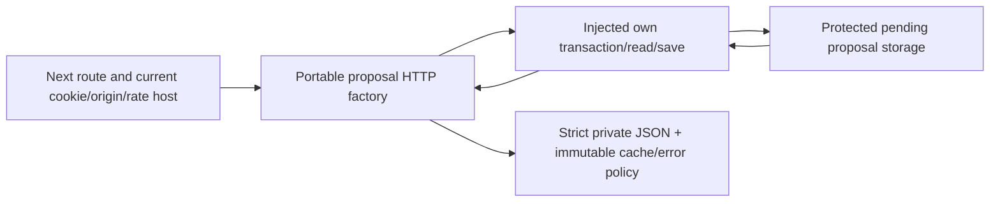

# Protected private project-proposal HTTP

The v1 private preparation API serves an authenticated owner’s empty/current proposal and saves versioned PENDING_VERIFICATION existing-project proposals. It implements05.5–6/06–07/13/16.2/24.6–8/26/28, R01–04/R10/R15/R16/I06/I07/I10/I13/AC71partial/73–75. It does not verify project control/evidence, consume a nonce, recognize a Guild/token, grant Founder/permissions, publish profiles, fund work or consume capacity. [Storage](raid-project-proposals.md) owns actual guarded25-migration state; approval/recognition/history/provider/UI/funded-flow/independentUAT/gates remain NOT VERIFIED.

`createGuildProjectProposalHandlers(host)` in src/guild-profiles/project-proposal-http.ts accepts a stable versionv1 GuildProjectProposalHttpHost: actor(), checkOrigin(Request), rateLimit(actor), read(actor,draftId), save(command) and requestId(). No Next, Prisma, root auth, env, RPC/provider or signing key is imported by the factory. It uses standard Request/Response/WebCrypto plus shared body/error/asset schemas. Actor/session/origin/rate/transactions/configuration remain host-owned and trusted; a fake host never proves a live gate.

Call `.GET(request,draftId|Promise<draftId>)` and `.POST(request,draftId|Promise<draftId>)`. Route is /api/v1/guild-drafts/[id]/project-proposal, dynamic GET/POST; Next16.3.8 context.params and cookies are awaited per the installed guide. Root composition uses requireUser/current session cookie hash, actual origin check and persistent account rate bucket project-proposal:{accountId},30per60seconds. Storage reauthorizes current cookie/restriction/resource under actual row locks after waits and before read/replay/commit. Knowing/guessing an ID, token mint, global role or logged-in wallet supplies no project authority.

POST requires Content-Typeapplication/json, safe Idempotency-Key and strict JSON `{expectedDraftRevision,expectedProposalRevision,candidateToken,publicEvidenceRefs}`. URL supplies the draftID; actor/account/Guild/signature/role/verification fields are forbidden in body. Parse and normalize using client-safe GuildProjectProposalHttpInputSchema; storage inserts guildDraftId from URL. Same shared body reader enforces actual UTF8bytes16KiB/5000ms even with false ContentLength, fatal decoding, content type and JSON validation before dispatch. Signature/nonce/project control is a separate approval-dependent contract.

GET returns GuildProjectProposalHttpStateSchema: versionv1, URL-bound guildDraftId, proposalnull or current SavedGuildProjectProposal, writesAvailable and unavailableReasonnull|DISABLED. Null is only an authenticated own draft with no proposal. POST returns GuildProjectProposalHttpSavedSchema with statusEXECUTED|REPLAYED and non-null proposal. Capability fields must agree; nested proposal must target that exact draft. POST also verifies expected next proposalrevision, submitted draftrevision, exact assetKey and normalized ordered references; a success-shaped wrong resource/snapshot/privateextra DTO failsclosed before any body is returned. UUID case-equivalence is normalized without changing case-sensitive asset identity.

Client-safe schema entrypoint is project-proposal-http-contracts.ts. It imports no HTTP command, server auth, DB or Node secrets. Body/candidate/reference bounds and pending-only flags come from the storage schema. The response is private state, not a portable permission token; none of its fields can authorize a subsequent business action. Replaying old receipt body returns its original version even if current proposal is newer; a client must not treat that acknowledgment as a new current version or invent a new command key after an unknown outcome. Preserve pending intent, reconcile and reload current state explicitly.

Every success/error has Cache-Controlprivate,no-store and VaryCookie, with JSON content type. Shared http-errors.ts preserves the existing GuildDraftHttpError prototype/name/status/body contract and exposes alias GuildProjectProposalHttpError(401/403/429); header policy is frozen so an importing host cannot switch all private replies to public cache. Old draft routes re-export the same class and retain previous behavior. Fixed error envelopes carry safe requestId/code/message/retryable only, never body, mint/reference URLs, account/cookie/signature or provider error text. Invalid requestID uses a safe random UUID fallback.

| Failure                                                    | HTTP/code                   |
| ---------------------------------------------------------- | --------------------------- |
| Missing/expired current session                            | 401 AUTHENTICATION_REQUIRED |
| Wrong actor/origin                                         | 403 FORBIDDEN               |
| Restricted account                                         | 403 ACCOUNT_RESTRICTED      |
| Rate limit                                                 | 429 RATE_LIMITED            |
| Unknown/foreign draft                                      | 404 NOT_FOUND               |
| Stale draft/proposal revision                              | 409 REVISION_CHANGED        |
| Same key/changed body                                      | 409 IDEMPOTENCY_KEY_REUSED  |
| Malformed fields/key/UUID/JSON                             | 422 INVALID_COMMAND         |
| Non-JSON content type                                      | 415 INVALID_COMMAND         |
| Oversize actual body                                       | 413 INVALID_COMMAND         |
| Body timeout                                               | 408 INVALID_COMMAND         |
| New writes disabled/host-storage malformed/unknown failure | 503 SERVICE_UNAVAILABLE     |

The root host requires non-demo mode, GUILD_DRAFTS_ENABLED=true and GUILD_PROJECT_PROPOSALS_ENABLED=true for new mutations. New project flag defaultsfalse in .env.example; reads/original receipt replay still delegate to protected storage while off. This controls private preparation only and cannot adopt a project-verification/provider/financial policy. PROJECT_PROPOSAL_HTTP_PREVIEW_URL is test-only loopback fixture configuration, not production wiring. Real credentials/session/origin/deployment data remain with the host; no new provider secret exists. No schema/migration/backfill or actual server flag enablement in this slice.

[Independent minimal PG host](../examples/project-proposals/README.md) consumes the same factory/schemas/guarded storage with its own declared User/Session/receipt/draft/proposal tables and independently installed20-package pg/zod/bs58/tsx dependencies. It proves portable GET/current3rdversion/originalPOSTreplay with newwrites off/private headers/foreign origin403 plus storage/currentcookie/whole-retry/nooutbox. No hidden Next/app state, copied live data or SDK credentials needed. Copy dereferences canonical links; refresh only matching source after a change and keep original operations/receipts pinned through a swap.

Verification includes genuine33HTTPRED before factory/host/route, additional shared-cache mutationRED before freeze, original draft-route regressions, input/output/privacy/authority/capability and root two-flag-off/replay tests. Actual owned synthetic NextTurbopack endpoint proof uses current cookies/realPG25schema and checks save/update/read/originalreplay/anonymous/foreign/unknown/origin/injected actor/key conflict/private headers,2versions1proposal3receipts3audits0outbox. URL was workspace-local, no publicforward; source/log/stop details are in [the task](tasks/2026-10-13-T010-proposal-http.md). Owned Next/database/CLI pools stop in finally after success/failure/interruption, retain evidence and preserve unrelated services. Development proof remains separate from required productionWebpack build; no renderedUI is delivered here.

Record useful request/version IDs and fixed failure categories, mask statement/commit/rollback details and reference/cookie bytes. Unknown outcome retries reconcile the same original intent/receipt and cannot repeat a business effect. On disablement preserve read/replay/history/case obligations. Rollback removes unused route/wiring while retaining25-migration immutable records/receipts/audit. v2 must version any new signing/proposal policy and preserve earlier byte/body/reference identities. Independent review, actual approvedproject relationship, nonce/proposalversion binding, recognizedasset uniqueness/history/provider/UI/fundedwork/UAT/O11/G01–G10 remain NOT VERIFIED; a staging push cannot supply them.
