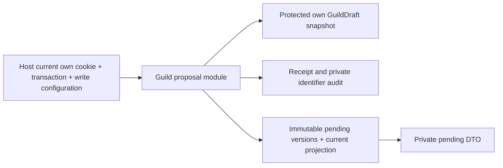

# Private existing-project proposals

This Guild-owned storage module lets a current unrestricted owner prepare an existing-project relationship on an own GuildDraft. It implements a private prerequisite of05.5/06/07/13/16.2/24.6–8/25/27/28, R01–04/R10/R15/R16/I06/I07/I10/I13 and AC71partial/73–75. A PENDING_VERIFICATION claim records a candidate token and supporting reference URLs; neither is actual approved evidence. No Founder/Guild recognition, token activation, grant, public profile, outbox, launch count, capacity or financial effect occurs. Actual control-policy adoption/authority/public-evidence review, nonce/recognizedasset uniqueness/history/provider/API/UI/UAT/G01–G10 remain NOT VERIFIED.

The public entrypoint is `src/guild-profiles/project-proposal-storage.ts`, with strict schemas in project-proposal-contracts.ts. It consumes shared exact TokenAssetId, identifiers, protected draft authorization and command-receipt SQL contracts. It owns pending proposal mutations, not auth identity or recognized token/Guild/permission policy. Inject a PostgreSQL READ_COMMITTED transaction and explicit allowNewWritesboolean; the host owns current cookie-derived GuildDraftActor(accountId=actorAccountId/sessionHash), transaction/retry/commit-before-response, configuration, credentials, CSRF/origin/rate policy and private HTTP mapping. No Next, Prisma singleton, Solana SDK, RPC, fetch, secret key, browser or environment variable is imported into the module.

`saveGuildProjectProposal(tx,{actor,input,idempotencyKey,requestId},{allowNewWrites})` returns `{status:EXECUTED|REPLAYED,proposal}` after the host commits. Strict input is guildDraftId(UUID normalized lowercase), expectedDraftRevision(current1+), expectedProposalRevision(0create/Nupdate), candidateToken(shared exact chain/networkIdentity/kindTOKEN/mint/tokenProgram) and publicEvidenceRefs(1–5 unique canonical HTTPS URLs, at most2048characters, no username/password). Network identity is claimed here, not verified configured genesis or support approval; ticker/image/decimals/policy/balance cannot be substituted. URL strings normalize through URL.href; references are never fetched or certified public. Future fetchers need their actual SSRF/DNS/redirect/credential/egress review.

`readGuildProjectProposal(tx,actor,guildDraftId)` returns current private SavedGuildProjectProposal, or null only when an authenticated own draft has none. Foreign/unknown drafts share NOT_FOUND. The frozen DTO has versionv1, immutable version id, guildDraftId, proposalrevision, submitted draftrevision, recordedAtUTC, projectTypeEXISTING_PROJECT, statePENDING_VERIFICATION, persistedtrue, candidateToken and references; explicitfalse fields founderControlVerified/recognizesGuild/activatesToken/createsPermissionGrant/publicProfileApproved. No owner/session/cookie/receipt/request/grant/private config is returned. It is a private claim and never a public Guild profile or authorization token; existing draft primaryToken remainsnull.

Tables are GuildProjectProposal(guildDraftId PK/owner/current revision/version pointer) and immutable GuildProjectProposalVersion(UUID/owner/revision/exact DraftVersion pointer+revision/candidate JSON/URL JSON/receipt/request/actor/time). The25th additive migration202610130003_guild_project_proposals touches no earlier migrations/data or asset registry. One pending current proposal per draft; different drafts/owners may claim the same token without recognition. Database FKs/guards retain attribution, exact owned draft snapshot, immutable owner/versions, sequential current pointer, finalized own receipt and exact private audit. SQL checks structural token/reference bounds; domain bs58 additionally checks32decoded bytes, matching existing asset-registry validation layering. Direct SQL cannot replace these records with a verified relationship; no approved-state column exists.

Receipt lock precedes User→Session→DraftFORSHARE→ProposalFORUPDATE. User/session authorization is reused from protected draft commands and current database clock after each relevant wait, before commit and after replay/read load. Expected draft/proposal revisions reject stale mutations. Replaying the original key/body returns its original immutable proposal even after later profile/proposal updates or disabling newwrites, with current own session/restriction authorization. Changed-body key conflict is disclosed only after current own authorization. No wallet/RPC/provider/finality/LLM waiting occurs under locks.

Private event guild.project_proposal_recorded.v1 has aggregateId=the private draft, aggregateVersion=proposal revision, guildIdnull and identifier-only projectProposalVersionId payload, publishfalse. This optional shared envelope field is additive; update private consumers with that schema. Existing outbox/provider consumers receive no new event. One receipt/version/privateaudit/projection change commits together or rolls back. A retryable serialization/deadlock retries the entire host transaction under the original command identity, never a partial insert. Same-revision concurrent writers yield one success and one REVISION_CONFLICT; no extra founder slot, history reset or recognizedasset claim is made.

Reuse the stable GuildDraftStorageError codes INVALID_INPUT/WRONG_ACTOR/UNAUTHENTICATED/ACCOUNT_RESTRICTED/NOT_FOUND/WRITES_DISABLED/REVISION_CONFLICT/STORAGE_CONTRACT/STORAGE_UNAVAILABLE and CommandReceiptError.IDEMPOTENCY_KEY_REUSED/RETRY_TRANSACTION. Unsupported dialect/isolation/row/DTO contracts fail closed. A real host must sanitize statement and commit/rollback errors, retain useful request/version IDs without logging token/reference/session/private-body bytes, and declare bounded retry policy. No success fallback on storage failure. Invalid credentials/duplicate references/injected authority fields are rejected before effects.

[Independent consuming example](../examples/project-proposals/README.md) installs its own minimal pg/zod/bs58/tsx dependencies and its own account/session/receipt/draft/proposal schema. Its local adapter substitutes for RAID Prisma while preserving actual guarded SQL and whole retries, original replay/current-cookie denial and no outbox/authority effects. Full application wiring or external project verification is not claimed.

Configuration contains only host-controlled allowNewWrites; reads/original receipt replay remain while new writes are off. No root API/UI/flag is added here. Host operational gates include private retention/access/backup/restore and bounded input/rate controls. Record failures with a named owner; disabling preparation must not delete submitted history. Rollback removes unused callers while retaining the additive immutable schema/receipts/audit; dropping records requires reviewed retention/recovery, not an automatic down migration. A future version must preserve earlier proposal/receipt identities and not reinterpret past candidates or evidence as approved.

Future verified activation must pin/recheck the current proposalversion and actual approved policy/authority/public-evidence versions, atomically consume its challenge/receipt, enforce one recognized Guild per exact network/program/mint and audit a newly verified relationship. T010A signature-only informational helper is not automatically wired to these proposals; any extension must version its signed context rather than silently changing old bytes. Authority revocation/conflicts/Founder transfers/token migrations preserve history and require their documented review. Permanently revoked mint authority is not an impossible mandatory signer.

Verification uses actual owned PostgreSQL for current-session/expiry after User/Session/Draft/Proposal waits, restriction races, sequential revisions/snapshot/privacy/SQLguards, original replay/changed-key/whole retry and same-revision one-winner race. [Task/evidence](tasks/2026-10-13-T010-project-proposals.md) preserves genuine RED12FAIL before implementation,33initialGREEN and actual extended failures/fixes. Pure unused storage adds no browser-visible flow; no preview applies. Owned fixtures/CLI pools stop in finally, source/logs/evidence remain and unrelated services/volumes/images are preserved. Full independent review/UAT/G01–G10/O11/actual project recognition/funded-work acceptance remains NOT VERIFIED.
