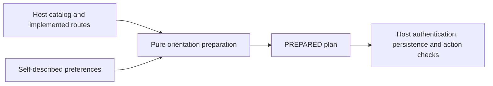

# Raider onboarding preparation and protected storage

## Purpose and non-goals

`src/raider-onboarding` prepares unpaid orientation preferences and the next navigation step. It implements a bounded T008 contract under R04/R12/R13/R15/R16, I07/I10/I13 and AC03/AC06 partial/AC73–AC75; blueprint07–10/13/24.6–24.7/33.5/34M1. State is always `PREPARED`, `persisted=false`: it creates no account/session/participant, completed orientation, assessed rank, reputation, work slot, private access or payment authorization. Full T008 and real starter/trial journeys, payout/paid-commit gates, independent review/UAT remain NOT VERIFIED.

The preparation entry point has no storage side effect. Protected persistence is a separate explicit entry point documented in [the private storage contract](raid-raider-preferences.md), with its additive migration and authenticated transaction host. It is not an authentication or assessment service. Portfolio URLs are self-provided pointers; the preparation/storage module performs no URL fetch, content/ownership verification or provider action. Acknowledgment means preparation input, not a saved or legally accepted work agreement.

## Public API

`prepareRaiderOrientation(input, host)` validates a v1 input and host declaration, returning an immutable plan. Exported schemas/types: `RaiderOrientationInputSchema`, `RaiderOnboardingHostSchema`, `RaiderOrientationInput`, `RaiderOnboardingHost`, `RaiderOrientationPlan`, `OnboardingContractError`, `normalizeRaiderOrientationPreferences`.

Input: self-described `experience` BEGINNER/EXPERIENCED;1–10 unordered `workInterests` using the shared opaque InternalId contract; valid runtime IANA `timezone`; `orientationAcknowledged=true`; optional PORTFOLIO/TRIAL `evidencePath` and nullable HTTP(S) `portfolioUrl` without user-info credentials. Interests are copied/deduplicated/sorted without altering caller data. Limits are technical v1 bounds (IDs200chars, timezone80, URL2048), not rank/economic policy. Rank, role and other unknown client fields are rejected.

Host: protocol `version=v1`, unique current interest IDs (1–1000), and `nextActions.starterTasks/portfolio/trial`. An available route carries an actual same-host relative href; an unavailable route carries NOT_CONFIGURED/NOT_READY and no href. Ambiguous/external URLs and success-shaped failed capabilities are invalid host contracts. Host replacement changes available navigation while retaining normalized preferences and every nonauthorization invariant; it cannot mutate in-flight account/work/provider operations.

Default route: beginner → STARTER_TASKS, experienced → PORTFOLIO; an explicit evidence path may select PORTFOLIO/TRIAL for either experience level. These are presentation defaults, not skill eligibility rules. An unavailable option returns availablefalse/hrefnull with its typed reason. Never pretend a missing starter/trial implementation exists.

Output includes preferences, nextAction, `assignsVerifiedSkill=false`, `reservesCapacity=false`, `authorizesPaidCommitment=false` and `requiresVerifiedPayoutForPaidWork=true`. Availability means a navigation route exists; qualification, accepted terms, funding, capacity, payout verification and private permission still need their actual server commands.

## Host dependencies

Node22.12+ or a compatible runtime with standard URL/Intl timezone data; zod4.6.5; the existing shared `contracts/ids.ts`; explicit current catalog and correctly scoped route declarations. No Next/Prisma/app config/global credentials or clock/store singleton. The TypeScript example declares its own tsx4.23.15 runtime. The pure entry point imports only its owned contract and shared identifier definition. The storage entry point additionally reuses the explicit identity/receipt/shared event contracts; see its declared transaction dependencies.



## Permissions and privacy

Preparing input is side-effect free and confers no authority, including for unauthenticated callers. The consuming application must authenticate before reading/saving existing preferences and authorize the self-account/resource at the actual command boundary; never trust client rank/role/capability claims or this plan as permission. Provide public/sanitized route/catalog declarations and avoid private case IDs/briefs in publicly rendered data.

The helper returns only caller-supplied preference fields and validated navigation. Error messages contain fixed codes, not private values. Do not log preference bodies, portfolio URLs or credentials; no analytics/event or external publication is generated here. Real privacy/retention/recovery policies stay unresolved until their dependent live data feature is approved.

## Consuming example

[The independent example](../examples/raider-onboarding/README.md) declares its dependencies and uses a synthetic host route registry/catalog. Copy dereferences only the canonical pure index/contracts entry-point files and shared ID symlinks; the pure example does not acquire the separate storage dependencies. no hidden RAID node_modules or environment is required.

```sh
cp -RL examples/raider-onboarding /tmp/raid-raider-onboarding-example
cd /tmp/raid-raider-onboarding-example
npm install --ignore-scripts --no-audit --no-fund
npm start
```

Expected JSON reports synthetictrue, beginnerSTARTER_TASKS, experiencedTRIAL, explicit unavailable navigation, no persisted completion, and no rank/slot/payment authority. This deterministic fixture demonstrates reuse/substitution, not a real trial provider or production gate. The app currently has no onboarding/starter/trial host wiring, so this module is not enabled by publication.

## Failure and recovery

`INVALID_INPUT` covers malformed preferences, unsupported catalog IDs, missing acknowledgment, unsafe portfolio URLs and injected privilege fields. `INVALID_HOST_CONTRACT` covers missing/malformed capabilities, bad protocol/catalog or external/ambiguous navigation. These fixed exceptions do not echo data. Callers preserve drafts and resolve validation/host availability before retry; there is no storage/provider effect to reconcile or cancel. A host may cancel before calling this synchronous function.

## Migration and next phase

Versionv1 is additive; changed field semantics require a versioned contract and updated consumers/tests. The pure preparation contract preserves existing auth/identity, financial records and capacity. The separate protected storage contract owns the additive preference/version migration; prior migrations are unchanged. Rollback removes only an unwired preparation library.

Protected self-account preference/orientation storage now reuses canonical HUMAN identity, revisions/immutable retry responses/private audit and DTOs. Its API/UI consuming host is verified separately; actual supported starter/portfolio/trial paths remain next work. Preserve existing history, verified skills and payout destinations, and verify payout before any paid commitment. Do not manufacture readiness from missing T006/T007 acceptance, skill/trial/work/capacity modules, OPEN privacy policies or fake adapters.
