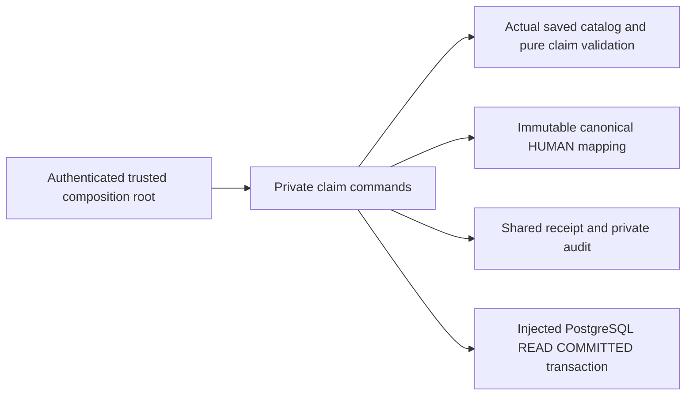

# Private canonical skill claim storage

T012B2 / M1, R04/R06/R12/R15/R16, D07/D13, I05/I06/I10/I13 and blueprint§08.2/13/24.6–24.8/25.3/28/35 AC01 partial, AC04–05, AC73–75. Current own HUMAN participants can persist private self-reported level and evidence links against an actual saved admin taxonomy. [Taxonomy publication](raid-skill-taxonomy-storage.md) and [pure preparation](raid-skill-claims.md) remain separate contracts. A persisted claim never creates an assessment, rank, grant, verified admission, public projection, paid-work capacity or financial claim. Full T012 is NOT VERIFIED.

## Owned contracts and records

Import commands/types/error/schema from `src/skills/claim-storage.ts`. `saveSkillClaim(tx, {actor, input, idempotencyKey, requestId}, {allowNewWrites})` returns `{status: EXECUTED | REPLAYED, claim: SavedSkillClaim}`. Strict input is `taxonomyId`, exact `expectedTaxonomyRevision`, `expectedClaimRevision`, stable `skillId`, trimmed `claimedLevel` (1–200 characters) and 0–5 distinct normalized HTTPS `supportingReferences` (≤2048 characters each; URL userinfo rejected). The module never fetches URLs, imports remote work or verifies ownership/quality. Reference-only evidence is private claimant assertion, not an artifact upload or verified assessment.

`readSkillClaim(tx, actor, skillId)` returns current own claim or null for empty own history. An absent canonical mapping is RESOURCE_UNAVAILABLE. No caller-supplied participant/account/wallet/assessment/verification/author/time fields are accepted. The cookie-derived actor shape is the existing strict `{accountId, sessionHash}` contract. Input claim revisions are 0–2,147,483,646; catalog revisions are 1–2,147,483,647, matching existing PostgreSQL INTEGER storage.

A saved claim DTO contains its stable UUID, revision, canonical participant/skill/domain, exact catalog ID/revision reference, database recordedAt (truncated milliseconds), claimant level/references, `state: CLAIMED`, `persisted: true`, informational true, and false authorization/verification/grant/capacity flags. Nested references/arrays are frozen. It deliberately contains no assessedRank/rubric/evaluator/confidence/assessmentHistory; those are owned by future separate assessment commands. Never overwrite an assessment with the pure preparer's null rank or empty history. CLAIMED describes the self-report record, not the overall skill verification state.

`SkillClaim` has one stable row per `(participantId, skillId)`, immutable account/participant/skill/domain/catalog binding and a current exact version pointer. `SkillClaimVersion` retains every self-report/references revision, canonical identity, exact catalog version UUID/revision, receipt/actor/request and recorded time. Domain/catalog cannot be moved by an edit; any conflict is HISTORY_CONFLICT. Host selects an actual canonical catalog with globally intentional skill IDs; this module never adopts a new catalog or turns a same-named skill into a different domain. Retirement does not delete earlier records or references.

## Dependencies and host wiring

Node≥22.12, Zod4, canonical shared contracts (including their bs58 dependency), shared receipt kernel, existing catalog storage/contracts and pure preparation are explicit dependencies. No Next, Prisma, environment singleton, provider SDK or fetch exists in the module. Host supplies actual current account/session tables, canonical HUMAN mapping, actual published catalog/version tables, one interactive PostgreSQL READ COMMITTED transaction, bounded pool/transaction deadlines, whole-callback retry classification and new-write flag. Actor facts must come from authenticated cookies, not JSON. The command does not create a participant, wallet link, X authorization, alias, assessment or admin policy. Canonical identity must already have been provisioned through the existing identity contract.

[The independently installed host](../examples/skill-claim-storage/README.md) declares minimal User/Session tables, canonical Participant migration plus its composite ownership index, receipt/catalog/claim SQL and local pg transaction adapter. Its synthetic HUMAN is actually persisted before the claim; no fixture-only participant assertion stands in for storage. Root API/config/UI integration is a later task, requiring actual cookie resolution, origin/CSRF/rate policy and safe DTOs; this delivery enables no endpoint or feature flag.

## Authority, snapshots and races

| Actor/state                                                            | New claim/edit                                           | Own retained read/original replay                                                                  |
| ---------------------------------------------------------------------- | -------------------------------------------------------- | -------------------------------------------------------------------------------------------------- |
| Current unrestricted own HUMAN/live supported session                  | Active category + exact catalog/claim revisions required | Allowed                                                                                            |
| Ordinary account, wallet/X credential changes                          | Same canonical identity; no rank privilege               | Same records preserved                                                                             |
| Missing canonical mapping, foreign/expired/revoked/unsupported session | Unavailable or authentication required                   | Same denial                                                                                        |
| Suspended account                                                      | Restricted                                               | Restricted for this ordinary skill endpoint; financial/case evidence access is a separate contract |
| Retired category / new catalog revision / removed catalog admin policy | Current new write rejects unavailable/stale input        | Old stored versions preserved                                                                      |
| New writes disabled                                                    | Denied                                                   | Current authorization still required; original immutable result preserved                          |
| Client asserted rank/verification/history/identity                     | Invalid input                                            | Never authority                                                                                    |

Lock order: command receipt → User FOR NO KEY UPDATE → Session FOR SHARE → Participant FOR SHARE → catalog FOR SHARE → claim FOR UPDATE. Account locking serializes initial absence for the same immutable HUMAN mapping. Current DB-clock expiry/authority are rechecked after row waits and before completion. Concurrent initial/stale edits have one winner; same semantic command key/body produces one EXECUTED and one original-result REPLAYED. Catalog publishers wait for a claim's shared catalog lock; a publication committed before acquisition is observed and stale input rejected. No external provider/LLM/signature/finality wait occurs under locks; host commits promptly.

Digest covers normalized input including both expected revisions and catalog/skill/reference/level. Different payload under the same key conflicts only after current own session/canonical authority. Replays skip current category/new-write validation and load the exact original own immutable version, even after later claim edits or catalog retirement. A rejected transaction leaves no claim/version/receipt/audit. Retry deadlocks/serialization as the whole transaction with its original identity; reconcile unknown successful commits by repeating the original key/body, never a new request intent.

## SQL, privacy and recovery

Additive migration `202610140002_skill_claims` follows all26 previous migrations, without seed/backfill or modifications to old DDL. Composite FKs bind owner to actual canonical participant, claim header/current version and exact admin catalog version. Triggers validate the exact active category/domain in the stored version, contiguous claim identity/history, next immutable pointer and matching finalized current-owner/current-catalog receipt/private audit. They reject direct SQL old-active-snapshot use after current retirement, cross-owner/domain/skill, orphan/provenance mistakes and version/header deletion/mutation. Cookie/session semantics remain the trusted command boundary; direct privileged SQL is not a supported client API.

Private event `skill.claim_recorded.v1` contains only `skillClaimVersionId` and canonical record/revision/actor/request metadata. No outbox/public feed/HTML/hydration/search/notification is emitted, no private links/level are copied into audit. This schema adds no assessment/rank column to overwrite. It preserves claim evidence independently of future assessor/rubric changes; actual assessment/reassessment/revocation histories still need implementation and independent evidence.

After acknowledged receipts/versions, destructive downgrade, deleting rows or changing identity is unsupported. Disable new writes while retaining authorized reads/replay; preserve catalog versions/participants and original IDs through restore. Reviewed retention/recovery owns any exceptional correction. Backup/restore/release operating evidence is NOT VERIFIED. Keep provider credentials, source uploads and public projections outside this module until their explicit contracts exist.

## Errors, verification and substitution

Storage error codes: INVALID_INPUT, AUTHENTICATION_REQUIRED, ACCOUNT_RESTRICTED, RESOURCE_UNAVAILABLE, WRITES_DISABLED, STORAGE_CONTRACT, STORAGE_UNAVAILABLE. Shared preparation can return REVISION_CHANGED, HISTORY_CONFLICT, SKILL_UNAVAILABLE/INVALID_HOST_CONTRACT; receipts expose IDEMPOTENCY_KEY_REUSED/RETRY_TRANSACTION and sanitized storage errors. The composition root maps protected HTTP status codes. Do not log cookie/hash, claimed level, evidence links or driver connection details; record request/command ID, sanitized code/duration/retry count.

[Task/evidence](tasks/2026-10-14-T012-claim-storage.md) retains genuine22 DB RED +1 audit RED, first23 GREEN, expanded actual SQL/race/authority regression, explicit consuming host, exact source/timed SELF and cleanup. Author verification is SELF-EVALUATED, never independent review/UAT or live rollout. Root protected API/UI, artifact evidence, assessment/rubric/evaluator/confidence/sample/reassessment/revocation and relevant verified admission remain unverified.

A different driver implements the owned query port with real PostgreSQL isolation/constraints/locks and whole retries; the minimal pg host demonstrates ORM substitution. Alternate storage needs actual equivalent durability/identity/privacy/race evidence, not an in-memory passing fixture. The fixture owner closes pools and stops only its task containers on success/failure/interruption, retaining source/logs/data. Maintainer scope is AG03 domain/storage plus AG05 assessment policy; no real evaluator/business policy is selected here.

## Anti-spam signals — T014 / issue 56 (blueprint 07.5, 09.7; O09 not decided)

Three bounded, advisory protections. None changes rank, access, capacity or money, none restricts an account automatically, and a shared network, young wallet or reused link is never a fraud verdict.

**Duplicate-evidence fingerprint.** Saving a claim also stores, in the same transaction, one `SkillEvidenceFingerprint` per distinct reference: SHA-256 of `v1` plus a normalized form (host lowercased, leading `www.` dropped, fragment, default port, trailing slash and `utm_*`/`fbclid`/`gclid`/`mc_*` parameters removed, query sorted; path case kept). Rows are append-only, reference only the claim version and carry no participant column, so the signal can only be derived through the version's canonical owner. Claims saved before migration `202610300001` have no rows and are never flagged until their next version; nothing is backfilled. A reviewer with a current practice-review assignment reads `readEvidenceReuseForReview(tx, actor, {version, assignmentId, submissionId, purpose}, canRead)` (same lock, scope and revocation rules as `readPracticeTrialForReview`). It returns `{possibleReuse, otherParticipantCount, matchedReferenceCount, advisory: true, automaticRestriction: false}` for the subject's **current** claim on the reviewed skill versus other participants' **current** claims. It never names the other participant, is symmetric (both claimants are flagged, neither blocked) and ignores the same participant reusing a link across their own skills. The claimant-facing `SavedSkillClaim` is unchanged. Verified by `tests/skill-evidence-reuse-db.test.ts` (real PostgreSQL including concurrent saves, replay, revocation and a migration-over-existing-rows check); the same test is the consuming-host example.

**Submission rate limit.** `submitPracticeTrial(..., { submissionRateLimit: { max, windowSeconds } })` counts the account's submissions in the trailing window under the existing per-account row lock, so concurrent submissions are admitted up to exactly `max`. Over the limit it throws `RATE_LIMITED` with `retryAfterSeconds` (rolled back: no row, receipt or consumed idempotency key; a replay of an earlier success still returns `REPLAYED`). The portal HTTP adapter maps it to `429 RATE_LIMITED` with `Retry-After`. The Next host reads `PRACTICE_SUBMISSION_RATE_LIMIT_MAX` / `_WINDOW_SECONDS` and otherwise uses 10 per 3600 s — a **conservative DEFAULT, not an owner decision (O09-adjacent)**. Omitting the option leaves the module unlimited. The existing generic per-request portal throttle is unchanged. **Applications are not changed:** `admission-storage.ts` already enforces a database-checked `applicationLimit` of live applications per canonical participant under the identity lock.

**Appeal reason categories.** `assessment-review-contracts` exports the closed `ASSESSMENT_APPEAL_REASON_CATEGORIES` (`FACTUAL_ERROR`, `RUBRIC_MISAPPLIED`, `NEW_EVIDENCE`, `CONFLICT_OF_INTEREST`, `OWNERSHIP_DISPUTE`, `PROCESS_IRREGULARITY`, `SIGNAL_MISINTERPRETED`) and a strict `SkillAssessmentAppealRequestSchema` bound to the exact assessment version. There is no free-form `OTHER`; changing the list needs an owner decision. **Not implemented / needs owner decision:** appeal intake storage, who adjudicates, deadlines and effects (blueprint 09.7 defines none), so no appeal row, route or UI exists.
