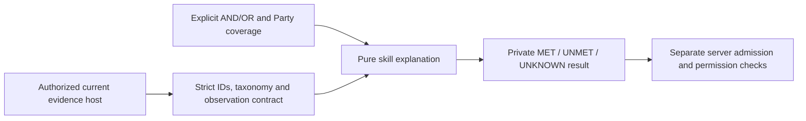

# Structured skill eligibility explanations

[T014](https://github.com/solana-hackathon-1/useRAID.fun/issues/56) · [Canonical skills](../RAID_AGENT_BLUEPRINT.md#085-admission-by-skill) · [Standalone host](../examples/skill-eligibility/README.md)

`src/skills/eligibility.ts` explains relevant skill fit using explicit AND/OR requirements and authorized host-supplied current evidence. The version v1 result is private and informational. A MET result describes only the selected skill predicates; a commit command must separately authorize and recheck current restrictions, consent, terms, Trust/reputation, resource access, funding, vacancy, orientation and canonical capacity. No Root admission API or UI consumes this slice yet. T012 assessment storage and T013 authorized evaluation remain dependencies.

R05/R06/R12/R15/R16/I07/I10/I13, descriptive E–S ordering and AC04/05/73–75 guide the contract. O09 numeric promotion and scoring remain OPEN. No token amount, ticker, paid placement, headline reputation or Guild Trust participates in rank evaluation.

The shared contracts own Participant IDs, E–S rank and unchanged accepted TermsSnapshot. Skills owns predicates, fact projections and explanations. No Prisma migration, table write, network call, URL fetch, audit/event, external effect, payment, assessment mutation or capacity reservation occurs. There are no credentials or environment variables.

Use `explainSkillEligibility(context, input)`. Both parameters are unknown at the boundary and strictly validated. Context contains v1, a UTC clock, the actual published taxonomy, and 1–50 authorized canonical participants. This count is a parser bound, not a production Party limit. Each participant supplies a complete current projection (`CURRENT`, observedAt, validUntil, skills), a `STALE` observation or `UNAVAILABLE`. The host declares validity under its approved policy; the module invents no freshness duration. Exact expiry is UNKNOWN, and a refreshed projection can recover without destroying history. Future taxonomy, observation or issuance is invalid; expiry cannot precede observation. Duplicate participants, duplicated human account mappings, duplicate current skill facts and foreign skill/domain facts fail closed. An AI participant uses its canonical identity; operator/capacity limits are separate.

Facts are either a free-text `CLAIM` or an `ASSESSMENT`. A claim carries skill ID/domain/claimedLevel, never an inferred assessed rank. An assessment carries current state, explicit assessedRank, immutable assessment and rubric references, assessmentPolicyVersion, evaluatorAccountId, issuedAt and nullable reassessmentAt. Shape validation proves no evaluator authority: resolve these from authorized current records, never request JSON or an untrusted model response. Hosts must resolve reassessment/revocation history and prevent selecting a higher historical fact over the current fact.

Input contains v1, coverage and a nullable requirement. A SKILL leaf specifies stable skillId, minimumRank, verificationRequired and exact assessmentPolicyVersion. AND/OR contain 1–16 children. The input parser enforces at most 8 node levels and 128 nodes before recursive schema parsing, rejecting cycles/shared object aliases; ordinary JSON trees do not contain aliases. Null explicitly declares no minimum skill prerequisite for starter work. Empty groups, unsupported rank/coverage, unknown skill ID, extra fields and free-text grouping are invalid. Higher rank qualifies only within the same stable skill. A retired category preserves its identity and prior assessment; retirement alone does not revoke it or rewrite old terms. New publication policy must separately disallow retired selections when appropriate.

Coverage is explicit:

- ONE_MEMBER evaluates the complete expression for each member and requires at least one to meet it. Separate specialists cannot satisfy a combined AND in this mode.
- DISTRIBUTED_PARTY lets different members cover individual leaves. AND/OR grouping still applies.
- EVERY_MEMBER requires each member to meet the complete expression.

A current VERIFIED assessment meets a leaf only when skill, policy, minimum rank and reassessment deadline match. Revoked or reassessment-required evidence does not qualify even for a weaker predicate. UNDER_REVIEW can be considered only when verificationRequired is explicitly false, and is always labeled UNVERIFIED_ASSESSMENT/UNVERIFIED_EVIDENCE. A free-text claim is UNMET when verification is required and UNKNOWN/CLAIM_NOT_RANKED otherwise; words such as “S” are never parsed as an ordinal. Pending rank facts require a host-authorized assessment candidate; this module neither creates nor approves it.

AND is UNMET if any child is UNMET, otherwise UNKNOWN if any is unknown, otherwise MET. OR is MET if any child is MET, otherwise UNKNOWN if any is unknown, otherwise UNMET. The same logic applies to ONE_MEMBER/EVERY_MEMBER coverage. Each explanation retains all alternatives and participant-specific reason codes; consumers can offer a relevant trial, refreshed observation or reassessment path without representing the result as permission.

Output includes v1, status, coverage, evaluatedAt, exact taxonomy reference, per-evaluation participant IDs and explanation tree. Leaf details expose stable skill/domain, predicate, per-member status/reason, evidence kind and qualifying/insufficient rank. Private claim text, proof links, assessment/rubric/evaluator records and issuance data are omitted. Participant-specific explanations remain private scoped data: authorize response readers, use private/no-store if transported, and do not send them to public projections/logs/analytics. Output is deeply frozen; inputs remain unchanged. `informational=true`, `isAuthorizationToken=false`, `verifiesSkill=false`, `createsPermissionGrant=false`, `consumesCapacity=false`, `persisted=false` explicitly bound its effects.

Errors are `SkillEligibilityContractError` with INVALID_INPUT or INVALID_HOST_CONTRACT; no raw private body is included. Evaluation is synchronous and deterministic, has no cancellation or receipt/retry identity, and produces no durable/external effect. On stale/unavailable evidence return UNKNOWN and refresh through the authorized host. On malformed input correct the declared predicate. On host failure stop the dependent action and repair its projection; never turn unknown into a positive admission decision. A pure module replacement has no in-flight provider operation to drain; preserve v1 shape/semantics and rerun behavior and consuming-host contracts. Real authorization/admission integration, UI accessibility, actual evaluator/provider authority, DB acceptance races, moderation/appeals, independent review, UAT and live gates remain NOT VERIFIED.

The independently installed [example](../examples/skill-eligibility/README.md) declares all dependencies and synthetic host facts. Automated tests cover descriptive rank order, wrong skill family, strict identity/policy/freshness/provenance, claims and weaker evidence, revoked/due states, nested grouping, all three-state truth tables and Party coverage, bounded/cyclic input, immutable output and omitted private evidence. CI uses the existing Vitest discovery and E04 inventory. No browser-visible change or owned server/container is introduced by this slice.
