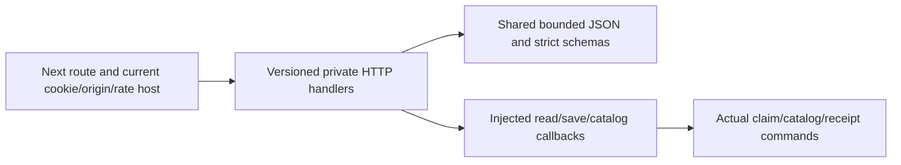

# Protected skill claim and catalog HTTP

T012C1 / M1, R04/R06/R12/R15/R16, I05/I06/I10/I13, blueprint§07/08/13/24–26/28–29/35 AC01 partial, AC04–05, AC73–75. [Private canonical claim storage](raid-skill-claim-storage.md) remains authority; [actual catalog storage](raid-skill-taxonomy-storage.md) supplies saved published records. This delivery adds protected reads and self-report writes, with no assessment/rank/grant/capacity/provider/money/public projection. Full T012/independent review/UAT/release remain NOT VERIFIED.

## Versioned private routes and DTOs

- `GET /api/v1/skill-claims/{skillId}` returns `{version:v1, skillId, claim:SavedSkillClaim|null, writesAvailable, unavailableReason}` for the current own canonical HUMAN.
- `POST` to that path accepts the strict storage input without `skillId`; the route supplies the authoritative stable skill ID. JSON contains actual `taxonomyId`, expected catalog/claim revisions, claimedLevel and supportingReferences. It requires Idempotency-Key; response is `{version:v1, status:EXECUTED|REPLAYED, claim, writesAvailable, unavailableReason}`.
- `GET /api/v1/skill-taxonomies/{id}` returns `{version:v1, taxonomyId, taxonomy:PublishedSkillTaxonomy|null}` under current own session. No catalog candidate is treated as published; no admin publication endpoint is included.

Internal IDs use the shared ASCII/length contract. Supported catalog/claim schemas, INTEGER revision limits, own identity, category availability, normalized bounded HTTPS references, immutability and receipts remain the storage contract. Claimant identity/skill ID/assessment/rank/admin/time/history fields in a POST body are rejected, rather than overriding route/server authority. A saved DTO must match the URL skill, exact requested catalog/reference revision, next claim revision and normalized level/ordered references. GET responses must match their requested resource. Host violations fail closed; no callback-returned success-shaped fallback is trusted.

All successes/errors set `Cache-Control: private, no-store` and `Vary: Cookie`. The root Next routes are force-dynamic. Public feed/index/cache/notification/HTML projections are absent. Saved DTOs contain no assessed rank/history; self-report S remains a claim and cannot qualify verified admission. Cookie/hash/private level/links/provider details never appear in public error messages or logs.

## Portable boundary and composition

Import `createSkillClaimHandlers`, `SkillClaimHttpError`, private DTO schemas and host types from `src/skills/http.ts`. Host supplies version v1, current actor, requestId, checkOrigin, rateLimit, own read/save and actual saved catalog callbacks. Returned actor must satisfy the existing strict cookie-derived `{accountId, sessionHash}` shape. Host callbacks are trusted server boundaries, not client assertions; they must enforce canonical ownership/current permissions through actual storage. The HTTP layer cannot independently attest a different host's cookies or database.

Domain transport imports only owned contracts/JSON/storage-error types, Zod and native Request/Response, never Next/global database/provider SDK. Runtime Node≥22.12, Zod4; canonical shared contracts/receipt/storage modules retain their explicit bs58 and PostgreSQL dependencies. [Independently installed PG/HTTP example](../examples/skill-claim-storage/README.md) declares every source/migration/driver dependency. Its deterministic actor/origin/rate fixture is synthetic; actual Root cookies/rate/origin are verified separately. No package/provider publication is implied.

Root `src/lib/skill-claims-http.ts` uses asynchronous Next cookies, existing requireUser/sessionCookie/hash, checkOrigin and actual database rateLimit (30 mutation requests per current account per 60 seconds). `src/lib/skill-claims-host.ts` owns real READ COMMITTED transactions/whole retries and calls the same storage commands. No parallel UI state machine or generic setRank action is added. Supported wallet/X own sessions may read/claim; canonical HUMAN must already exist, not be body-selected/provisioned by this endpoint. Missing mapping is unavailable. Suspended/revoked/expired/foreign session remains denied at current root/storage boundaries; root may return generic authentication failure for a session excluded by existing currentSession.

Catalog administrative publication was tightened in the same change to match existing root adminUser/requireUser(admin): actual current Session via=x is required in addition to locked ADMIN/xId/current scoped policy. Wallet-only admin publication/replay fails FORBIDDEN, while ordinary reads remain allowed. Earlier publications/history are retained; no new freshness/re-authentication duration or body role flag is adopted. Actual failing wallet-admin behavior and corrected X-session fixtures/consumers are retained.

## New-write configuration and recovery

`SKILL_CLAIMS_ENABLED=false` is the documented default. Only the exact string true enables applicable new self-report writes; the server command receives allowNewWrites. Current own reads and original successful replay survive disablement/category retirement. HTTP does not preempt replay by rejecting all requests when flag off. UI/public/assessment/provider/money enablement is absent. Do not enable real personal-data collection before actual privacy/retention/recovery operating readiness; synthetic preview sets its flag only in an isolated task fixture.

Mutations check approved origin, resolve current server actor and enforce rate limits before parsing the body/saving. Shared JSON reader enforces JSON media type, 16KiB byte/content-length bound, valid UTF-8/JSON and five-second stream deadline; this fits the claim's bounded reference/level fields. No URL fetch/import/redirect/preview occurs. Idempotency-Key is the existing shared internal identifier; normalized input/revisions go into the same receipt digest. Unknown successful saves retry the original key/body; stale revision requires reading current records and reviewing preserved input before choosing another intent. Never silently switch catalog/skill/assessment or issue a new unknown-success key.

Errors use shared versioned envelopes: auth401, forbidden/restricted403, unavailable canonical resource404, revision/key conflict409, invalid body/skill/history422, rate429 and unavailable/disabled/host/driver503. JSON reader failures retain their media/length/stream status (415/413/408). Request-ID callback errors/invalid IDs use safe random UUID fallback. Private unknown error details are discarded. Root/global deployment billing failures are not exposed as product claim/assessment facts.

## Verification, lifecycle and remaining work

[Task/evidence](tasks/2026-10-14-T012-skill-http.md) records genuine33 transport RED→GREEN and3 Root host RED→GREEN, plus wallet-admin authority RED; actual SQL/root API preview/independent consumer/source/timed SELF/check selection. The preview is a task-owned Next development server using synthetic real records and declared PostgreSQL; its reachable workspace-local URL/source/mode/results and access limitation are shown to the owner. Development preview and production build are separate checks. Owner-directed automatic shutdown stops only owned resources after success/failure/interruption, retaining source/logs/evidence. No public forwarding/VM rollback or unrelated service changes.

Reuse matching unchanged storage/full-suite evidence, reverify changed catalog admin session checks and affected HTTP/root boundaries, run mandatory applicable delivery gates and report skipped/unavailable CI truthfully. Author self-evaluation does not supply independent criterion review/UAT or release approval. Root owner-private form/discovery, admin interface, artifact evidence, assessment/rubric/evaluator/confidence/sample/reassessment/revocation and verified admission remain separate work. Existing parent issues stay open.
