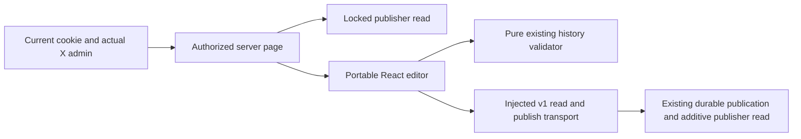

# Authorized skill catalog editor

T012D2, M1; blueprint§08.2/23/24.6–8/25.3/26/28–29, R06/R12/R15/R16, I05/I06/I10/I13 and AC40/69/70/73–75. Current allowed X administrators edit an actual selected catalog, preview normalized changes, then publish through the [protected API](raid-skill-taxonomy-http.md). Full T012, independent review, representative UAT and release acceptance remain NOT VERIFIED.

## Interface and host dependencies

`/admin/skills` loads actual configured `SKILL_TAXONOMY_ID`. A configured empty catalog starts without categories and can be bootstrapped from explicit entered data; absent/invalid configuration shows unavailable. Operations links to this editor. Current own live X-authorized session, unrestricted ADMIN role and actual `adminXIds()` membership are required; Studio-only privilege is insufficient. Before HTML/hydration, additive `readSkillTaxonomyForPublisher(tx,actor,id,{canPublish})` checks the existing locked account/session/scoped policy before and after reading. It creates no receipt/audit/version. Ordinary private wallet catalog reads retain their separate contract.

`GET /api/v1/admin/skill-taxonomies/{id}` returns strict v1 `{taxonomyId,publisherAccountId,taxonomy,writesAvailable,unavailableReason}`. Taxonomy is an actual immutable published DTO or null. `createSkillTaxonomyReadHandler` is additive, with explicit current `actor`, `read` and `requestId` callbacks; the original publication factory/POST remains compatible. Output binds URL/actual actor with consistent availability and no extra fields. Errors use the existing sanitized private/no-store/VaryCookie envelope. Root parses this same schema before rendering. Publisher ID is a data binding, never an authorization token.

Import `SkillTaxonomyForm` and `SkillTaxonomyTransport` from `src/components/skill-taxonomy-form.tsx`. Props are plain JSON `state:SkillTaxonomyEditorInput`, validated into canonical branded output, and optional injected `api`. `publish(id,input,key)` and `read(id)` return native Response; the default transport uses relative same-origin protected endpoints. The module owns no cookie, role, X credential, database, provider or global environment. React/ReactDOM19.3, Zod4, canonical contracts and shared bs58 are explicit dependencies. Host supplies existing orientation-card/fields/actions, button and visually-hidden styles or equivalent accessible styling.

## Draft and review

Stored IDs/domains and existing aliases are retained. Administrators edit names/statuses, add aliases or add explicit new ID/domain/name/aliases. Only unsaved new rows can be discarded. Canonical schemas normalize names/aliases and reject duplicate IDs/aliases, malformed data, removed historical identity, saturated persisted revision or payload over16KiB before publication. Illustrative categories are not seeded.

Review shows current/proposed names/statuses and complete identity/aliases. Existing `prepareSkillTaxonomyUpdate` supplies a prospective preview only; publishing is a separate action. Field changes clear prior review. An unchanged catalog has no publication to review. Exacttrue/defaultfalse `SKILL_TAXONOMY_PUBLICATION_ENABLED` remains authoritative inside SQL; disabled mode renders saved data and disables new edits/publication. No live flag is enabled.

Controls are disabled until hydration (stable React store server=false/client=true), during dispatch and while an intent is unconfirmed. A synchronous guard prevents double dispatch. Labels, fieldsets/legends, focused alerts and readable status support keyboard/mobile use with existing responsive styles; full WCAG conformance/UAT is not claimed. Saved data remains readable without JavaScript.

## Failure and recovery

First POST freezes one normalized reviewed body and random key. Lost response, malformed/mismatched success,5xx or idempotency-key conflict leaves publication unconfirmed. Validate catalog, publisher, next revision and complete ordered normalized categories before accepting success. Every later unsuccessful response—including authentication, rate or stale denial—retains an already unconfirmed intent. Retry uses the original key/body; editing/reloading cannot replace it. Keep the page open: pending intent is in memory, without browser storage or credential persistence. Original receipts may return an older immutable version after later publication, under current authority.

A known fresh409 REVISION_CHANGED requires reading current publisher state. Local draft fields are preserved; current stored aliases/categories are retained and newly published missing categories are appended. Colliding new draft identities must satisfy actual current history before review. Reload rejects wrong publisher/catalog, regressed/inconsistent revisions and invalid history. Failed read preserves the draft and stale block; valid read requires renewed review before a new command. No driver/private policy details are exposed.

No schema/migration, assessment/rank/rubric, grant, capacity, financial/provider or outbox change. Disable new publication while retaining acknowledged versions/receipts/audit on rollback; destructive history rollback is unsupported. Before/after immutable snapshots and actor/time/request provenance exist. A separate administrator change-reason field and broader bulk administration repair/dry-run contracts remain gaps. This local category validation preview does not imply full section29 or assessment acceptance. Observability uses safe request/error/duration/retry metadata, without logging catalog bodies/cookies/session hashes.

## Independent consumption and evidence

[Own-install React host](../examples/skill-taxonomy-form/README.md) declares all runtime/type/source dependencies and verifies empty/no-seed, saved identity, disabled writes, hydration-disabled SSR, invalid-host denial and no hidden dispatch. SSR/port use is distinct from actual Root desktop/mobile interaction. [Minimal PG/HTTP host](../examples/skill-taxonomy/README.md) also consumes additive publisher read/GET, actual locked current authority and policy revocation. Alternate deterministic HTTP hosts test private DTO/resource/actor/availability bindings. Synthetic fixtures supply no live authority or enablement.

Exact RED sources, failed/green checks, source identity, timed SELF-EVALUATED review, cleanup and required gates are in [the task record](tasks/2026-10-14-T012-taxonomy-editor.md). Both existing CI workflows execute enabled-editor and disabled-host modes before production artifacts without changing triggers/runners/timeouts. Actual hosted CI/image/rollout remains distinct; known GitHub billing failures supply neither source failure nor deployment success. Next: authorized assessment/trial contracts and the remaining administration/independent obligations.
