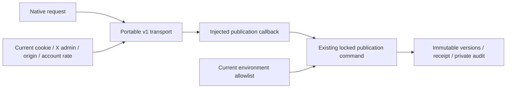

# Administrative skill catalog publication API

T012D1, M1; blueprint§08.2/24.6–8/25.3/26/28–29, R06/R12/R15/R16, I05/I06/I10/I11/I13, AC04–07/40/73–75. This API exposes the existing [durable publication command](raid-skill-taxonomy-storage.md) to current authorized Root administrators. The category editor is the next slice. Full T012, independent review, UAT and release acceptance remain NOT VERIFIED.

## Contract and ownership

`POST /api/v1/admin/skill-taxonomies/{id}` accepts an `Idempotency-Key` and strict JSON `{expectedRevision, skills}`. The URL supplies the actual catalog ID. Each category contains stable `id`, stable `domain`, editable `name`, `ACTIVE|RETIRED` status and globally unique normalized aliases. The server owns publishing account/time and revision. Client actor/admin/author/time/rank/flag fields are rejected.

Import `createSkillTaxonomyHandlers`, `SkillTaxonomyHttpError`, host types and v1 input/result schemas from `src/skills/taxonomy-http.ts`. Native Request/Response, Node≥22.12, Zod4 and the canonical contracts/receipt/body modules are required; shared contracts declare bs58. The portable module imports no Next, Prisma, driver, environment singleton or external provider.

Success is `{version:'v1', status:'EXECUTED'|'REPLAYED', taxonomy:PublishedSkillTaxonomy, writesAvailable, unavailableReason:null|'DISABLED'}`. Availability describes new publication. The transport parses strict host output and binds its catalog ID, next revision, publisher account and complete ordered normalized category snapshot to the command before returning it. A mismatched or extra-field acknowledgment fails closed with503; its result is unknown to the client and must be recovered with the original intent.

Input is bounded to **16KiB UTF8 bytes**, including JSON overhead, with a five-second streamed-body deadline, content-type/length validation, fatal invalid UTF8 and cancellation on completion/failure. This HTTP limit is deliberately narrower than the durable receipt's65,536 serialized-character limit and the schema's1,000-category maximum. Large catalogs must fit the HTTP bound; this API is not an unbounded import service. Expected revision0–2,147,483,646 matches the existing INTEGER-backed store. Duplicate IDs/aliases or invalid category shapes are rejected before SQL; historical ID/domain/alias preservation is enforced by SQL-backed preparation.

All handler success/error responses use `Cache-Control: private, no-store` and `Vary: Cookie`; Next adds its routing Vary tokens. The response contains an explicit catalog DTO, never raw ORM records, cookie/session hash or driver/policy errors. No proof URL is fetched. No public feed, outbox, notification, assessment, verified rank, permission, work capacity or money effect occurs.

## Explicit host dependencies and authority

The host injects `actor()`, `checkOrigin(request)`, `rateLimit(actor)`, `publish(command)` and `requestId()`. Actor means server-derived current account/session authority, never a request-body assertion. The publishing callback owns live READ COMMITTED transactions, whole retries, timeouts and current scoped policy. A deterministic replacement host is exercised by portable contract tests; it proves substitution only and supplies no live authorization or durability.

Root composition uses `requireUser(true)`, which requires current own live **via=x** session, unrestricted ADMIN role and connected X identity. It additionally requires actual `adminXIds()` membership, rejecting Studio-only synthetic privilege. Origin must equal the configured canonical APP_URL origin; the actual database account bucket allows30 publication requests per60 seconds, including retries. Origin, current actor and rate checks precede consuming command bytes. Missing/expired/revoked/suspended Root sessions currently return401 according to existing `requireUser`; role, wallet-only session or missing allowlist return403. A restriction discovered by the locked command returns403 ACCOUNT_RESTRICTED.

SQL independently rechecks actual locked role/restriction/own live X session and `canPublish:({xId})=>adminXIds().includes(xId)` after waits and before completion/original replay. The callback reads current environment policy every invocation; no cached `isAdmin` boolean or manufactured Studio permission is used. No new X freshness duration is chosen. Wallet sessions retain the existing ordinary private catalog GET; publisher privilege is separate.

`SKILL_TAXONOMY_PUBLICATION_ENABLED` accepts exact `true`, otherwise new publication defaults off. It is passed inside the SQL command, preserving currently authorized original receipt replay when off. It does not enable claim writes, populate a catalog, choose categories, or change another feature gate. No live flag is enabled by this delivery. `SKILL_TAXONOMY_ID` still selects an actual saved catalog for the existing Raider browse/form; this API's explicit URL may bootstrap a new catalog with expected revision0. Selecting a catalog for the Raider UI remains explicit host configuration.

## Recovery, errors and compatibility

Generate one key for a reviewed command. On lost response,503 or malformed acknowledgment, retain the **same key and normalized body**; retries return the original immutable publication even after later catalog edits or disabling new writes. Do not replace an unknown intent with a new key. Current authority is still required. Rate/permission/session denial does not prove an earlier commit failed.

A known409 REVISION_CHANGED requires reading the actual catalog at `/api/v1/skill-taxonomies/{id}`, preserving the draft, reconciling stable history and reviewing a new command. Same key/different body returns409 IDEMPOTENCY_KEY_REUSED after current authorization. Removing old category IDs/domains/aliases returns422 INVALID_COMMAND. Malformed input422, unsupported MIME415, oversized413, body deadline408, authentication401, forbidden/restricted403, rate429 and service/contract/write-disabled503 use the existing sanitized canonical error envelope and request ID. No private error details are returned.

Storage lock order, immutable versions, original receipts, private identifier-only audit, alias preservation and rollback rules are unchanged. No migration/schema/dependency change is required. Existing private catalog/claim routes retain their contracts. Rollback disables new publication or removes this additive route while retaining every acknowledged catalog/version/receipt/audit. Destructive history rollback is unsupported. Observability uses request/command ID, safe error code, duration and retry count; never log cookies, session hashes or entire catalogs.

The existing publication command retains before/after immutable snapshots, actor/time/request identity and private audit. It has no separate administrator change-reason field or bulk dry-run UI. Those broader administration contracts, assessment policy and criterion review remain unverified; this API does not claim full section29 acceptance.

## Independent example and verification

The [independent PG/HTTP host](../examples/skill-taxonomy/README.md) copies canonical source, installs its own locked dependencies and owns minimal User/Session schema, real receipts/catalog SQL, current local allowlist, READ COMMITTED driver/retries and pool shutdown. It tests actual publication, disabled new-intent rejection, original replay, policy revocation, protected errors, one version and no outbox. Its CLI synthetic actor has no untrusted caller; real servers must supply current cookie and account rate policy. No hidden Root singleton/Prisma/provider/X credential is required.

Portable tests retain genuine47RED→47GREEN; actual missing-route RED is separate. Root policy tests use real PostgreSQL for default-off rollback, current environment revocation, original replay after later publication/disablement and wallet-session denial. Actual Next tests use synthetic current cookies and real SQL for roles, session expiry/revoke, origin/rate, stale/history/digest conflicts, concurrent publication and private responses. CI runs the new API suite before production artifacts in both existing workflows without changing triggers, runners, deadlines or enablement. Evidence and SELF-EVALUATED findings: [task record](tasks/2026-10-14-T012-taxonomy-http.md). The API has no new browser-visible screen; admin-editor desktop/mobile verification belongs to the next slice.
