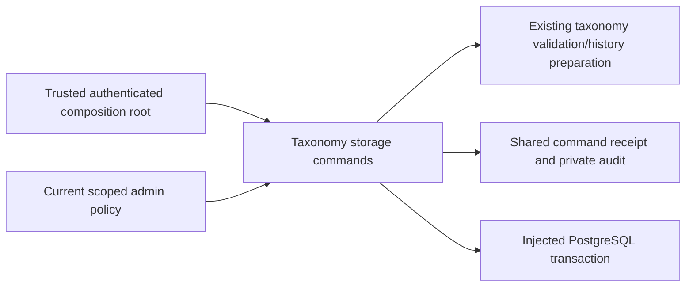

# Durable skill taxonomy publication

T012B1, M1; R06/R12/R15/R16, D07/D13, I05/I06/I10/I13; blueprint§08.2/24.6–24.8/25.3/28/29/35 AC04–05, AC73–75. This module saves real authorized catalog versions. It builds on [claim preparation](raid-skill-claims.md); it creates no assessment, verified rank, claim, participant, grant, public projection, work capacity or financial obligation. Full T012 and independent review/UAT/release remain NOT VERIFIED.

## Public contract and ownership

Import `publishSkillTaxonomy`, `readPublishedSkillTaxonomy`, `SkillTaxonomyStorageError` and actor/options types from `src/skills/taxonomy-storage.ts`. Publication accepts `{actor, input, idempotencyKey, requestId}`. `input` is the existing strict taxonomy update with `taxonomyId`, `expectedRevision`, categories, stable domains and globally unique normalized aliases. The storage revision limit is 0–2,147,483,646 before increment because the existing audit and projection use PostgreSQL INTEGER; pure preparation retains its wider limit. Shared receipt canonical requests are limited to 65,536 serialized characters, also applying to large catalogs.

Result is `{status: EXECUTED | REPLAYED, taxonomy: PublishedSkillTaxonomy}`. The immutable saved DTO contains version `v1`, catalog ID/revision, `PUBLISHED`, actual publishing account/time and category snapshots. Date precision is milliseconds, truncated from database clock. Every version has its own UUID internal storage ID. Current reads return the saved DTO or null; they do not publish public data. A current read may return the immutable version selected immediately before another publication.

The owned current `SkillTaxonomy` pointer references `(version UUID, catalog ID, revision)` in `SkillTaxonomyVersion`. Version IDs, catalog identity, historical JSON, author/time/request/receipt and domain/alias identities are retained. Renaming, adding categories/aliases and retirement are allowed; removing old IDs/domains/aliases or reassigning aliases is rejected. No assessment history is overwritten; assessments and private canonical claim/evidence storage are future separate commands. The host selects its actual canonical catalog ID; the example ID/categories are synthetic, never a seeded policy.

## Dependencies and authority

Runtime Node≥22.12, Zod4 and the canonical shared contracts/receipt module; shared asset contracts also declare bs58. No Next, Prisma, global database, environment lookup, external fetch or provider SDK is imported by the module. Host supplies a live READ COMMITTED interactive transaction, its own account/session tables, current cookie-derived `{accountId, sessionHash}`, synchronous scoped `canPublish` policy, `allowNewWrites` boolean, transaction deadlines and whole-transaction retry classification. Never obtain these actor/options facts from an untrusted body. A callback must be local, bounded and synchronous; no network/LLM/signature/finality waits under locks.

Publication requires actual locked User `role='ADMIN'`, `suspended=false`, nonempty current xId, current own live X-authorized session, plus `canPublish({accountId,xId}) === true`. The host policy narrows permission to catalog management. For the existing root production allowlist, use `canPublish: ({xId}) => adminXIds().includes(xId)` with server-owned `src/lib/admins.ts`; role, restriction and session checks remain in the command. Evaluate the current allowlist every time the callback runs. Do not reuse a pre-request `isAdmin` boolean or manufacture Studio privileges. The storage module owns no Root singleton or automatic publication. The additive [Root HTTP adapter](raid-skill-taxonomy-http.md) supplies current request authorization and default-off publication configuration; no live feature enablement is implied.

| Actor/current state                                           | Private current catalog read  | Publish / original publication replay |
| ------------------------------------------------------------- | ----------------------------- | ------------------------------------- |
| Current unrestricted own account/session                      | Allowed                       | Only current scoped catalog admin     |
| Role-only admin, removed xId/allowlist, ordinary/Guild holder | Allowed with own live session | Forbidden                             |
| Suspended account                                             | Restricted                    | Restricted                            |
| Foreign, expired, revoked, unsupported session                | Authentication required       | Authentication required               |
| Client asserted admin/author/time/rank fields                 | Rejected input                | Rejected input                        |

Publication also requires the actual current Session via=x, matching root adminUser/requireUser(admin) in src/lib/auth.ts; wallet sessions can read but cannot publish/replay administrative commands. This corrects the earlier broader publication session contract, preserves prior versions and does not invent a new freshness threshold. Read authorization is separate from publication. Retiring categories affects new use, not existing snapshots. `allowNewWrites=false` denies new publications while preserving current reads and currently authorized original-result replay. Removing publication authority also denies publication replay; it does not delete history.

## Atomicity, retries and privacy

Lock order: command receipt → User FOR NO KEY UPDATE → Session FOR SHARE → catalog advisory lock → current catalog FOR UPDATE. The namespaced catalog advisory lock serializes bootstrap even when no projection exists; hash collisions only serialize unrelated catalogs. Current role/session/DB-clock/scoped policy are rechecked after waits and before completion. User/session revocations that commit before their locks are observed; changes arriving after must wait until commit. The host must commit promptly and must not add slow effects after authorization.

Two publications at the same expected revision have one winner and one `REVISION_CHANGED`; same command identity returns its original immutable result. Receipt digest covers normalized input; later catalog updates or disabled writes do not change original successful replay. Same key/different body throws shared `IDEMPOTENCY_KEY_REUSED` only after current publication authorization. A rejected attempt rolls back its version, pointer, receipt and audit. The transaction host retries the whole callback with the same identity on deadlock/serialization failures; never retry only an insert. Unknown commit success is recovered by the same original key/body.

Private audit `skill.taxonomy_published.v1` contains only `skillTaxonomyVersionId`, catalog/revision/actor/request metadata. No outbox, notification, telemetry body, evidence URL, public feed or hydration is written. The additive audit namespace permits skill events while preserving prior families. Database constraints/triggers enforce catalog shape/unique aliases, contiguous history/stable identities, immutable versions, next-version pointer, finalized matching admin receipt/audit/projection and no publication outbox. Current environment policy and cookies remain the trusted command/host boundary, not a database constraint; privileged direct SQL is not an alternate authorization API.

## Installation and independent consumer

[Independent PostgreSQL host](../examples/skill-taxonomy/README.md) owns its dependency installation, minimal account/session schema, real receipts/catalog SQL and local driver adapter. It proves actual publication, private read, original replay, current policy revocation and consumption of an actual saved catalog by an unverified claim preparer. It declares every dependency, including the synthetic participant fact used only by pure preparation; it does not claim canonical participant or claim persistence exists in its minimal schema.

PostgreSQL16 and migration `202610140001_skill_taxonomy` are required. Apply existing migrations first; never rewrite their files. No live data backfill/default taxonomy/admin exists. Old application instances do not consume the new tables. Once acknowledged versions/receipts exist, dropping tables, deleting old categories, changing immutable records or rolling back to destructive schema is unsupported. Disable new writes and retain history; a reviewed retention/recovery procedure owns any repair. Database backup/restore and independently reviewed live rollout remain unverified.

## Errors, operations and substitution

Storage errors: INVALID_INPUT, AUTHENTICATION_REQUIRED, ACCOUNT_RESTRICTED, FORBIDDEN, WRITES_DISABLED, STORAGE_CONTRACT, STORAGE_UNAVAILABLE. Existing preparation also yields REVISION_CHANGED/HISTORY_CONFLICT; receipt host yields IDEMPOTENCY_KEY_REUSED/RETRY_TRANSACTION and sanitized storage errors. Policy exceptions and unknown driver errors expose no private details. An invalid async/nonboolean authorization result fails closed. The host maps errors to protected HTTP semantics and adds origin/CSRF/rate limiting before exposing a route; the [Root HTTP adapter](raid-skill-taxonomy-http.md) exposes the command separately without changing this storage contract.

Signals should be command/request ID, category/error code, duration and retry count; never log cookies/session hash, full catalogs or credential-bearing provider content. Connection/isolation mismatch and cleanup failure block successful verification. Maintain bounded transaction/pool ownership and close the independent CLI pool in finally. Substitution preserves current authority, actual SQL guards/locks, original receipts/version references and retained catalog identity. A new driver/ORM can implement the port; an alternate datastore needs real equivalent durability/concurrency evidence before use.

Owner/maintainer boundary: AG03 domain/storage with AG05 assessment policy and future AG02 UI. Author checks are SELF-EVALUATED; independent criterion review has not occurred. [Task/evidence record](tasks/2026-10-14-T012-taxonomy-storage.md) retains genuine RED, integration failures, GREEN/regression, consumer, source hashes and cleanup. The existing [private canonical HUMAN claim store](raid-skill-claim-storage.md) now consumes these actual publications, and [private browse/form](raid-skill-claim-form.md) retains the separation from assessment. The [authorized category editor](raid-skill-taxonomy-editor.md) now consumes current publisher reads and publication; assessment and broader administration acceptance remain separate. Evaluator/rubric/confidence/sample/reassessment/revocation and verified admission remain unimplemented.
