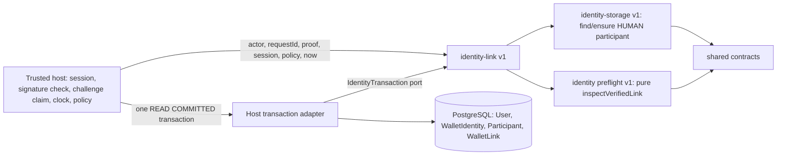

# Wallet links v1 (additional verified wallets on one participant)

[Blueprint identity](../RAID_AGENT_BLUEPRINT.md#07-identity-and-onboarding) · [One active Raid](../RAID_AGENT_BLUEPRINT.md#13-one-active-raid) · [Wallet rotation / payout](../RAID_AGENT_BLUEPRINT.md#1613-wallet-rotation-and-payout-recovery) · [Module reuse](raid-module-reuse.md) · [Plan](tasks/T006-wallet-link-plan.md) · [Independent plan review (WR01-WR14)](tasks/T006-wallet-link-plan-review.md) · [Identity storage](raid-identity-storage.md) · [Identity preflight](raid-identity-preflight.md)

**Status: IMPLEMENTED_UNVERIFIED, disposable-database tested only (PR-A of two). Full T006 and all 27 completion criteria remain NOT VERIFIED. AC01 / T006-A01 are PARTIAL: the identity half (same canonical participant, history and payout rows unchanged after a second wallet is linked) is evidenced on real PostgreSQL; the capacity half has no table to assert against (gap G1) and T006-A02 stays NOT VERIFIED.** The independent non-author [PR-A implementation review](tasks/T006-wallet-links-review.md) accepted the slice with conditions LR01–LR07 at `1b4a495`. A separate [follow-up review](tasks/T006-wallet-links-followup-independent-review.md) verified LR01/LR02/LR03/LR07; LR04/LR05/LR06 remain binding. Nothing is deployed, migrated on a live database or backfilled. The user-visible outcome of AC01 (a second wallet signs in to the same account) is **not delivered by this change**: sign-in resolution, the route and the `wallet_links_enabled` flag are PR-B (WR13).

## Purpose and non-goals

Lets one canonical account hold additional VERIFIED wallet credentials, keyed to its immutable HUMAN `Participant`, without touching the legacy `WalletIdentity` row. That row remains the single payout/funding-bound "primary" wallet (blueprint 16.13). A link is login/identity evidence only: it grants no Guild role, private access, skill, work slot, payout change or reward change. Wallet address is a credential, never a person ID.

Owned requirements: R04, R13 (identity half only), R15, R16; I01, I05, I06, I07, I10, I11, I13; D01, D13; AC01 (partial). Blueprint sections 07, 13, 16.13, 24.6-24.7, 25.2, 26, 28, 32, 35.1.

Non-goals (not delivered here): sign-in through a linked wallet, HTTP routes, `link-additional` challenge purpose in `wallet-auth.ts`, feature flag, UI, revoke/unlink command, account recovery or merge approval (O11, W03), promotion of a link to payout wallet, provider (X) links, capacity or engagement tables, command receipts (T019), nonce/domain/network hardening (T007), backfill, login auto-provisioning.

## Dependency and host contract



- Public entry point: `src/identity-link/index.ts`. Copy `src/identity-link`, `src/identity-storage`, `src/identity` and `src/contracts` as sibling directories. Dependencies: Zod and bs58 through the shared contracts. No Next.js, Prisma SDK, environment variable, global client, system clock or credential import (enforced by `tests/identity-link-boundary.test.ts`).
- The host supplies an `IdentityTransaction` port (`{ dialect: 'POSTGRESQL', isolation: 'READ_COMMITTED', query(sql, bindings) }`). The module owns its parameterized SQL; the host owns connection, transaction, retry, authentication, signature verification, the atomic challenge claim, the clock and the policy.
- Host database contract: tables `User` (text `id`, boolean `suspended`), `WalletIdentity` (`address`, unique `userId`), `Participant` and `WalletLink` from `prisma/migrations/202610080001_participant_mapping` and `prisma/migrations/202610090003_wallet_links`.
- Reference Prisma adapter: `src/lib/identity-storage-adapter.ts` (shared with identity-storage). This change adds SQLSTATE `23505` / Prisma `P2002` classification to `UNIQUE_CONFLICT` there, additively; existing classifications and tests are unchanged.
- Reference proof adapter: `src/lib/wallet-link-proof.ts` (`deriveWalletLinkProof`), the thin seam T007 can later replace (WR11). It parses `domain`, `uri`, `issuedAt` and the Chain ID strictly from the exact stored message, takes `expiresAt` from the column, requires the digest to be the SHA-256 of that message, requires the `LINK_ADDITIONAL_STATEMENT`, and never defaults any field. Anything missing or non-matching is `PROOF_INVALID`. `SIWS_CHAIN_ID` (`mainnet`) is the one shared constant the generator signs.
- Verified actor authority stays with the host. The module only checks `actorAccountId === accountId` (`WRONG_ACTOR`); equality of two strings cannot authenticate an HTTP assertion.
- Proof contract: the host claims the stored challenge with its atomic `updateMany` in the same transaction, verifies the signature, then passes a `LinkProofObservation` describing the row as it was when claimed (`consumed: false`). A thrown error must roll the whole transaction back, including the claim.

## Public interface

| Export                                                       | Behavior                                                                                                                                                                                                                                                                                                                                            |
| ------------------------------------------------------------ | --------------------------------------------------------------------------------------------------------------------------------------------------------------------------------------------------------------------------------------------------------------------------------------------------------------------------------------------------- |
| `linkVerifiedWallet(tx, input)`                              | Validates input (`INVALID_INPUT`, `WRONG_ACTOR`) and the port (`STORAGE_CONTRACT`) before any SQL, then runs the lock order below. Returns `{ outcome: 'LINKED' \| 'ALREADY_LINKED', source: 'LINK' \| 'PRIMARY', linkId, participantId, networkIdentity, address, status }`.                                                                       |
| `listWalletLinks(tx, accountId)`                             | The caller's own link rows, oldest first, with UTC ISO timestamps.                                                                                                                                                                                                                                                                                  |
| `publicWalletLink(result)`                                   | Safe shape `{ address, networkIdentity, status, alreadyLinked }` with no account, participant or link identifier.                                                                                                                                                                                                                                   |
| `IdentityLinkError` / `IdentityLinkCode`                     | `INVALID_INPUT`, `WRONG_ACTOR`, `ACCOUNT_NOT_FOUND`, `AUTHENTICATION_REQUIRED`, `FORBIDDEN`, `ACCOUNT_RESTRICTED`, `PROOF_INVALID`, `UNSUPPORTED_IDENTITY`, `IDENTITY_CONFLICT`, `IDENTITY_REVOKED`, `PRIMARY_WALLET_REQUIRED`, `LINK_LIMIT_REACHED`, `STORAGE_CONTRACT`, `RETRY_TRANSACTION`, `STORAGE_UNAVAILABLE`. The message is the code only. |
| `LinkWalletInput`, `WalletLinkLimits`, `IdentityTransaction` | Types. `limits` is injected (`maxActiveLinks`, `maxTotalLinks`; EXAMPLE 5 and 20 are not recorded decisions).                                                                                                                                                                                                                                       |

Behavior in order (after the locks and reads):

1. The pure `inspectVerifiedLink` preflight runs first: session, actor, restriction (`User.suspended`), proof binding (intent, account, subject, domain, URI, freshness, not consumed), supported network, ownership. A suspended account, a bad session or a bad proof is therefore never answered with `ALREADY_LINKED` (WR08).
2. Address owned by another account (primary or link, active or revoked) -> `IDENTITY_CONFLICT` with one external shape; own revoked link -> `IDENTITY_REVOKED`. No merge is ever attempted.
3. Address is the account's own primary or own active link -> idempotent `ALREADY_LINKED`; **nothing is created**, including no participant mapping.
4. Account has no primary wallet -> `PRIMARY_WALLET_REQUIRED` (WR05; the first wallet remains the legacy flow).
5. Caps: `LINK_LIMIT_REACHED` when active links reach `maxActiveLinks` or total rows (active plus revoked) reach `maxTotalLinks`.
6. Participant: reuse the existing mapping, otherwise `ensureHumanParticipant` inside this transaction (first actor and request are never overwritten; a later failure rolls the mapping back).
7. `INSERT ... ON CONFLICT DO NOTHING RETURNING`. An empty result is resolved by reading the colliding rows: same account, address, network and proof -> idempotent `ALREADY_LINKED`; anything else -> `IDENTITY_CONFLICT` (WR01). No error is ever caught and continued inside the transaction.

## Entity and state ownership

| Record                                                                                 | Owner                          | Rules                                                                                                                                                                                                                                                                                                  |
| -------------------------------------------------------------------------------------- | ------------------------------ | ------------------------------------------------------------------------------------------------------------------------------------------------------------------------------------------------------------------------------------------------------------------------------------------------------ |
| `WalletIdentity`                                                                       | Legacy application (unchanged) | Single payout/funding-bound primary wallet. Moved only by the existing rotation flow. Gains only the exclusivity trigger below; no row is changed by this slice.                                                                                                                                       |
| `WalletLink`                                                                           | This module                    | Additional credentials. `address` unique alone (network-less, like the legacy table); `proofRef` unique; `participantId`+`accountId` composite FK to `Participant(id, accountId)` so a link can only name its own account's participant; `linkActorAccountId = accountId`; provenance `linkRequestId`. |
| Trigger `wallet_link_guard_v1`                                                         | Database                       | Links are never deleted. The only allowed change is `ACTIVE` to `REVOKED` with `revokedAt`; every other column stays identical; no-op updates are allowed; reactivation is impossible (recovery is OPEN O11). SQLSTATE `23000`.                                                                        |
| Triggers `wallet_link_subject_exclusive_v1` and `wallet_identity_subject_exclusive_v1` | Database                       | Both take the same advisory key the module takes and then check the other table, raising SQLSTATE `23505` with constraint name `raid_wallet_subject_exclusive_v1`. The `WalletIdentity` trigger fires on `INSERT` and `UPDATE OF address` only, so the legacy merge (`userId` re-point) is unaffected. |
| `Participant`                                                                          | identity-storage               | Unchanged. Gains a unique index `Participant_id_accountId_key` as the composite-FK anchor.                                                                                                                                                                                                             |

The proof reference column is defence in depth only. The effective replay barrier is the atomic consumption of the wallet challenge in the same transaction (WR14); the worker prunes consumed challenges.

Derived, not stored: the identity revision (`1 + link rows + revoked rows`, monotone because rows are never deleted) is internal and tautological for the preflight; it is not exposed and does not move on primary rotation or X linking. `activeEngagementId` is `null` until an engagement store exists (gap G1).

Reservation asymmetry (WR14): a REVOKED link reserves its address forever, but a primary rotated away releases its address (rotation deletes the legacy row) and `User` cascade deletion of an unmapped account releases its primary. This is legacy behavior. Do not claim "a verified wallet is never reassigned".

## Lock order and concurrency contract

Module contract (WR12). Any writer that touches a wallet subject or its account must follow it or take a prefix of it:

1. Transaction-scoped advisory lock on `wallet-subject:<address>` (the database triggers take the same key, re-entrantly).
2. The account's `User` row `FOR NO KEY UPDATE` (serializes concurrent links and legacy `UPDATE "User"` merges for this account while still allowing foreign-key `KEY SHARE` checks).
3. Participant mapping read, or insert for the first link.
4. `WalletLink` insert.

No two-account locks are taken. Legacy writers were read: `rotateWallet` takes the `balance:` advisory lock and reaches the subject key only through its trigger; wallet sign-in reaches the subject key through its trigger before the foreign-key `KEY SHARE`; `absorbAccount` and X sign-in take `x-auth:` and `User` row locks and never the subject key. No cycle was found by reading them, and the named race tests below exercise each pairing with real `pg_blocking_pids` evidence. This is not a proof over all interleavings: a PostgreSQL `40P01` is handled by whole-callback retry, and a new `40P01` in the named tests would be a defect to fix, not a pass.

Named races (all in `tests/identity-link-db.test.ts`, each prints a `walletLinkRace` JSON line with waiter PID, blocker PID and the blocked statement): link vs link on two accounts for one address; link vs link on one account; link vs legacy sign-in insert (both orders); link vs rotate (both orders); link vs merge as drop (link first and merge first) and as keep; link vs a plain `User` row update.

## Permissions and trust boundary

Linking authorizes nothing but the credential relationship. The host decides who may call `linkVerifiedWallet`: only an authenticated, unsuspended account acting for itself, after a fresh proof for the new wallet. Never forward client-supplied actor, account or ownership values. Treat `accountId`, participant ids and link ids as internal authorized context: not in public responses, logs or search without review. Conflict responses must not reveal the owner. A database owner can still alter the schema or triggers; row fences do not contain that.

**WR04 decision accepted by the owner on 9 October 2026:** confirmation through a connected X account, following the connected-X condition in `rotateWallet` ([DEC-2026-10-09-01](../RAID_AGENT_BLUEPRINT.md#026-accepted-owner-change--9-october-2026)). PR-B must check that connection for the authenticated account at the server command boundary, deny wallet-only sessions and still require fresh proof from the additional wallet. This choice is recorded before PR-B RED; PR-A does not implement the host confirmation. Likewise a revoke/unlink command or audited operator revoke procedure must exist before the flag is enabled anywhere except tests. PR-A adds no route, flag or sign-in change, so nothing here can be enabled.

## Configuration names

No secret is read by the module. The example host and tests use: `DATABASE_URL` (explicit local synthetic URL; the example accepts only localhost databases `useraid_wallet_links_host_test` or `useraid_test` and refuses `NODE_ENV=production`), `NODE_ENV` (must not be `production` for the example), and for repository tests `RUN_DB_TESTS=true` and `DEMO_MODE=false`. The planned feature flag `wallet_links_enabled` does not exist yet (PR-B).

## Transaction, retry and sanitized errors

Run every command inside one interactive transaction at READ COMMITTED; the adapter checks the actual isolation once per transaction and the module rejects other levels with `STORAGE_CONTRACT`. The lock and the exclusivity triggers rely on a per-statement snapshot taken after the advisory lock. On `RETRY_TRANSACTION` (SQLSTATE `40001`/`40P01`, Prisma `P2034`, or `P2010` wrapping them) retry the **entire** business transaction (challenge claim included) with the same `requestId` and proof, bounded. Never catch an error inside the transaction and commit.

Classification is by SQLSTATE and pre-checked ownership, never by constraint name or message (WR01): Prisma's raw error carries no constraint name, its message can contain the conflicting address, and after any failure the same transaction answers `25P02`. The adapter maps `23505`/`P2002` to `UNIQUE_CONFLICT`, which the module reports as `IDENTITY_CONFLICT`. Errors carry the code only: no address, proof, owner, constraint or driver text, so `failure()` in `src/lib/http.ts` (which logs `error.message`) logs only a code. Suggested HTTP mapping for PR-B: `PROOF_INVALID`/`AUTHENTICATION_REQUIRED` 401, `FORBIDDEN`/`ACCOUNT_RESTRICTED` 403, `IDENTITY_CONFLICT`/`IDENTITY_REVOKED`/`PRIMARY_WALLET_REQUIRED`/`LINK_LIMIT_REACHED` 409, `UNSUPPORTED_IDENTITY`/`INVALID_INPUT` 422/400, `RETRY_TRANSACTION`/`STORAGE_UNAVAILABLE` 503.

Command receipts (T019, AC69): a receipt replay must return the stored result **before** re-running challenge consumption or signature verification, otherwise a lost-response retry hits "challenge already used". Until T019 lands, a retry after a lost response sees the consumed-challenge error although the link exists; the list endpoint reveals it. AC69 is unverified for this command.

## Legacy readers and writers

Corrected inventory (WR03, replaces the plan's "six readers"). `WalletIdentity` is read or written at 24 call sites in 16 files outside `src/lib/wallet-auth.ts`: pages `creator/raids/[id]`, `creator/balance`, `creator/new`, `creator/account`, `raids/[id]`, `launch`, `tokens/[mint]`; route `api/launch/[id]/enroll`; `usdc.ts` (2), `raid-funding.ts` (1), `studio-campaigns.ts` (2), `tracking.ts` (1), `pump-launch.ts` (5), `x-oauth.ts` (1), `account-merge.ts` (3). Writers: `wallet-auth.ts` (3 creates, 1 delete), `studio-sandbox.ts` `walletIdentity.upsert` (a writer the plan omitted; sandbox only, and it would fail closed on a linked address), `account-merge.ts` `updateMany({ userId })`. **None reads or writes `WalletLink`**, so a link cannot subvert any payout, funding, enrollment or withdrawal path; an unchanged primary row is what keeps all of them correct.

Accepted consequence (WR06): the first successful link creates the account's `Participant` mapping, which permanently stops the legacy helpers from folding or deleting that account (`isEmptyAccount` refuses mapped accounts, and the foreign keys reject the final delete). Rejection behavior is unchanged and covered by tests (real wallet sign-in fold path, `absorbAccount`, frozen legacy merge). The user-facing messages of those paths still say "has its own account with activity" for an account that only has a link; correcting that copy changes legacy files and is deferred to PR-B. Reviewed merge/recovery (O11, W03) is a follow-up task that must exist before the flag is enabled.

Legacy characterization (frozen helper `tests/helpers/legacy-wallet-auth.ts`, an old binary that knows nothing about links): sign-in, link and rotate onto a linked or revoked address fail closed at the trigger as Prisma `P2002` (HTTP 409 "Already exists." through `failure()`), with the whole transaction rolled back and no orphan `User`, session or changed primary. Typed handling of those cases (WR07 a-c) is PR-B.

## Substitution and versioning

Any adapter implementing `IdentityTransaction` for PostgreSQL at READ COMMITTED can replace the Prisma adapter; `host.ts` and the unit tests demonstrate deterministic alternate ports. A different dialect or weaker isolation is rejected, not emulated. The proof adapter is replaceable without touching storage. Version `v1`: additive changes only; a changed table shape, error code or SQL semantics needs a new version, a reviewed forward migration and updated consumers and tests together. Provider links (X) can later be re-pointed to a generalized store by a reviewed migration; naming keeps the blueprint `wallet_links` intent.

## Observability

No metrics or logs are emitted. Hosts should count the error codes and retry rate and alert on `STORAGE_CONTRACT` and sustained `STORAGE_UNAVAILABLE`. Audit: `SELECT "accountId", "address", "status", "linkRequestId", "verifiedAt" FROM "WalletLink"`. There are no receipts or outbox events; provenance is a creation audit only. Do not log addresses with account ids.

## Failure and recovery runbook

| Situation                                | Action                                                                                                                                 |
| ---------------------------------------- | -------------------------------------------------------------------------------------------------------------------------------------- |
| `RETRY_TRANSACTION`                      | Retry the whole transaction, bounded; same request id and proof.                                                                       |
| `IDENTITY_CONFLICT` / `IDENTITY_REVOKED` | Address belongs to an account (possibly revoked). No automatic merge; recovery is the unreviewed O11 process.                          |
| `ACCOUNT_RESTRICTED`                     | Suspended; claim and case access are unaffected by this module.                                                                        |
| `STORAGE_CONTRACT`                       | Wrong isolation, malformed or duplicate rows; stop and investigate.                                                                    |
| SQLSTATE `23000` from the guard          | A write tried to delete or alter a link; use the reviewed recovery process (not defined).                                              |
| Application rollback after links exist   | Keep the table, foreign keys and all three triggers. Dropping them reopens address reuse by another account and strands those wallets. |
| Database restore                         | Link rows ride the restore; reconcile consumed challenges and sessions afterward (AC68 not verified here).                             |

Retention and deletion of link provenance is OPEN (O11).

## Rollout and rollback

Migration `202610090003_wallet_links` is additive (no backfill; unlinked accounts behave exactly as before). The later PR-B order is mandatory: (1) apply the migration, (2) deploy sign-in resolution through links to **every** instance, (3) only then enable `wallet_links_enabled`; an old instance cannot sign in with a linked wallet (it fails closed). The flag must gate the server command, not only the UI, and stays off in staging and production until a revoke path, T007 AC02 evidence and the rollout order are satisfied (WR04, WR07 d). The prefix already sorts after T019/T029; no renumbering is required. Resolve schema/CI-matrix conflicts and rerun a fresh combined migration bootstrap at merge (LR06). T003 environment audit, backup/restore rehearsal and a named custodian are still required before any non-disposable target.

## Limitations

- Disposable-database evidence only; independent technical reviews and their conditions are recorded above; no live rollout, no exact-head CI claim, no browser or accessibility check, no UAT.
- AC01 capacity half (G1), T006-A02, AC68/G10 durability, AC69 receipts, WR04 connected-X enforcement and revoke, WR06 copy, WR07 typed handling and the sign-in/route/flag wiring are not delivered.
- Uniqueness on `address` alone is stricter than the blueprint `(network, address)` tuple (conservative DEFAULT); relaxing it later is a migration.
- The caps are injected EXAMPLE values, not recorded decisions. The x-oauth fold path shares `isEmptyAccount`/`absorbAccount` and is covered through those helpers, not end to end.
- The command is database-only: no GitHub, Solana, model or notification effect is involved.

## Run the standalone consuming host

The example has its own `package.json`, minimal `User`/`WalletIdentity`/`Participant`/`WalletLink` schema and four migrations (two host-owned tables, plus symlinks to the exact canonical participant-mapping and wallet-link SQL). It never loads RAID configuration or `src/lib/db`. Copy to a fresh directory, dereferencing the symlinks, install, migrate against an explicit disposable database and run:

```sh
raid_links_source="$(pwd)"
raid_links_host="$(mktemp -d)"
cp -RL "$raid_links_source/examples/wallet-links/." "$raid_links_host/"
cd "$raid_links_host"
npm install --ignore-scripts --no-audit --no-fund
export NODE_ENV=test
export DATABASE_URL='<explicit local synthetic URL for useraid_wallet_links_host_test>'
npx prisma generate
npx prisma migrate deploy
npm start
```

Expected output is one JSON line with `synthetic`, `realDatabase`, `sameParticipant`, `primaryUnchanged`, `idempotentReplay`, `foreignAddressConflict`, `primaryRequired`, `wrongActorDenied`, `proofDerived`, `alternatePort` and `sanitizedFailure` all `true`.

Repository tests (they truncate the target; point them only at an explicitly disposable database):

```sh
RUN_DB_TESTS=true NODE_ENV=test DEMO_MODE=false DATABASE_URL='<synthetic test URL>' \
  npm test -- tests/identity-link.test.ts tests/wallet-link-proof.test.ts tests/identity-link-db.test.ts tests/identity-link-migration.test.ts tests/identity-link-boundary.test.ts
```

Migration check: `npx prisma migrate deploy` (a second run reports no pending migrations) and `npx prisma migrate diff --from-url "$DATABASE_URL" --to-schema-datamodel prisma/schema.prisma --exit-code` (exit 0; this needs the `map: "WalletLink_participant_fkey"` on the composite relation, WR02).

## PR-B1 credential resolution contract

`lookupWalletLink(tx, address)` is an internal read-only reservation lookup using the same explicit READ COMMITTED `IdentityTransaction` port. It returns null when no additional link reserves the address, or `{accountId, networkIdentity, status, accountSuspended}`. It does not verify a signature, create a link, create a session or authorize access; the trusted proof/session host applies those decisions. Never expose this internal DTO from an unauthenticated HTTP endpoint.

Lock order: transaction-scoped wallet-subject advisory lock, discover immutable owner, account row FOR NO KEY UPDATE, then WalletLink row FOR SHARE; retain locks until the consuming transaction commits or rolls back. No participant/financial row is modified. Concurrent revocation is observed honestly or waits until the lookup transaction completes. Unknown/malformed rows fail closed through sanitized IdentityLinkError. A future revoke host must use the same lock order, never link row before account.

The RAID wallet-auth host calls lookup only after verifying and atomically claiming the fresh stored challenge. ACTIVE same-network additional credentials resolve to the existing account without creating a User/Participant/WalletIdentity. REVOKED or wrong-network credentials cannot fall through to a new account. Suspended owners cannot receive a session. A foreign signed-in account cannot fold a linked credential. A valid same-account authenticated session may preserve X provenance; anonymous, expired or foreign sessions cannot widen a wallet sign-in. Payout rotation rejects every additional-link reservation. Legacy primary flows remain supported.

PR-B1 completes only resolution preparation, not additional-link creation: no new link-additional route/flag or revoke command exists. Connected-X step-up, revoke, T007 AC02, all-instance rollout, user-facing recovery/copy and capacity/durability/independent evidence remain required before enablement. Prior PR-A reports describe their exact historical source; their no-route/no-sign-in assertion is superseded only by this approved next resolution scope. Existing storage boundary tests now assert no new linking command or enablement, while module isolation remains mandatory.
