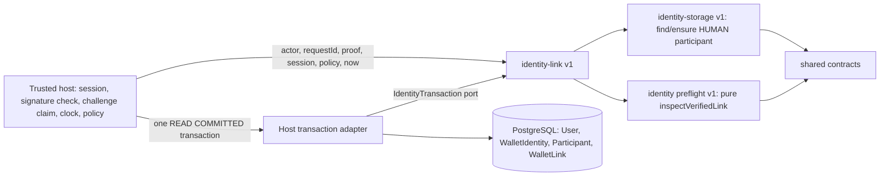

# Wallet links v1 (additional verified wallets on one participant)

[Blueprint identity](../RAID_AGENT_BLUEPRINT.md#07-identity-and-onboarding) · [One active Raid](../RAID_AGENT_BLUEPRINT.md#13-one-active-raid) · [Wallet rotation / payout](../RAID_AGENT_BLUEPRINT.md#1613-wallet-rotation-and-payout-recovery) · [Module reuse](raid-module-reuse.md) · [Plan](tasks/T006-wallet-link-plan.md) · [Independent plan review (WR01-WR14)](tasks/T006-wallet-link-plan-review.md) · [Identity storage](raid-identity-storage.md) · [Identity preflight](raid-identity-preflight.md)

**Status: IMPLEMENTED_UNVERIFIED, disposable-database tested only (PR-A of two). Full T006 and all 27 completion criteria remain NOT VERIFIED. AC01 / T006-A01 are PARTIAL: the identity half (same canonical participant, history and payout rows unchanged after a second wallet is linked) is evidenced on real PostgreSQL; the capacity half has no table to assert against (gap G1) and T006-A02 stays NOT VERIFIED.** The independent non-author [PR-A implementation review](tasks/T006-wallet-links-review.md) accepted the slice with conditions LR01–LR07 at `1b4a495`. A separate [follow-up review](tasks/T006-wallet-links-followup-independent-review.md) verified LR01/LR02/LR03/LR07; LR04/LR05/LR06 remain binding. Nothing is deployed, migrated on a live database or backfilled. B1 adds transaction-bound internal credential resolution and storage revocation, plus shared challenge vocabulary. Released main now authenticates existing active linked wallets through the existing sign-in route, including when new link creation is disabled. The default-off `WALLET_LINKS_ENABLED` switch gates additional-link challenge/creation only. New link routes, revoke composition with session invalidation and audit, and UI remain B2c/B3. The combined B2a/B2b source has not been independently accepted. See the reconciliation contract below and DEC-2026-10-11-03. An independent security review REJECTED the first B2a candidate (B2A-01/02); later fixes and the proposed global lock protocol remain subject to their recorded review gates. See [B1 checkpoint](tasks/T006-wallet-links-b1.md).

## Purpose and non-goals

Lets one canonical account hold additional VERIFIED wallet credentials, keyed to its immutable HUMAN `Participant`, without touching the legacy `WalletIdentity` row. That row remains the single payout/funding-bound "primary" wallet (blueprint 16.13). A link is login/identity evidence only: it grants no Guild role, private access, skill, work slot, payout change or reward change. Wallet address is a credential, never a person ID.

Owned requirements: R04, R13 (identity half only), R15, R16; I01, I05, I06, I07, I10, I11, I13; D01, D13; AC01 (partial). Blueprint sections 07, 13, 16.13, 24.6-24.7, 25.2, 26, 28, 32, 35.1.

Non-goals (not delivered by the storage module; see the B2a section for what the host now adds): sign-in through a linked wallet, HTTP routes, UI, composed revoke/session invalidation, account recovery or merge approval (O11, W03), promotion of a link to payout wallet, provider (X) links, capacity or engagement tables, command receipts (T019), nonce/domain/network hardening (T007), backfill, login auto-provisioning.

## Dependency and host contract



- Public entry point: `src/identity-link/index.ts`. Copy `src/identity-link`, `src/identity-storage`, `src/identity` and `src/contracts` as sibling directories. Dependencies: Zod and bs58 through the shared contracts. No Next.js, Prisma SDK, environment variable, global client, system clock or credential import (enforced by `tests/identity-link-boundary.test.ts`).
- The host supplies an `IdentityTransaction` port (`{ dialect: 'POSTGRESQL', isolation: 'READ_COMMITTED', query(sql, bindings) }`). The module owns its parameterized SQL; the host owns connection, transaction, retry, authentication, signature verification, the atomic challenge claim, the clock and the policy.
- Host database contract: tables `User` (text `id`, boolean `suspended`), `WalletIdentity` (`address`, unique `userId`), `Participant` and `WalletLink` from `prisma/migrations/202610080001_participant_mapping` and `prisma/migrations/202610090003_wallet_links`.
- Reference Prisma adapter: `src/lib/identity-storage-adapter.ts` (shared with identity-storage). This change adds SQLSTATE `23505` / Prisma `P2002` classification to `UNIQUE_CONFLICT` there, additively; existing classifications and tests are unchanged.
- Reference proof adapter: `src/lib/wallet-link-proof.ts` (`deriveWalletLinkProof`), the thin seam T007 can later replace (WR11). It parses `domain`, `uri`, `issuedAt` and the Chain ID strictly from the exact stored message, takes `expiresAt` from the column, requires the digest to be the SHA-256 of that message, requires the `LINK_ADDITIONAL_STATEMENT`, and never defaults any field. Anything missing or non-matching is `PROOF_INVALID`. `siwsChainId()` and the legacy purpose statements are owned by `src/lib/wallet-challenge-contract.ts`, imported by the generator and re-exported by the proof adapter. `siwsChainId()` reads the host-supplied `USDC_NETWORK` for each new challenge (`devnet` or `mainnet`); unknown values and unset production config throw HTTP503, while unset nonproduction config keeps the legacy mainnet default. The host validates the stored message digest, signature, supported signed chain, purpose and single-use expiry. `walletChallengeMatchesOrigin(message, appUrl): boolean` is a pure exported helper in the same challenge contract. The composing host supplies its current configured URL and requires both the exact signed domain (including port) and URI origin (including scheme) before any challenge consumption. Path-only URL changes remain compatible; domain, port or scheme changes require a newly issued signature. Invalid URL configuration or missing/mismatched origin text fails closed without leaking message/owner details. This check does not verify signatures or create/consume persistence; those remain host responsibilities. The helper needs only the standard URL implementation and has no app singleton or credential dependency. The copied SIWS consumer verifies accepted and denied origins alongside the existing network policy. Pending challenges retain their signed network across a valid config change; credential lookup must match that network, and additional-link subject/proof/policy share it. No network column exists on WalletChallenge and no schema or existing session/credential rewrite is needed. `tests/wallet-network.test.ts` consumes the actual generator/verifier using an injected synthetic transaction and real Ed25519 signatures; this proves application behavior, not PostgreSQL rollback or real Phantom compatibility. Real Phantom remains NOT VERIFIED until the owner retests after deployment (DEC-2026-10-12-02). The app generator accepts signin/link/rotate, plus `link-additional` only while the server switch is on and the caller has a connected X account (B2a); with the switch off it rejects that purpose before any write. No HTTP route exposes the new purpose yet.
- Verified actor authority stays with the host. The module only checks `actorAccountId === accountId` (`WRONG_ACTOR`); equality of two strings cannot authenticate an HTTP assertion.
- Proof contract: the host claims the stored challenge with its atomic `updateMany` in the same transaction, verifies the signature, then passes a `LinkProofObservation` describing the row as it was when claimed (`consumed: false`). A thrown error must roll the whole transaction back, including the claim.

## Public interface

Released `lookupWalletLink(tx, address)` is also retained as an additive internal API. It returns null for no reservation, or a `WalletCredentialReservation` including the owner account, network, ACTIVE/REVOKED status and suspension observation while transaction locks are held. It does not authenticate a signature or create/revoke a credential. Hosts must independently verify proof and apply their permission/network rules in the same transaction. The consuming host exercises it through real PostgreSQL and an alternate injected port.

B1 adds `resolveWalletCredential(tx, { subject, walletNetworks })` and `revokeWalletCredential(tx, { subject, walletNetworks, accountId, actorAccountId, requestId, session, now })` without new schema or app routes. Both require the existing injected READ COMMITTED transaction. Approved networks and trusted session/clock observations come from the composing host; they are not HTTP assertions.

`resolveWalletCredential` returns `{ source: 'ABSENT' }` or internal `{ source: 'PRIMARY' | 'LINK', accountId, participantId, linkId, address, networkIdentity }`. This is **transaction-bound ownership context**, not authentication or a portable session authorization. A host must verify a fresh sign-in proof independently, resolve and create a session inside the same still-live transaction, using the documented locks. Never cache or expose account/participant/link IDs publicly. A legitimate legacy PRIMARY may have `participantId: null` and never provisions a mapping on sign-in. A LINK must match its account's existing immutable HUMAN participant; revoked links, restricted owners, unsupported networks and malformed durable observations fail closed. An ABSENT observation authorizes no user creation; that remains host-owned legacy behavior, not a B1 command.

`revokeWalletCredential` requires an active unexpired self-session from the trusted host, actor equality and an unsuspended account. It locks subject then account, validates immutable mapping and changes only ACTIVE→REVOKED with the injected timestamp. It returns internal `{ outcome: 'REVOKED' | 'ALREADY_REVOKED', linkId, participantId, address, networkIdentity, status: 'REVOKED', revokedAt }`. Repeating preserves the original revokedAt. A missing or foreign target returns the same sanitized IDENTITY_CONFLICT; an own primary returns PRIMARY_WALLET_PROTECTED. Existing rows and provenance remain, and an address remains reserved without automatic reactivation. Request identity is accepted for host audit composition; B1 does not persist a revocation receipt or audit event. Before any non-test acknowledgement, the composing host must durably audit and invalidate sessions in this same transaction; B2 must review the all-session versus credential-attribution choice. B1's fixture host proves storage behavior, not safe deployed revocation/session composition.

Host permissions remain explicit: resolver reads belong only to a trusted composing service; revoke belongs only to the authenticated self-account. No admin override, Guild role, private access, claim redirection, primary rotation or money mutation is added. Missing/foreign revoke errors reveal no account ownership. Null primary mapping is deliberate compatibility with no-login-auto-provision, not missing link validation.

The added lock races are in `tests/wallet-link-credentials.test.ts`: resolver then revoke of the same additional subject, revoke then resolver, and primary resolver holding the User lock while an additional revoke waits. They observe independent PostgreSQL PIDs and pg_blocking_pids. This proves storage serialization only; auth-session creation/invalidation and X disconnect races belong to B2. Existing legacy rotation/merge writers have not all adopted B1's account lock. A PRIMARY observation rechecks ownership after obtaining its account lock and fails closed with `IDENTITY_CONFLICT` if the owner changed while waiting. This recheck is defense in depth: it is pinned by an alternate-port test only, and has **not** been shown reachable on real PostgreSQL, because the shipped legacy merge deletes the dropped account, so a waiting resolver sees `ACCOUNT_NOT_FOUND` first (still fail closed, no context returned). The composing host must reconcile legacy writer lock compatibility before claiming credential/session revocation safety, and must treat a session created inside a resolver transaction on a dropped account as cascaded away with that account.

| Export                                                       | Behavior                                                                                                                                                                                                                                                                                                                                                                                                                                                                                                                                                   |
| ------------------------------------------------------------ | ---------------------------------------------------------------------------------------------------------------------------------------------------------------------------------------------------------------------------------------------------------------------------------------------------------------------------------------------------------------------------------------------------------------------------------------------------------------------------------------------------------------------------------------------------------- |
| `linkVerifiedWallet(tx, input)`                              | Validates input (`INVALID_INPUT`, `WRONG_ACTOR`) and the port (`STORAGE_CONTRACT`) before any SQL, then runs the lock order below. Returns `{ outcome: 'LINKED' \| 'ALREADY_LINKED', source: 'LINK' \| 'PRIMARY', linkId, participantId, networkIdentity, address, status }`.                                                                                                                                                                                                                                                                              |
| `linkVerifiedWallet` option `observeAuthority(tx)`           | Optional host hook, awaited after the subject and account locks and before the preflight. Returns `{ session, now }`, which replaces any `session`/`now` input (both become optional when the hook is given). Throw `IdentityLinkError` to deny; any other thrown value is reported as `STORAGE_UNAVAILABLE` without its text; a malformed return is `INVALID_INPUT`. The host should row-lock what it reads until commit. Tested in `tests/identity-link-authority-hook-db.test.ts`; a worked host is `observeLinkAuthority` in `src/lib/wallet-auth.ts`. |
| `listWalletLinks(tx, accountId)`                             | The caller's own link rows, oldest first, with UTC ISO timestamps.                                                                                                                                                                                                                                                                                                                                                                                                                                                                                         |
| `publicWalletLink(result)`                                   | Safe shape `{ address, networkIdentity, status, alreadyLinked }` with no account, participant or link identifier.                                                                                                                                                                                                                                                                                                                                                                                                                                          |
| `IdentityLinkError` / `IdentityLinkCode`                     | `INVALID_INPUT`, `WRONG_ACTOR`, `ACCOUNT_NOT_FOUND`, `AUTHENTICATION_REQUIRED`, `FORBIDDEN`, `ACCOUNT_RESTRICTED`, `PROOF_INVALID`, `UNSUPPORTED_IDENTITY`, `IDENTITY_CONFLICT`, `IDENTITY_REVOKED`, `PRIMARY_WALLET_REQUIRED`, `LINK_LIMIT_REACHED`, `STORAGE_CONTRACT`, `RETRY_TRANSACTION`, `STORAGE_UNAVAILABLE`. The message is the code only.                                                                                                                                                                                                        |
| `LinkWalletInput`, `WalletLinkLimits`, `IdentityTransaction` | Types. `limits` is injected (`maxActiveLinks`, `maxTotalLinks`; EXAMPLE 5 and 20 are not recorded decisions).                                                                                                                                                                                                                                                                                                                                                                                                                                              |

Behavior in order (after the locks and reads):

1. The pure `inspectVerifiedLink` preflight runs first: session, actor, restriction (`User.suspended`), proof binding (intent, account, subject, domain, URI, freshness, not consumed), supported network, ownership. A suspended account, a bad session or a bad proof is therefore never answered with `ALREADY_LINKED` (WR08).
2. Address owned by another account (primary or link, active or revoked) -> `IDENTITY_CONFLICT` with one external shape; own revoked link -> `IDENTITY_REVOKED`. No merge is ever attempted.
3. Address is the account's own primary or own active link -> idempotent `ALREADY_LINKED`; **nothing is created**, including no participant mapping.
4. Account has no primary wallet -> `PRIMARY_WALLET_REQUIRED` (WR05; the first wallet remains the legacy flow).
5. Caps: `LINK_LIMIT_REACHED` when active links reach `maxActiveLinks` or total rows (active plus revoked) reach `maxTotalLinks`.
6. Participant: reuse the existing mapping, otherwise `ensureHumanParticipant` inside this transaction (first actor and request are never overwritten; a later failure rolls the mapping back).
7. `INSERT ... ON CONFLICT DO NOTHING RETURNING`. An empty result is resolved by reading the colliding rows: same account, address, network and proof -> idempotent `ALREADY_LINKED`; anything else -> `IDENTITY_CONFLICT` (WR01). No error is ever caught and continued inside the transaction.

## Entity and state ownership

| Record                                                                                 | Owner                          | Rules                                                                                                                                                                                                                                                                                                  |
| -------------------------------------------------------------------------------------- | ------------------------------ | ------------------------------------------------------------------------------------------------------------------------------------------------------------------------------------------------------------------------------------------------------------------------------------------------------ |
| `WalletIdentity`                                                                       | Legacy application (unchanged) | Single payout/funding-bound primary wallet. Moved only by the existing rotation flow. Gains only the exclusivity trigger below; no row is changed by this slice.                                                                                                                                       |
| `WalletLink`                                                                           | This module                    | Additional credentials. `address` unique alone (network-less, like the legacy table); `proofRef` unique; `participantId`+`accountId` composite FK to `Participant(id, accountId)` so a link can only name its own account's participant; `linkActorAccountId = accountId`; provenance `linkRequestId`. |
| Trigger `wallet_link_guard_v1`                                                         | Database                       | Links are never deleted. The only allowed change is `ACTIVE` to `REVOKED` with `revokedAt`; every other column stays identical; no-op updates are allowed; reactivation is impossible (recovery is OPEN O11). SQLSTATE `23000`.                                                                        |
| Triggers `wallet_link_subject_exclusive_v1` and `wallet_identity_subject_exclusive_v1` | Database                       | Both take the same advisory key the module takes and then check the other table, raising SQLSTATE `23505` with constraint name `raid_wallet_subject_exclusive_v1`. The `WalletIdentity` trigger fires on `INSERT` and `UPDATE OF address` only, so the legacy merge (`userId` re-point) is unaffected. |
| `Participant`                                                                          | identity-storage               | Unchanged. Gains a unique index `Participant_id_accountId_key` as the composite-FK anchor.                                                                                                                                                                                                             |

The proof reference column is defence in depth only. The effective replay barrier is the atomic consumption of the wallet challenge in the same transaction (WR14); the worker prunes consumed challenges.

Derived, not stored: the identity revision (`1 + link rows + revoked rows`, monotone because rows are never deleted) is internal and tautological for the preflight; it is not exposed and does not move on primary rotation or X linking. `activeEngagementId` is `null` until an engagement store exists (gap G1).

Reservation asymmetry (WR14): a REVOKED link reserves its address forever, but a primary rotated away releases its address (rotation deletes the legacy row) and `User` cascade deletion of an unmapped account releases its primary. This is legacy behavior. Do not claim "a verified wallet is never reassigned".

## Lock order and concurrency contract

Module contract (WR12). Any writer that touches a wallet subject or its account must follow it or take a prefix of it:

1. Transaction-scoped advisory lock on `wallet-subject:<address>` (the database triggers take the same key, re-entrantly).
2. The account's `User` row `FOR NO KEY UPDATE` (serializes concurrent links and legacy `UPDATE "User"` merges for this account while still allowing foreign-key `KEY SHARE` checks).
3. Participant mapping read, or insert for the first link.
4. `WalletLink` insert.

Hook step: `observeAuthority` runs after step 2 (see B2a), and the host's own row locks on `Session` and `XAccount` come after it. Writers that also touch those rows must take the `User` row first. `absorbAccount` now locks both `User` rows (stable id order) before any `XAccount`, `Session` or wallet write; without this a merge deadlocked with the command (re-review N1, regression test in `tests/wallet-link-authority-db.test.ts`).

No two-account locks are taken by the module. Released `lookupWalletLink` holds the subject advisory lock, then the owner `User` row with `FOR NO KEY UPDATE` and the reservation with `FOR SHARE`; wallet sign-in calls it before deciding a legacy account path, and rotation calls it after the balance lock and challenge claim. B1 resolve/revoke use that same module account lock and additionally return/check participant mapping context. The carried `absorbAccount` takes any dropped X-identity lock, sorted OAuthAttempt locks, then sorted User locks before identity/session writes. These are the actual local paths, not an accepted global protocol: [the separate lock-protocol design](tasks/T006-identity-lock-protocol-design.md) records unresolved cycles and prior rejected candidates. The named schedules provide evidence for their tested paths only; no general deadlock-free claim or enablement approval follows. Released wallet transactions retry bounded whole callbacks on retryable failures and sanitize storage errors.

Named races (all in `tests/identity-link-db.test.ts`, each prints a `walletLinkRace` JSON line with waiter PID, blocker PID and the blocked statement): link vs link on two accounts for one address; link vs link on one account; link vs legacy sign-in insert (both orders); link vs rotate (both orders); link vs merge as drop (link first and merge first) and as keep; link vs a plain `User` row update.

## Permissions and trust boundary

Linking authorizes nothing but the credential relationship. The host decides who may call `linkVerifiedWallet`: only an authenticated, unsuspended account acting for itself, after a fresh proof for the new wallet. Never forward client-supplied actor, account or ownership values. Treat `accountId`, participant ids and link ids as internal authorized context: not in public responses, logs or search without review. Conflict responses must not reveal the owner. A database owner can still alter the schema or triggers; row fences do not contain that.

**WR04 decision accepted by the owner on 9 October 2026:** confirmation through a connected X account, following the connected-X condition in `rotateWallet` ([DEC-2026-10-09-01](../RAID_AGENT_BLUEPRINT.md#026-accepted-owner-change--9-october-2026)). The owner clarified on 10 October 2026 ([DEC-2026-10-10-01](../RAID_AGENT_BLUEPRINT.md#027-owner-clarification--10-october-2026)) that the current session must carry X authority. PR-B must check that at the server command boundary, deny wallet-only sessions and still require fresh proof from the additional wallet. This choice is recorded before PR-B RED; PR-A does not implement the host confirmation. Likewise a revoke/unlink command or audited operator revoke procedure must exist before the flag is enabled anywhere except tests. PR-A adds no route, flag or sign-in change; the later B2a/B2b host slices add a default-off switch and no route, so nothing here can be enabled.

## Configuration names

No secret is read by the module. The example host and tests use: `DATABASE_URL` (explicit local synthetic URL; the example accepts only localhost databases `useraid_wallet_links_host_test` or `useraid_test` and refuses `NODE_ENV=production`), `NODE_ENV` (must not be `production` for the example), and for repository tests `RUN_DB_TESTS=true` and `DEMO_MODE=false`. The server switch is `WALLET_LINKS_ENABLED` (default off; see B2a). `NODE_ENV`, `DATABASE_URL` and `RUN_DB_TESTS` apply to the tests above.

## Transaction, retry and sanitized errors

Run every command inside one interactive transaction at READ COMMITTED; the adapter checks the actual isolation once per transaction and the module rejects other levels with `STORAGE_CONTRACT`. The lock and the exclusivity triggers rely on a per-statement snapshot taken after the advisory lock. B1 explicitly selects READ COMMITTED in all three affected legacy hosts: wallet verification, wallet rotation and X connection. Database-default REPEATABLE READ can retain an obsolete absence observation even after the subject lock wait; the rotation/link regression proves that the losing rotation rolls back its primary replacement, challenge consumption and audit. On `RETRY_TRANSACTION` (SQLSTATE `40001`/`40P01`, Prisma `P2034`, or `P2010` wrapping them) retry the **entire** business transaction (challenge claim included) with the same `requestId` and proof, bounded. Never catch an error inside the transaction and commit.

Classification is by SQLSTATE and pre-checked ownership, never by constraint name or message (WR01): Prisma's raw error carries no constraint name, its message can contain the conflicting address, and after any failure the same transaction answers `25P02`. The adapter maps `23505`/`P2002` to `UNIQUE_CONFLICT`, which the module reports as `IDENTITY_CONFLICT`. Errors carry the code only: no address, proof, owner, constraint or driver text, so `failure()` in `src/lib/http.ts` (which logs `error.message`) logs only a code. Suggested HTTP mapping for PR-B: `PROOF_INVALID`/`AUTHENTICATION_REQUIRED` 401, `FORBIDDEN`/`ACCOUNT_RESTRICTED` 403, `IDENTITY_CONFLICT`/`IDENTITY_REVOKED`/`PRIMARY_WALLET_REQUIRED`/`PRIMARY_WALLET_PROTECTED`/`LINK_LIMIT_REACHED` 409, `UNSUPPORTED_IDENTITY`/`INVALID_INPUT` 422/400, `RETRY_TRANSACTION`/`STORAGE_UNAVAILABLE` 503.

Command receipts (T019, AC69): a receipt replay must return the stored result **before** re-running challenge consumption or signature verification, otherwise a lost-response retry hits "challenge already used". Until T019 lands, a retry after a lost response sees the consumed-challenge error although the link exists; the list endpoint reveals it. AC69 is unverified for this command.

## Legacy readers and writers

Corrected inventory (WR03, replaces the plan's "six readers"). `WalletIdentity` is read or written at 24 call sites in 16 files outside `src/lib/wallet-auth.ts`: pages `creator/raids/[id]`, `creator/balance`, `creator/new`, `creator/account`, `raids/[id]`, `launch`, `tokens/[mint]`; route `api/launch/[id]/enroll`; `usdc.ts` (2), `raid-funding.ts` (1), `studio-campaigns.ts` (2), `tracking.ts` (1), `pump-launch.ts` (5), `x-oauth.ts` (1), `account-merge.ts` (3). Writers: `wallet-auth.ts` (3 creates, 1 delete), `studio-sandbox.ts` `walletIdentity.upsert` (a writer the plan omitted; sandbox only, and it would fail closed on a linked address), `account-merge.ts` `updateMany({ userId })`. **None reads or writes `WalletLink`**, so a link cannot subvert any payout, funding, enrollment or withdrawal path; an unchanged primary row is what keeps all of them correct.

Accepted consequence (WR06): the first successful link creates the account's `Participant` mapping, which permanently stops the legacy helpers from folding or deleting that account (`isEmptyAccount` refuses mapped accounts, and the foreign keys reject the final delete). Rejection behavior is unchanged and covered by tests (real wallet sign-in fold path, `absorbAccount`, frozen legacy merge). The user-facing messages of those paths still say "has its own account with activity" for an account that only has a link; correcting that copy changes legacy files and is deferred to PR-B. Reviewed merge/recovery (O11, W03) is a follow-up task that must exist before the flag is enabled.

Legacy characterization (frozen helper `tests/helpers/legacy-wallet-auth.ts`, an old binary that knows nothing about links): sign-in, link and rotate onto a linked or revoked address fail closed at the trigger as Prisma `P2002` (HTTP 409 "Already exists." through `failure()`), with the whole transaction rolled back and no orphan `User`, session or changed primary. Typed handling of those cases (WR07 a-c) is PR-B.

## Substitution and versioning

Any adapter implementing `IdentityTransaction` for PostgreSQL at READ COMMITTED can replace the Prisma adapter; `host.ts` and the unit tests demonstrate deterministic alternate ports. A different dialect or weaker isolation is rejected, not emulated. The proof adapter is replaceable without touching storage. Version `v1`: additive changes only; a changed table shape, error code or SQL semantics needs a new version, a reviewed forward migration and updated consumers and tests together. Provider links (X) can later be re-pointed to a generalized store by a reviewed migration; naming keeps the blueprint `wallet_links` intent.

## Observability

No metrics or logs are emitted. B1 adds PRIMARY_WALLET_PROTECTED to the public typed codes; hosts must map it to a generic primary-wallet-protected HTTP409 if composing an HTTP API. Hosts should count the error codes and retry rate and alert on `STORAGE_CONTRACT` and sustained `STORAGE_UNAVAILABLE`. Audit: `SELECT "accountId", "address", "status", "linkRequestId", "verifiedAt" FROM "WalletLink"`. There are no receipts or outbox events; provenance is a creation audit only. Do not log addresses with account ids.

## Failure and recovery runbook

| Situation                                | Action                                                                                                                                 |
| ---------------------------------------- | -------------------------------------------------------------------------------------------------------------------------------------- |
| `RETRY_TRANSACTION`                      | Retry the whole transaction, bounded; same request id and proof.                                                                       |
| `IDENTITY_CONFLICT` / `IDENTITY_REVOKED` | Address belongs to an account (possibly revoked). No automatic merge; recovery is the unreviewed O11 process.                          |
| `ACCOUNT_RESTRICTED`                     | Suspended; claim and case access are unaffected by this module.                                                                        |
| `STORAGE_CONTRACT`                       | Wrong isolation, malformed or duplicate rows; stop and investigate.                                                                    |
| SQLSTATE `23000` from the guard          | A write tried to delete or alter a link; use the reviewed recovery process (not defined).                                              |
| Application rollback after links exist   | Keep the table, foreign keys and all three triggers. Dropping them reopens address reuse by another account and strands those wallets. |
| Database restore                         | Link rows ride the restore; reconcile consumed challenges and sessions afterward (AC68 not verified here).                             |

Retention and deletion of link provenance is OPEN (O11).

## Rollout and rollback

Migration `202610090003_wallet_links` is additive (no backfill; unlinked accounts behave exactly as before). The later PR-B order is mandatory: (1) apply the migration, (2) deploy sign-in resolution through links (B2b) to **every** instance, (3) only then enable `WALLET_LINKS_ENABLED`; an old instance cannot sign in with a linked wallet (it fails closed). The flag must gate the server command, not only the UI, and stays off in staging and production until a revoke path, T007 AC02 evidence and the rollout order are satisfied (WR04, WR07 d). The prefix already sorts after T019/T029; no renumbering is required. The prior owner-directed stack merged into main `66d6a3a` with combined local CI; current B1 integration additionally bootstraps all22 migrations and checks drift on a fresh disposable database. These results are test evidence for LR06, not live rollout approval. T003 environment audit, backup/restore rehearsal and a named custodian are still required before any non-disposable target.

## Limitations

- Disposable-database evidence only; independent technical reviews and their conditions are recorded above; no live rollout, no exact-head CI claim, no browser or accessibility check, no UAT.
- AC01 capacity half (G1), T006-A02, AC68/G10 durability, AC69 receipts, revoke with session invalidation and audit, WR06 copy and the HTTP route/UI wiring are not delivered. Connected-X enforcement (B2a), typed ownership conflicts and linked sign-in (B2b) exist but await independent re-review.
- Uniqueness on `address` alone is stricter than the blueprint `(network, address)` tuple (conservative DEFAULT); relaxing it later is a migration.
- The caps are injected EXAMPLE values, not recorded decisions. The X fold path shares `isEmptyAccount`/`absorbAccount`; real wallet/X fold tests also run in fresh child processes under database-default REPEATABLE READ and SERIALIZABLE. No live X provider call is made.
- The command is database-only: no GitHub, Solana, model or notification effect is involved.

## Run the standalone consuming host

Current B2c policy: DEC-2026-10-12-05 requires server-persisted wallet-credential attribution and invalidation of only that credential's sessions on revoke. The existing Session table has no attribution, so this host behavior is **NOT IMPLEMENTED**. Earlier all-session options are historical proposals, not the chosen policy. DEC-2026-10-12-06 requires the additional-link signed message to show the destination account ID and connected X handle; this is also **NOT IMPLEMENTED**. Existing unattributed-session rollout and suspended-account revoke remain unresolved; see [the current protocol revision](tasks/T006-identity-lock-protocol-20261012.md). Linking stays disabled pending reviewed protocol, migration, host command, audit, races and rollout evidence.

The example has its own `package.json`, minimal `User`/`WalletIdentity`/`Participant`/`WalletLink` schema and four migrations (two host-owned tables, plus symlinks to the exact canonical participant-mapping and wallet-link SQL). It never loads RAID configuration or `src/lib/db`. Copy to a fresh directory, dereferencing the symlinks, install, migrate against an explicit disposable database and run:

```sh
raid_links_source="$(pwd)"
raid_links_host="$(mktemp -d)"
cp -RL "$raid_links_source/examples/wallet-links/." "$raid_links_host/"
cd "$raid_links_host"
npm install --ignore-scripts --no-audit --no-fund
export NODE_ENV=test
export DATABASE_URL='<explicit local synthetic URL for useraid_wallet_links_host_test>'
npx prisma generate
npx prisma migrate deploy
npm start
```

Expected output is one JSON line with `synthetic`, `realDatabase`, `sameParticipant`, `primaryUnchanged`, `idempotentReplay`, `foreignAddressConflict`, `primaryRequired`, `wrongActorDenied`, `proofDerived`, `alternatePort` `sanitizedFailure`, `internalCredentialContext` and `revokedReserved` all `true`.

Repository tests (they truncate the target; point them only at an explicitly disposable database):

```sh
RUN_DB_TESTS=true NODE_ENV=test DEMO_MODE=false DATABASE_URL='<synthetic test URL>' \
  npm test -- tests/identity-link.test.ts tests/wallet-link-proof.test.ts tests/identity-link-db.test.ts tests/identity-link-migration.test.ts tests/identity-link-boundary.test.ts tests/wallet-link-credentials.test.ts tests/wallet-auth-isolation-db.test.ts
```

Migration check: `npx prisma migrate deploy` (a second run reports no pending migrations) and `npx prisma migrate diff --from-url "$DATABASE_URL" --to-schema-datamodel prisma/schema.prisma --exit-code` (exit 0; this needs the `map: "WalletLink_participant_fkey"` on the composite relation, WR02).

## Wallet sign-in session authority (T007 AC02 precursor, internal v1)

Purpose: decide which authority (`wallet` or `x`) the replacement session receives when a wallet sign-in or link is verified while the caller already holds a session. Non-goals: authentication, linked-wallet sign-in, routes, revocation, X reauthentication policy, or any client-visible capability. Maps to R04/R13, I05/I10, AC01/AC02.

Contract: `walletSessionAuthority(previous, authenticatedAccountId, resolvedAccountId, now)` in `src/lib/wallet-session-authority.ts` is pure. `previous` is a trusted-host observation `{ userId, via, expiresAt }` taken by the host, never an HTTP assertion; it returns `'x'` only when the authenticated account equals the resolved account, `previous.userId` equals it, `previous.via === 'x'`, the clock is valid and `expiresAt > now`. Every other input (absent, foreign, unauthenticated context, `wallet` or unknown provider, expired or equal-to-now expiry, invalid dates) returns `'wallet'`.

Behavior changes in `verifyWalletChallenge` (`src/lib/wallet-auth.ts`), all covered by `tests/wallet-auth-db.test.ts` and `tests/wallet-session-authority.test.ts`:

- The caller's own session is taken atomically (`DELETE … WHERE tokenHash AND userId RETURNING`) inside an explicit READ COMMITTED transaction, so a concurrent revoke, expiry or downgrade is observed before authority is carried forward (three real-PostgreSQL race tests print `sessionRace` with waiter/blocker PIDs).
- An expired X session no longer renews X authority through a wallet signature.
- A cookie session owned by another account is neither deleted nor borrowed.
- Folding the signed-in X account into the wallet owner yields a `wallet` session.
- An unknown `via` value is normalized to `wallet`.

Host obligations (B2): read the session from the database in the same transaction, use a server clock, durably audit, and invalidate sessions on revoke. The consuming example does not yet exercise this helper; that gap is recorded for B2.

## B2a: additional-wallet link command (host, default off, no HTTP route yet)

Purpose: let an authenticated account whose X account is connected add a sign-in wallet. Non-goals: routes, UI, sign-in through a linked wallet (B2b), revoke composition with session invalidation and durable audit (B2c), payout change, recovery or merge (O11/W03). Maps to R04/R13, I05/I10, DEC-2026-10-09-01, AC01 (partial), AC40.

Contract (`src/lib/wallet-auth.ts`, switch in `src/lib/config.ts`):

- `walletLinksEnabled()` is true only when `WALLET_LINKS_ENABLED` is exactly `true`; unset, `TRUE`, `1` and anything else are off. Documented in `.env.example` as `false`. Off means `createWalletChallenge(…, 'link-additional')` and `linkAdditionalWallet` fail with the same generic 400 as an unsupported purpose and write nothing. The switch gates the server commands, not just a UI.
- `createWalletChallenge(address, userId, 'link-additional')` additionally requires a connected X account for `userId` (403 otherwise). The statement is `LINK_ADDITIONAL_STATEMENT`; legacy `signin`/`link`/`rotate` bytes are unchanged, and an additional-link signature cannot be used for legacy link, sign-in or rotation (statement and signer-state binding).
- `linkAdditionalWallet(userId, digest, signature, address, currentSessionHash, requestId)` runs in one explicit READ COMMITTED transaction in this order: challenge verify+claim, then `linkVerifiedWallet` with proof derived from the claimed row, which takes the wallet-subject and account locks and only then runs the host's authority observation (the caller's own session and the connected-X row, read from the database with a database clock; there is no client-asserted X field; the connected-X condition is the one `rotateWallet` already applies). Any failure rolls back everything including the challenge claim. The payout wallet is never changed; the first link creates the HUMAN participant mapping (existing WR06 consequence).
- Errors are sanitized HTTP errors: 400 off/invalid, 401 session or proof, 403 no X / restricted, 409 one identical message for a foreign primary, foreign link and own revoked link (no IDs or addresses), 409 primary required / limit reached, 503 retryable. Link limits (5 active / 20 total) are EXAMPLE values injected by the host, not policy.
- Authority (DEC-2026-10-10-01, corrects the first B2a candidate): the CURRENT session must be the caller's own, live by the database clock, and carry `via = 'x'`, and the account's X connection must still exist. A session with wallet or any other authority is denied with 403 even when an X row exists; there is no client-supplied X field. Challenge issue still checks the X row early (fast fail); the command's decision is the boundary below.

Linearization boundary (fix for B2A-02): the identity-link module takes an optional `observeAuthority` hook, awaited after it holds the wallet-subject advisory lock and the account row lock and before its preflight. `linkAdditionalWallet` reads the session and XAccount there with `FOR SHARE`, then reads the database `clock_timestamp()` in a separate statement after both row locks are granted (CR-B2-01: a clock evaluated in the locking SELECT, or captured before either wait, predates the wait and let a session that expired while blocked still link; the `now` later used for the proof check is that same post-lock reading). Consequences, each tested on real PostgreSQL with observed `pg_blocking_pids`: a session revoke, X disconnect, or natural expiry that happens while the command waits for the Session or XAccount row lock (`tests/wallet-link-lock-order-db.test.ts`, one case per lock) denies the link and rolls back the challenge claim (401/403); a revoke or disconnect arriving after the decision waits for the link's commit, so an already-decided link is not undone and the writer is not aborted; a randomized race never leaves a link without a consumed challenge or the reverse, and shows no deadlock. The server switch is checked on entry only: a flip to off while the command waits for the subject lock does not stop it (existing linked-wallet sign-in is independent of the creation switch under DEC-2026-10-11-03). Whether the switch must be a live kill switch at the authorization boundary is an open owner/enablement decision; it is not invented here. App and database clocks must agree (no skew tolerance is implemented; a 3-second app-ahead skew was reproduced to fail closed with 401): the proof's `issuedAt` is app-clock and the decision clock is the database's, so large skew fails closed with 401. Writers that take the account lock first (a future revoke composition) must keep the order subject lock, account lock, then session/X rows.

Identity lock order (CR-B2-02, CR-B2-05; every writer that touches these must follow it or take a prefix): (1) the `wallet-subject:<address>` advisory lock for wallet writers and/or the `x-auth:<xId>` advisory lock for X writers, (2) the account's `OAuthAttempt` rows, (3) `User` rows in stable id order, (4) `XAccount`, `Session` and wallet rows. Two cycles were found and fixed by ordering, not by retry. CR-B2-02: `absorbAccount` took User rows before the X advisory lock while `completeConnection` takes the advisory lock before updating a User. CR-B2-05: for a FIRST X connection the account has no X id yet, so the merge shares no advisory key with `completeConnection`; the callback deletes its claimed attempt row and then updates the User, while the merge locked the User and then deleted the same attempt row (attempt→User versus User→attempt; PostgreSQL 40P01 for both the merge and the wallet-fold caller). `absorbAccount` now reads the dropped account's X id, takes that advisory lock if any, locks the dropped account's attempts `FOR UPDATE` in `stateHash` order, locks both User rows and re-reads the X id; if it changed while it waited (a connection won) it fails closed with `Account identity changed during the merge; try again.` and nothing is folded. The attempts are still deleted at the end of the merge, after the emptiness check. Retrying a deadlock is not the fix and the bundled host does not retry automatically: the wallet HTTP wrapper maps an unclassified merge error to 503 `Service unavailable. Please try again.`, and the X callback redirects to `?auth=failed` (a typed conflict/retry mapping is a follow-up). Residual: deletes of several attempt rows by other writers (`disconnectX`, the expired-attempt sweep in `startAttempt`) are unordered and are not proven cycle-free against each other; they hold no User lock. The writer audit (X start/disconnect take only the advisory lock and attempt/X rows; sign-in, rotation and link follow the order above) is an analysis plus the interleavings tested in `tests/wallet-link-lock-order-db.test.ts`, not an exhaustive proof.

Tests: `tests/wallet-link-additional-db.test.ts` (7 cases, real PostgreSQL) and the updated boundary guard `tests/identity-link-boundary.test.ts` (no route, component, X callback or sign-in resolution uses the command; the switch defaults off). The earlier "nothing is wired" assertion on `wallet-auth.ts` was replaced, not deleted, because B2a deliberately wires the command there. An independent reviewer must verify this slice; author-side mutation probing killed 9 of 10 mutations, the survivor (session expiry) is double-enforced by the module's own preflight.

Enablement is still blocked: no route reaches this command, revoke has no session invalidation or durable audit, the victim-signed-challenge risk below is undecided, T007 AC02 and the instance rollout order remain open. (Existing linked-wallet sign-in is already part of released main, as documented below.) The consuming example does not cover this host command.

## B2b: sign-in through an existing linked wallet

Current owner-approved contract (DEC-2026-10-11-03): `verifyWalletChallenge` uses released `lookupWalletLink` within the host's READ COMMITTED whole-transaction retry boundary. A fresh valid challenge and signature are required. Resolution is independent of `WALLET_LINKS_ENABLED`, which gates new additional-link creation only.

- An ACTIVE supported-network link signs in to its canonical owner without creating a User, primary wallet or new link, and without changing payouts/history. Same-account reauthentication is permitted.
- A revoked or wrong-network credential returns the same sanitized401. A suspended owner returns403. Foreign-account legacy linking and rotation to a reserved address return409. Rejected transactions retain neither a consumed challenge nor a session.
- Only an atomically claimed live prior session belonging to the resolved account can preserve X authority. Foreign, deleted or expired sessions cannot lend authority. Anonymous linked sign-in receives wallet authority.
- Two independent fresh sign-in proofs may produce two sessions for one canonical account; replaying the same consumed proof remains rejected. Ordinary primary/unknown-wallet behavior, default-off account folds and atomic first-X binding remain released behavior.

Current tests are `tests/wallet-link-signin-db.test.ts` and released `tests/wallet-linked-signin-db.test.ts`, transaction/retry, session-authority, fold-gate and first-X suites. Earlier B2 rejection/single-session expectations survive only as historical evidence in the task/review records; they are superseded by the explicit owner decision, not relaxed silently. Combined-source independent acceptance remains NOT VERIFIED.

Residual risk recorded by the re-review (not fixed here, needs an owner/T007 policy): the additional-link message does not name the target account, so an attacker holding an X-authority session on their own account could ask a victim to sign a link challenge for the victim's wallet; the victim's address would then be reserved by the attacker's account and, after B2b, the victim's wallet sign-in would land in that account. The same gap exists conceptually for any signed-message flow; mitigation options (naming the account in the signed statement, a confirmation step on the signing account, recovery/O11) must be decided before enablement.

## Main/WIP reconciliation — 11 October 2026

Owner chose released main sign-in behavior (DEC-2026-10-11-03). Existing `lookupWalletLink` reservations resolve under transaction-held subject/account/link locks regardless of `WALLET_LINKS_ENABLED`; the flag gates new additional-wallet challenges/creation, not already registered credentials. Same-account fresh reauthentication is allowed and preserves only a live session's authority for that same account. Foreign-account legacy linking remains409; revoked/wrong-network credentials401 and suspended accounts403, all without challenge/session residue or payout/history changes. Full transaction retries and sanitized driver failures from released main are preserved. Atomic own-session deletion/returning prevents stale/cross-account X-authority transfer.

WIP `resolveWalletCredential`, `revokeWalletCredential`, `observeAuthority`, linked-proof helpers, consuming example and gated/unwired `linkAdditionalWallet` stay present. Earlier B2 flag-off/signin409 and anonymous-only statements/test results above are historical and superseded for sign-in by this owner decision. New link creation still requires connected-X, current own X session, fresh proof and the default-off switch; no route/UI/X callback or revoke composition is enabled. T006/B2/T007/O11/lock-protocol/independent-review gates remain open for the new combined source.

Latest released sign-in documentation: [T006 linked-wallet delivery](tasks/T006-linked-wallet-signin.md).

## Lock protocol candidate, 13 October 2026

The bounded [shared protocol](raid-identity-locks.md) supersedes the legacy writer-order/retry prescriptions above. Standalone aggregate calls plan old/new subjects and installed X/children before final roots; composed calls supply optional transaction-bound `locks`, validate coverage and skip acquisition. Read-only resolution uses SHARE; aggregate mutations use NO KEY UPDATE. A changed observed subject/account set returns RETRY_TRANSACTION for a fresh bounded host transaction. Authority hooks observe prelocked children using a post-wait clock. Minimal independent hosts must explicitly declare their installed identity layout; the RAID adapter always uses the full schema. Linking remains disabled/unwired. Attribution/selective invalidation, destination Resources and actual Phantom consent/network verification remain required future gates; this protocol change does not supply them. Independent implementation review is pending.
